# Canterlot

<p align="center">

[](https://github.com/Fenicu/canterlot)

[](CHANGES.rst)
[](LICENSE)


</p>

Canterlot — self-hosted хаб для агентов программирования. Claude Code, Codex и OpenCode работают на машинах владельца, а сессии открываются с телефона через PWA: лента, разрешения и вопросы, очередь сообщений, доска плана, поиск по истории, лимиты и настройки.

Разработка идёт в [Forgejo](https://git.fenicu.com/Fenicu/canterlot); GitHub — зеркало.

Хаб написан на Rust и хранит состояние в PostgreSQL. На каждой рабочей машине запущен Rust-воркер, хаб и воркеры общаются по gRPC поверх TLS. Клиент — статическая сборка SvelteKit; её раздаёт обратный прокси (Caddy), а владельца проверяет сам хаб: страница входа в PWA, пароль, ссылка восстановления и сеансы браузера в cookie. Отдельного сервера приложений у клиента нет. Диктовку в поле ввода распознаёт служба `canterlot-speech` на хосте хаба (Parakeet v3 на GPU NVIDIA через transcribe.cpp, запасной режим на CPU): хаб пересылает ей звук по unix-сокету, звук и текст не попадают на диск ([устройство](docs/design/dictation.md), [настройка](docs/configuration.md)).

Что можно делать из интерфейса:

- смотреть ленту сессии: ответы, вызовы инструментов, субагентов и служебные строки;
- видеть наверху списка раздел «Ждут вас»: сессии, которые ждут разрешения, ответа или подвисли, самые давние первыми; каждая остаётся и в своей группе, а счётчик на кнопке «назад» в чате ведёт прямо к разделу;
- отвечать на разрешения и вопросы агента карточками; ответ проходит этапы «отправка → сохранено → передано → применено»;
- давать агенту секрет (пароль, токен, ключ) карточкой: значение вводится один раз, уходит на машину сессии в отдельном управляющем сообщении и живёт только в файле в tmpfs, который удаляется по отзыву, через 24 часа или с концом сессии;
- вести очередь сообщений: «Влить» в полосе очереди или стрелка «Влить в ход» рядом с отправкой отдают набранное в текущий ход, а ждущее сообщение можно изменить до отправки;
- начинать новую сессию одной кнопкой: машина, папка, модель и усилие прошлой сессии (в группе — прошлой сессии этой группы) уже подставлены, а форма свёрнута в строку «Как в прошлый раз» с кнопкой «Изменить»;
- убирать сессию в корзину на 24 часа, возвращать её одним нажатием или удалять окончательно;
- продолжать черновик с любого устройства: текст и готовые вложения хранятся на хабе, удаление и отправка сразу видны на телефоне и компьютере;
- принимать подсказку следующего сообщения от Claude Code: она видна серым в пустом поле ввода и вставляется по Tab или кнопкой «Подставить», выключается в настройках;
- выбирать slash-команду или навык по первому `/` в поле ввода: меню показывает только то, что CLI сессии действительно может выполнить, фильтруется по имени, вставляет `/<имя> ` в черновик и ничего не отправляет; меню доступно на телефоне и компьютере, а каталог приходит из снимка машины;
- диктовать в поле ввода с телефона и компьютера: кнопка микрофона шлёт звук в хаб по WebSocket `GET /api/v1/dictation`, живой текст идёт со словарём замен («мейн» → `main`, «сессион спаун» → `session_spawn`), итог вставляется в поле; словарь хранится на владельца (`GET/PUT /api/v1/dictation/terms`), доступность службы видна по `GET /api/v1/dictation/status` ([протокол](docs/design/dictation.md#9-протокол-pwaхаб), [словарь](docs/design/dictation.md#10-словарь-замен));
- прерывать текущий ход, не закрывая сессию: контекст и процесс остаются, следующее сообщение продолжает работу;
- менять усилие (effort) посреди диалога, в том числе у Claude Code: новое значение действует со следующего хода;
- видеть заполнение контекста и сжимать его, в том числе между ходами;
- запускать делегированные сессии через MCP-инструменты: отдельная рабочая копия, вложенный список и панель делегирования, приём результата; итог делегата остаётся в ленте оркестратора и после удаления делегата, а о делегате, который дольше 15 минут простаивает с работающей фоновой командой, оркестратор слышит отдельно;
- давать агенту будильники: по времени, по состоянию других сессий (в том числе одним сообщением за всю пачку и со сторожем по сроку), по сбросу лимита провайдера, по появлению файла на машине и по освобождению машины; в чате они видны плашками;
- запускать повторяющиеся задачи по расписанию: cron в часовом поясе владельца, новая сессия через политику маршрутизации, ввод в существующую или рутина «Отчёт из сессии» (скрытая копия читает контекст разговора и кладёт отчёт карточкой в его ленту), необязательная проверка на машине перед запуском, пропуск при красных лимитах и пересечении, «Запустить сейчас» и история с задержкой до очереди (HTTP и события доступны хабом);
- вести доску плана оркестратора в хабе: задачи с номерами, состоянием, исполнителем, находками и причиной блокировки переживают сжатие контекста и перезапуск, сами переходят в работу при запуске делегата с `plan_task`, на проверку по его завершении и в готовые при приёме результата, а коммиты и отчёт исполнителя подтягиваются при чтении; план открывается вкладкой «План» в панели делегирования, вызовы плана видны в ленте карточками, у сессии в списке — счётчик «План · 2/7», все планы — в меню «Планы»;
- включать автопинок делегата: хаб сам подталкивает исполнителя, бросившего ход без маркера `STATUS: DONE`, и будит оркестратора один раз, когда толчки кончились; состояние, счётчики и последние сигналы видны в чате, владелец ставит правило на паузу или снимает его, а текст толчка редактируется во вкладке «Текст толчка» экрана «Инструкции»; файл отчёта считается прогрессом, а его отсутствие называется в толчке;
- искать по истории сессий: ответы агентов, свои сообщения, сообщения между сессиями и итоги делегатов в любых формах слова, с фильтрами по периоду и виду; найденные слова подсвечены, касание открывает ленту на месте совпадения; поиск запускается из списка («Искать в сообщениях») или из меню сессии, агент ищет тем же поиском через `history_search`;
- вести общую память агентов в хабе: `memory_search` ищет записи (русская морфология и точные коды вроде `ERR_NETWORK_CHANGED`), `memory_get` читает запись целиком, `memory_write`, `memory_update` и `memory_delete` пишут, правят по номеру версии (`version_conflict` при гонке) и архивируют; память строго разделена на домены `work` и `personal` по каталогу сессии, агент другого домена записей не видит, а чужой идентификатор отвечает `not_found`; записи с секретами отклоняются (`looks_like_secret`), лимиты задаёт `[memory]` в `hub.toml`; делегаты пользуются теми же инструментами, боковые чаты нет; владелец ведёт ту же память на экране «Память» в настройках (`GET/POST /api/v1/memory`, `PUT/DELETE /api/v1/memory/{id}`, архив, возврат и прошлые версии; домен в каждом запросе обязателен, правка идёт с `expected_version`), а домен, проект и конфликт домена сессии видны в её карточке; в ленте сессии каждый вызов памяти — своя карточка (запрос и итог, тема записи, отказ словами) со ссылкой на запись на экране «Память» (`/settings?c=memory&entry=<id>`);
- выбирать исполнителя по политике маршрутизации владельца: тип задачи, упорядоченные кандидаты, пороги лимитов и параллельности; предпросмотр показывает выбор и причины по каждому кандидату;
- видеть публичный статус Anthropic и OpenAI рядом с лимитами: хаб сам опрашивает их страницы статуса (`[provider_status]`), при сбое полоса лимитов пишет «сбой» или «частичный сбой» со ссылкой на страницу, а маршрутизация берёт другого кандидата, если он есть;
- вести лимиты по учётным записям: у каждого харнесса в `worker.toml` есть необязательная метка `account` (по умолчанию `owner`), и вторая подписка того же провайдера на другой машине получает свои окна, удержания, пробуждения и опрос, не смешиваясь с первой (см. [конфигурацию](docs/configuration.md)); таблица `[claude_code]` включает Claude Code на машине, а без неё он игнорируется целиком: ни каталога, ни опроса, ни историй `~/.claude`;
- следить за лимитами провайдеров по пятичасовому, недельному и месячному окнам и за скоростью ответа; настраивать пороги жёлтого и красного предупреждений и недельный резерв — изменения действуют сразу, без перезапуска хаба; видеть прогноз расхода по темпу и обратный отсчёт до сброса, а маршрутизация пропускает кандидата, которому не хватит лимита на ожидаемую длительность задачи; видеть подаренные Codex сбросы лимита — сколько доступно и когда сгорит ближайший (ближе недели — предупреждение), а на экране лимитов — каждый со своим сроком;
- видеть под каждым законченным ходом строку расхода: токены, долю кэша, примерные деньги и долю недельного лимита; цену называют сами Claude Code и OpenCode, для Codex хаб считает её по таблице цен (`[pricing]` её переопределяет), а неизвестная цена не выдаётся за ноль; касание открывает сведения о ходе, диагностика сессии показывает итог с делегатами;
- продолжать сессию после сброса лимита без «кранча»: у паузы лимита «Продолжить при сбросе» взводит одноразовое автопродолжение с тем же текстом, что у «кранча», а «Не продолжать» возвращает обычную паузу;
- видеть в сведениях о сессии расход токенов за всю сессию и всех её делегатов, по моделям и с кэшем;
- вставлять скриншоты и файлы из буфера или перетаскиванием; агент может отдать файл в ленту;
- листать все картинки сессии в одном просмотрщике: вложения, картинки из ответов и инструментов агента, файлы, которыми он поделился; счётчик «12 из 40», старые картинки подгружаются по мере листания, а «Показать в чате» прокручивает ленту к сообщению;
- открывать вложенные `.md`, документы Word (`.docx`) и таблицы Excel (`.xlsx`) прямо в приложении: отрендеренный текст, листы с закреплённой шапкой, копирование и скачивание;
- получать пуши на телефон через Gotify (`[notify.gotify]`): сессия ждёт ответа или разрешения, ход завершён, сбой, зависание или пауза по лимиту, вход Claude Code заканчивается или уже закончился; касание открывает чат; если чат сессии открыт и владелец уже прочитал событие, пуш не приходит, а если чат открыт, но не прочитан, хаб откладывает пуш на минуту и не теряет его, даже когда телефон уснул; пункт «Без уведомлений» выключает все пуши выбранной сессии и её делегатов до включения обратно;
- откладывать сессию на час, три часа, до утра, до сброса лимита или до выбранного времени: отложенные уходят в свёрнутый раздел «Отложенные · N» с временем возврата, вопрос, сбой или ваше сообщение возвращают сессию раньше срока, а пуши об итогах хода, пока она отложена, не приходят;
- видеть честное состояние без связи: через пять секунд после обрыва таймеры замирают, живые состояния гаснут, баннер показывает время последних данных, а отправленное без связи помечено «Ждёт связи»;
- видеть свободное место на машинах и тихое предупреждение в списке сессий, когда его меньше `[machines] disk_warn_free_gb = 30` ГБ (критический уровень — `disk_critical_free_gb = 10`);
- следить за машиной через сторожа: самые крупные кэши сборки с подсказкой, как их убрать, нехватка памяти (`mem_warn_gb`), процессы, пережившие свою сессию, и сборки вне очереди; об этом слышат и активные оркестраторы на машине;
- запускать делегатов на другой машине: оркестратор с одной машины вызывает `session_spawn` (и `route_preview`) с `machine` и `workdir` в корнях целевой машины, а запуск, каталоги, изоляция и приём идут через воркер цели. Принимает такую работу только машина, у которой владелец включил на её карточке переключатель «Принимать делегатов и команды с других машин» (по умолчанию выключен; ни агент, ни предложение настроек его не меняют);
- запускать команды на месте: `job_run` (сессия в режиме `bypass`, каталог своего домена памяти) выполняет `bash -lc` в каталоге машины с воркером, своей или другой, и отвечает в вызове, если команда уложилась в `wait_seconds` (до 60 с), а иначе итог приходит одним сообщением `[canterlot]`; `job_status`, `job_log`, `job_cancel` и `jobs_list` читают и отменяют задачи этой сессии, а владелец видит все задачи и отменяет любую через `GET /api/v1/jobs` и `POST /api/v1/jobs/{id}/cancel`. Очередь по машинам, потеря молчащей машины через `[jobs].lost_grace`, правила — в [docs/design/pilot.md](docs/design/pilot.md) §12.4;
- видеть очередь тяжёлых задач машины: кто держит гейт или сборку и сколько, кто ждёт и на каком месте; сессия в очереди пишет «Ждёт очереди на сборку · 2-й» и не считается подвисшей, а об аренде, занятой дольше 90 минут, оркестраторы на машине слышат один раз;
- запускать сессию в режиме «только чтение»: выход из режима планирования canterlot отклоняет сам, не спрашивая владельца, и сессия заканчивает ход ответом;
- спрашивать о сессии в стороне: копия форкается от её нативной записи и отвечает только чтением, не трогая очередь и ход родителя; вход — «Спросить в стороне» в меню чата или `/side` в поле ввода, сводка о сессии идёт агенту отдельно от вопроса;
- выбирать одну из пятнадцати тем по карточкам с предпросмотром, в тёмном и светлом режиме; новая тема плавно раскрывается от нажатой кнопки;
- с одного взгляда отличать в списке сессий идущий ход, ожидание ответа, паузу по лимиту и сбой (кольцо вокруг аватара), живой простой (зелёная точка) и сессию без процесса (серая строка);
- открывать настройки из левого нижнего угла на компьютере: разделы «Внешний вид», «Ввод и чтение», «Лимиты и делегирование», «Маршрутизация», «Расписание», «Вход и безопасность» и «Приложение»;
- видеть версию в настройках, окно «Что нового» и историю изменений.

## Скриншоты

Телефон и рабочий стол: темы Аквамарин, Стандартная, VS Code и Норд, тёмные и светлые; остальные темы — в настройках.

Браузерные тесты удалены 22.11.2026 по решению владельца. Веб проверяется сверкой сгенерированных типов API, svelte-check, ESLint, token lint, vitest и проверками собранных артефактов. Обвязка Playwright сохранена для разовых проверок экрана и снимков README; порядок описан в [docs/development.md](docs/development.md).

<table align="center">
  <tr>
    <td align="center" valign="top"><a href="docs/screenshots/sessions-dark.png"></a><br><sub>Сессии, «Ждут вас» и лимиты</sub></td>
    <td align="center" valign="top"><a href="docs/screenshots/chat-dark.png">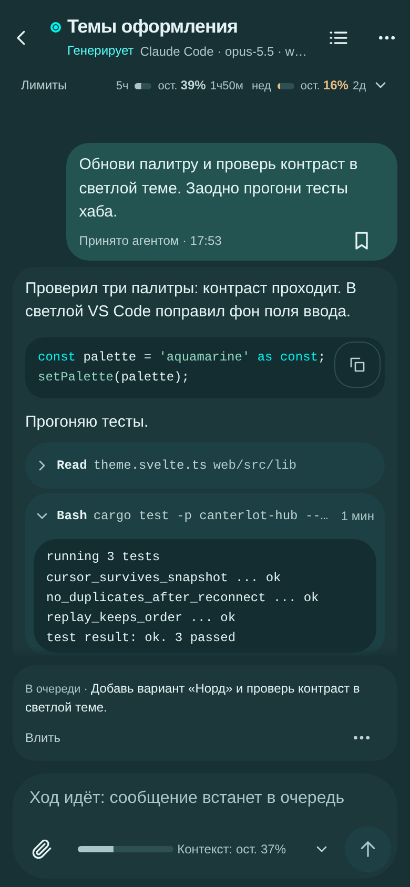</a><br><sub>Чат, очередь и контекст</sub></td>
    <td align="center" valign="top"><a href="docs/screenshots/permission-light.png">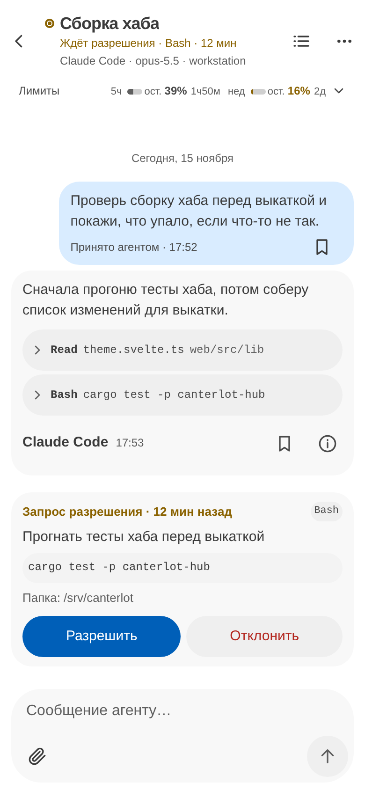</a><br><sub>Разрешения агента</sub></td>
  </tr>
  <tr>
    <td align="center" valign="top"><a href="docs/screenshots/question-dark.png">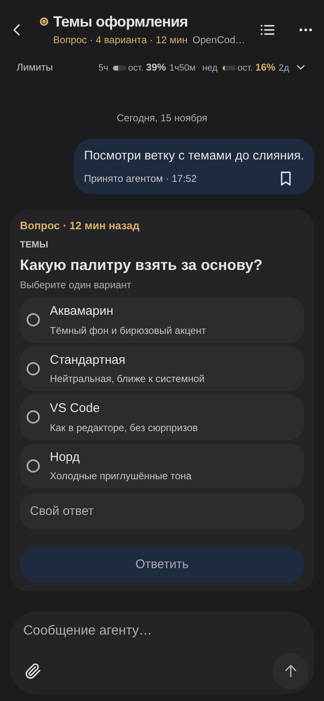</a><br><sub>Вопросы с вариантами</sub></td>
    <td align="center" valign="top"><a href="docs/screenshots/plan-dark.png">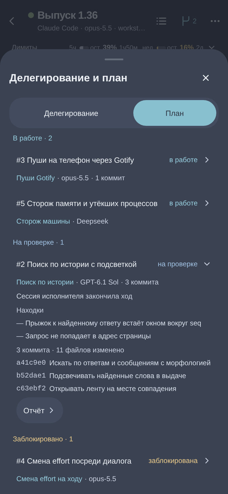</a><br><sub>Доска плана</sub></td>
    <td align="center" valign="top"><a href="docs/screenshots/plan-feed-light.png">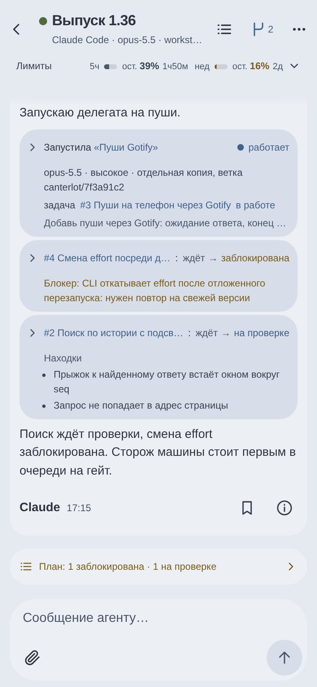</a><br><sub>Карточки плана в ленте</sub></td>
  </tr>
  <tr>
    <td align="center" valign="top"><a href="docs/screenshots/delegation-dark.png"></a><br><sub>Панель делегирования</sub></td>
    <td align="center" valign="top"><a href="docs/screenshots/search-light.png">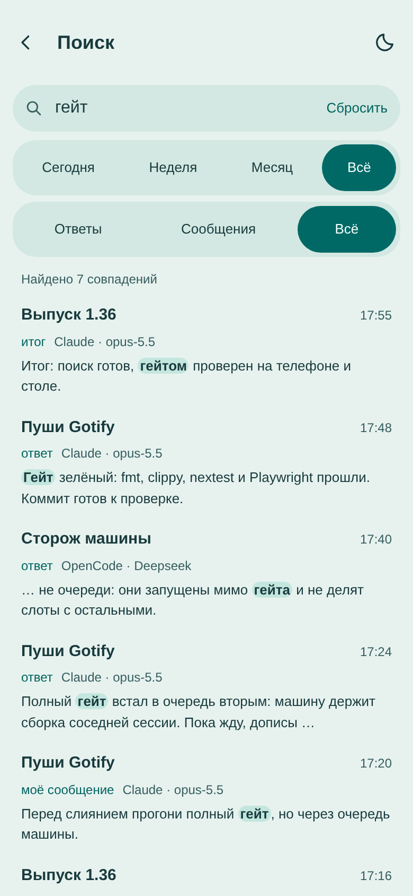</a><br><sub>Поиск по истории</sub></td>
    <td align="center" valign="top"><a href="docs/screenshots/gallery-light.png">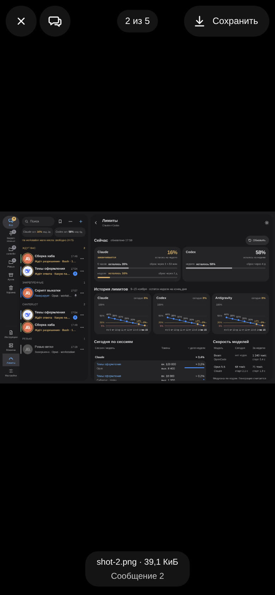</a><br><sub>Галерея картинок сессии</sub></td>
  </tr>
  <tr>
    <td align="center" valign="top"><a href="docs/screenshots/new-session-light.png">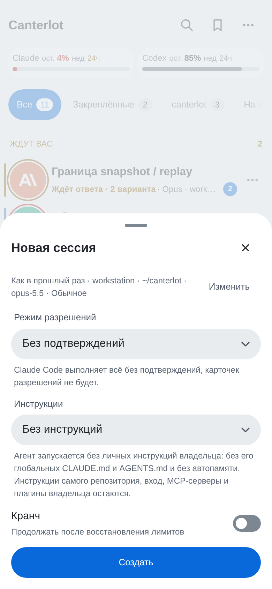</a><br><sub>Новая сессия по прошлой</sub></td>
    <td align="center" valign="top"><a href="docs/screenshots/machines-dark.png">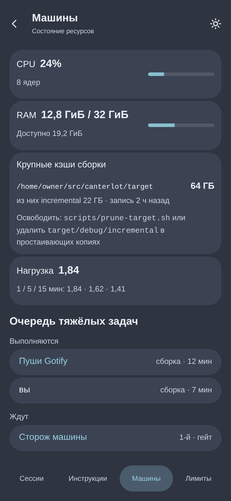</a><br><sub>Машина, сторож и очередь</sub></td>
    <td align="center" valign="top"><a href="docs/screenshots/limits-light.png">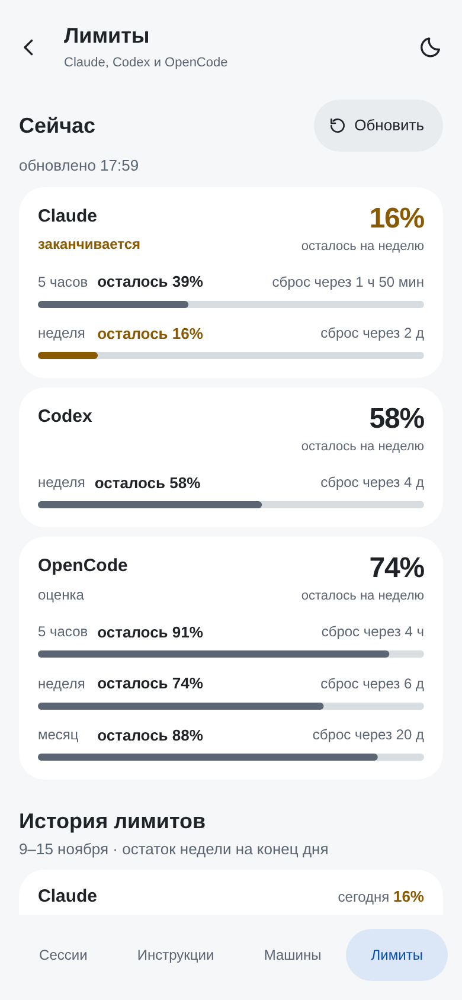</a><br><sub>Текущие лимиты и история</sub></td>
  </tr>
  <tr>
    <td align="center" colspan="3"><a href="docs/screenshots/desktop.png">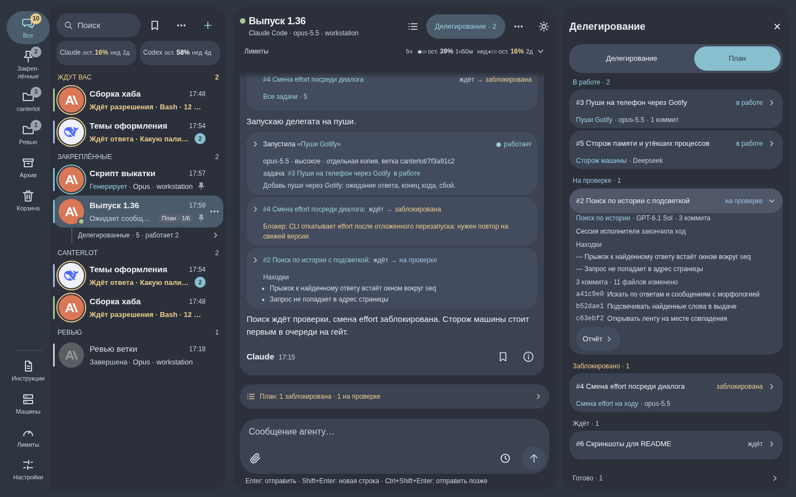</a><br><sub>Рабочий стол: список, чат и план рядом</sub></td>
  </tr>
</table>

## Сборка выпуска

Выпуск собирается один раз в контейнере Debian 13 на отдельной машине, а готовый
каталог затем используют и выкат, и публикация. Собирать напрямую, без контейнера,
нельзя ни на этой VM, ни на сборочной машине: прод — Debian 13 с glibc 2.41, а
сборочная машина — Arch с glibc 2.44, и собранные там бинарники на проде не запустятся.

```bash
scripts/build-release.sh v1.24.0            # сборочная машина (CANTERLOT_BUILD_HOST, по умолчанию canterlot-build)
scripts/build-release.sh v1.24.0 --local    # та же сборка на местном docker, для проверки
```

Тег должен быть локально и на origin. На сборочной машине нужны ssh-доступ (алиас
`canterlot-build`), работающий docker и bare-репозиторий `~/canterlot.git`. Скрипт:

1. отправляет тег в bare-репозиторий `~/canterlot.git` на сборочной машине;
2. создаёт там чистую рабочую копию `~/release/src-<sha12>` на коммите тега;
3. собирает или переиспользует образ `canterlot-release-build:<hash Dockerfile + rust-toolchain.toml>`
   из `docker/release-build/Dockerfile`: Debian trixie по digest, Rust из
   `rust-toolchain.toml`, Node 24 с проверкой sha256;
4. запускает контейнер от uid хоста с ограничениями `--cpus 24 --memory 40g --pids-limit 4096`
   (systemd-лимиты сборочной машины на контейнеры dockerd не действуют);
5. переносит готовый каталог по ssh tar-потоком в
   `.superpowers/deploy/dist/<sha12>` этой рабочей копии (`CANTERLOT_DIST_ROOT`),
   проверяет SHA256SUMS, `RELEASE`, `--version` и состав файлов; существующий
   каталог не перезаписывается;
6. убирает рабочую копию на сборочной машине через `git worktree remove --force`.

Внутри контейнера `scripts/release-build/in-container.sh` собирает хаб, воркер,
синтетический воркер, `canterlot-speech` с CUDA 12.9 для sm_70 (`hub/bin/canterlot-speech`;
образ содержит nvcc, cudart, cublas и cccl из архивов redist NVIDIA с проверкой sha256)
и PWA (`npm ci`, `PWA_VERSION=<sha12> npm run build`) и проверяет
то же, что выкат: отсутствие libssl и CUDA у хаба, прямые зависимости `canterlot-speech`
(только glibc, libstdc++ и `libcuda.so.1`, `libcudart.so.12`, `libcublas*.so.12`), `hub openapi` против `docs/api/openapi.json`,
CSP, `_app/version.json`, `synthetic-cli` только в синтетическом воркере, SHA256SUMS
и максимальную версию GLIBC не выше 2.41. Тестов здесь нет: полный прогон
`scripts/check.sh` и `check-web.sh` уже прошёл на этом коммите.

Кэши: на сборочной машине `~/release/cache`, локально
`~/.cache/canterlot-release-build` (`CANTERLOT_BUILD_CACHE`); расклад, инвалидация и
очистка — в [docs/development.md](docs/development.md#сборка-выпуска-и-кэш). Нативные
объекты `transcribe.cpp`/ggml лежат в `target/<ключ>`, где ключ — id образа и флаги
CMake, поэтому смена образа или флагов не смешивается со старым кэшем, а неизменные
входы переиспользуются. Повторная сборка того же коммита инкрементальная. Сборочный
инструмент берётся из этой рабочей копии, а не из тега: первый выпуск после появления
скрипта собирает тег, в котором его ещё нет.

Публикация — из того же каталога:

```bash
scripts/publish-release.sh v1.24.0
```

Выкат production — только через `scripts/deploy` (см. §11 `docs/deploy/pilot.md`, ранбук — §11.7): он проверяет готовый dist из `build-release.sh`, `cutover.sh <id> --dry-run` или `--rehearse` (весь путь записи, записи только печатаются) выдаёт токен, а боевой прогон `cutover.sh --execute <id> --confirm <токен>` принимает его 2 часа и только для того же плана. Значения своего стенда — в `.superpowers/site.env`, образец в [docs/deploy/site.env.example](docs/deploy/site.env.example).

Выпуск после ручной записи в `CHANGES.rst` — три команды (ранбук — §11.7 `docs/deploy/pilot.md`):

```bash
scripts/release.sh prepare 1.35.0    # бамп версии во всех местах, cargo update -w, check-version, коммит «Выпустить версию 1.35.0»
scripts/gate.sh                      # полный гейт, аттестация .superpowers/gate/<sha>.ok
scripts/gate.sh --runner auto        # то же на раннере (canterlot-worker job run), аттестация с runner=
scripts/release.sh ship 1.35.0       # тег, push, сборка, stage, репетиция, боевой прогон, check-proxy, публикация, журнал
scripts/release.sh ship 1.35.0 --full   # то же без быстрого пути: всегда репетиция и vzdump
```

Выпуск прикладного кода без миграций идёт быстрым путём: `ship` сам сравнивает развёрнутый релиз с целью
(`scripts/deploy/fastpath.sh`, точные хэши коммитов и список прикладного кода). Если изменились только
исходники, тесты, веб, документация и номер версии, репетиции нет (`cutover.sh --fast` сам повторяет
проверки и все ворота остаются); а vzdump пропускается, только когда манифест миграций бинаря цели
(`canterlot-hub migrations manifest --json`) точно совпал с `_sqlx_migrations` живой базы (проверенный
`pg_dump` остаётся точкой отката). Любая неясность — полный путь; путь и причины пишутся в лог, файл
итога и журнал. Подробности — §11.1 и §11.7 `docs/deploy/pilot.md`.

`ship` можно запускать в фоне: ход — в `.superpowers/deploy/release-1.35.0.log`, итог — в `release-1.35.0.result`. Он публикует только после `cutover done` без мягких ошибок, репетицию повторяет один раз и только на переходных кодах (стартующая сессия, идущий vzdump), боевой прогон не повторяет никогда; после остановки — `scripts/release.sh ship 1.35.0 --continue`.

### Гейт перед выпуском

Полный гейт на рабочей VM — `scripts/gate.sh`. Он держит одну аренду `gate` весь
прогон и гоняет веб ровно один раз: один `npm ci` в `web/`,
`scripts/check.sh --all --no-web` (версия, fmt, clippy, nextest и
`canterlot-speech` без веб-половины), наборы `scripts/deploy/tests/run.sh`
(только если с последнего тега `vX.Y.Z` менялась обвязка выката — `scripts/deploy/**`,
`release.sh`, `check-proxy.sh`, `check-version.sh` или `lease.sh`) и один
`scripts/check-web.sh`
(сверка типов API, статические проверки, vitest, две сборки PWA и `vitest.build`).
Порт тестовой
PostgreSQL по умолчанию 55441, временный каталог — `/tmp` (длинный путь ломает
сокеты супервизоров), бинарник воркера для аренды — установка в
`$HOME/.local/opt/canterlot/current/bin/canterlot-worker`; все три (`CANTERLOT_TEST_PG_PORT`,
`CANTERLOT_GATE_TMPDIR`, `CANTERLOT_WORKER_BIN`) перекрываются окружением.

Сводка в формате прежнего `result.txt` и логи складываются в
`.superpowers/gate/<sha8>/` и печатаются в stdout. При полном успехе, чистой
рабочей копии и неизменном HEAD гейт атомарно пишет аттестацию
`.superpowers/gate/<full sha>.ok`; её требует `release.sh ship`. Аттестация пишет
`deploy_exit=0` или `deploy_exit=skipped`: пропуск наборов выката `release.sh`
принимает наравне с успешным прогоном. Грязная копия
аттестации не даёт: такой прогон возможен только с `--no-attest`, и аттестация
тогда не пишется. Каталог `.superpowers/` не отслеживается git.

Каждый прогон — успешный или нет — пишет в `.superpowers/gate/<sha8>/state.tsv`
машиночитаемое состояние: полный sha, время, признак завершения, коды и
длительности шагов и идентичности упавших тестов (`rust|binary|test`,
`deploy|suite`). Падения не по
тестам (npm ci, fmt, clippy, сборка, svelte-check, eslint, проверки API,
токенов и типов) помечаются как `*_failed=other`. После такого прогона
`scripts/gate.sh --rerun-failed` берёт ту же аренду и перезапускает только то,
что упало: прошедшие шаги не трогаются, упавшие по тестам шаги получают точный
фильтр nextest или имена наборов выката, а шаг, упавший не по тестам, идёт
целиком. Перезапуск
разрешён только для того же HEAD и чистого дерева; один тест можно перезапустить
не более одного раза на коммит, второе падение — настоящий провал. После
успешного перезапуска аттестация сохраняет все прежние ключи и добавляет
`rerun_of=<время первого прогона>` и по строке `flaky=<идентичность>` на тест,
прошедший только со второй попытки; `release.sh ship` принимает её без
изменений. В конце печатается отчёт о нестабильных тестах и напоминание завести
им строку в `.superpowers/carry/flaky-tests.md` — сам скрипт файл не меняет.
`--no-attest` работает с обоими режимами.

Что гейт состоит из тех же шагов, проверяет `scripts/gate-coverage.sh`: он
сверяет шаги Rust, речи, статики и vitest и контейнерный путь гейта.

### Полный гейт на сборочной машине

Тот же прогон, что перед выпуском, можно снять на сборочной машине
(`CANTERLOT_BUILD_HOST`) в контейнере Debian 13: быстрее, чем на рабочей VM, и без
влияния на неё.

```bash
scripts/gate-remote.sh 4d884712            # коммит на сборочной машине (CANTERLOT_BUILD_HOST)
scripts/gate-remote.sh 4d884712 --local    # то же на местном docker, для проверки
```

`REV` — любой коммит, не только тег (по умолчанию `HEAD`). Скрипт отправляет его
в `~/canterlot.git` как `refs/gate/<sha12>`, создаёт отсоединённую рабочую копию
`~/gate/src-<sha12>` и запускает в контейнере тот же `scripts/gate.sh --no-attest`,
что идёт на VM (через `scripts/gate/in-container.sh`, с тестовой PostgreSQL):

1. `npm ci` в `web/`;
2. `scripts/check.sh --all --no-web` — fmt, clippy, nextest;
3. наборы `scripts/deploy/tests/run.sh` (без тега `vX.Y.Z` в рабочей копии они идут
   всегда; образ несёт для них `shellcheck` и `zstd`);
4. `scripts/check-web.sh` — проверки web: сверка типов API, статические проверки,
   vitest, две сборки PWA и `vitest.build`.

Шаги не перечисляются в контейнерном пути заново, поэтому разойтись с `scripts/gate.sh`
им нечем; `scripts/gate-coverage.sh` это проверяет.

Образ `canterlot-gate:<hash>` (`docker/gate/Dockerfile`) — Debian trixie по digest,
Rust из `rust-toolchain.toml`, Node 24, PostgreSQL 18 (как у тестовой базы VM)
и те же шрифты, что на VM. Тег считается из Dockerfile и `rust-toolchain.toml`. База
поднимается внутри контейнера на `127.0.0.1:55441` с выключенным fsync; на host
`55441` не занимается, поэтому гейт на VM можно запускать одновременно.

Ограничения контейнера — `--cpus 30 --memory 48g --pids-limit 8192 --shm-size=2g`:
у 7950X 32 потока и 61 ГБ, два потока и ~13 ГБ остаются хосту. Общая память —
2 ГБ вместо 64 МБ по умолчанию, `strace`-тестам выдаётся `SYS_PTRACE`; `--init`
пожинает осиротевших потомков. Кэши на сборочной машине —
`~/gate/cache/{cargo,target,npm,tmp}`, локально —
`~/.cache/canterlot-gate` (`CANTERLOT_GATE_CACHE`); повторный прогон того же
коммита их переиспользует. `tmp` — это `/tmp` контейнера (база и временные
каталоги тестов): на overlayfs и на tmpfs те же проверки
ловят таймауты, на обычной ФС хоста проходят.

Результат и логи (`gate.log`, `npm-ci.log`, `check.log`, `deploy.log`, `web.log`,
`result.txt` и `state.tsv` в формате `scripts/gate.sh`) складываются в
`/tmp/gate-remote/<sha12>` (`CANTERLOT_GATE_OUT`). Код возврата — код гейта. Рабочая
копия и ref на сборочной машине убираются автоматически (`git worktree remove --force`
и `update-ref -d`, без `rm`).

Гейт на самой VM — `scripts/gate.sh` с `CANTERLOT_TEST_PG_PORT=55441`; контейнерный
`scripts/gate-remote.sh` остаётся для сборочной машины.

### Гейт на раннере

`scripts/gate.sh --runner local|auto|<имя машины>` выбирает, где идёт гейт. `local`
(по умолчанию) — на этой VM, как выше, байт в байт. Всё остальное отправляет гейт
раннеру через `canterlot-worker job run`:

```bash
scripts/gate.sh --runner auto        # место выбирает хаб (метка kernel-6.12)
scripts/gate.sh --runner runner-a    # конкретная машина
```

Нужна чистая рабочая копия: на раннер уходит ровно полный sha `HEAD` (`--no-attest`
грязное дерево не разрешает). Скрипт выполняет

```
canterlot-worker job run --title "Гейт <sha8>" --machine <значение> --labels kernel-6.12 \
    --lease gate --timeout-minutes 240 --expected-minutes 45 --source <repo>@<sha> \
    --output .gate-out --wait -- scripts/gate/runner-gate.sh <sha>
```

Носитель кладёт этот коммит в чистую рабочую копию `<корень раннера>/jobs/<домен>/<задача>`,
а `scripts/gate/runner-gate.sh` в ней проверяет, что `HEAD` равен sha, собирает (или
берёт готовый) образ `canterlot-gate:<hash>` из `docker/gate/Dockerfile` **этой рабочей
копии** (с VM не копируется ничего) и запускает контейнер `canterlot-gate-<sha12>-<случайное>`
с `--cpus` и `--memory` по `nproc` и `free` (хосту остаются 2 ядра и 4 ГБ). Кэши лежат в
`<корень раннера>/cache/{cargo,target,npm,tmp}`; корень находится по пути
рабочей копии, а без `<корень>/worker.toml` скрипт отказывает. По TERM и INT контейнер
убивается по имени. Результат (`result.txt`, `state.tsv`, логи) попадает в `./.gate-out`,
носитель забирает его в `~/.local/state/canterlot-worker/job-outputs/<job_id>/`, а
`runner-gate.sh` дописывает в `state.tsv` строку `runner<TAB>имя`: имя берётся из
`CANTERLOT_RUNNER_NAME`, иначе это имя хоста.

Аттестацию `.superpowers/gate/<полный sha>.ok` пишет сам `gate.sh` на VM, атомарно,
в прежнем формате плюс строка `runner=<имя, как его назвал раннер>`, и только если
одновременно: `result.txt` называет именно этот sha, `state.tsv` относится к тому же
полному sha без тестовых швов, каждый шаг вышел с 0 (`deploy_exit=skipped` допустим), код
задачи 0, `HEAD` не сместился, а дерево осталось чистым. Иначе скрипт называет причину
и ничего не пишет. `release.sh ship` принимает такую аттестацию без изменений. Логи
раннера лежат в `.superpowers/gate/<sha8>/runner/`.

`--rerun-failed` с раннером в первой версии отказывается: гейт на раннере идёт целиком.
У `job run` отмены нет: Ctrl-C на `gate.sh --runner` останавливает только ожидание и
печатает идентификатор задачи, а сама задача на раннере продолжает работать. Отменить её
можно в PWA (карточка задачи). Аренда `gate` берётся на раннере (`--lease gate`), не на VM.

### Облачные окна раннеров

С таблицей `[runners.cloud]` в `hub.toml` (`docs/configuration.md`) хаб сам поднимает в Yandex
Cloud прерываемую машину под раннера `cloud` и удаляет её: окно живёт, пока есть работа, и
ограничено жёстким пределом по времени и по деньгам. Резерв считается заранее в целых копейках
по двум ставкам каталога SKU, создание вызывается один раз (неопределённый исход ищется по имени
в полном списке каталога), машина и её диск подтверждённо удаляются только по полным спискам, а
раз в пять минут сверка находит и убирает лишние машины и диски в отдельном каталоге. Машина
получает публичный IPv4 и подключается по SSH на порт 22, а в интернет выходит через SOCKS в
SSH-туннеле несущей (из облака закрыты GitHub, крейты и CDN Docker Hub); расход считается по секундам и
осторожно оценивается, а прерывание Яндекса возвращает потерянную задачу в очередь и, если время
ещё есть, поднимает окно замены. Владелец видит окна и их цену в `GET /api/v1/cloud/windows`
и может удалить окно сразу. Месячный бюджет, автоматический режим и карточку запуска задаёт
владелец: `GET/PUT /api/v1/cloud/budget`, `POST /api/v1/cloud/budget/clear-block` и
`POST /api/v1/cloud/proposals`. Агент предлагает окно инструментом `runner_propose(hours, reason, prepare)`:
в `prepare` он может перечислить apt-пакеты для cloud-init и скрипт, который несущая выполнит
от root после подъёма выхода в сеть и до запуска раннера. Карточка показывает их целиком;
решение владельца создаёт не более одного окна на карточку. `runners_list` показывает живые окна
с расходом и остаток бюджета. Устройство — в `docs/design/runners.md` (§7).

## Развёртывание из готовых архивов

В [выпусках на GitHub](https://github.com/Fenicu/canterlot/releases) лежат собранные хаб, воркер и PWA. Хаб и воркер собраны для x86_64 под glibc 2.41 и новее (Debian 13, Ubuntu 25.04 и новее). Подробности каждого шага — в [docs/deploy/pilot.md](docs/deploy/pilot.md), ключи конфигурации — в [docs/configuration.md](docs/configuration.md). Собрать всё из исходников можно по [docs/development.md](docs/development.md).

Понадобятся:

- PostgreSQL 18 с базой в UTF-8;
- Caddy (TLS, статика PWA и обратный прокси к хабу); SSO не нужен, вход проверяет сам хаб;
- на рабочих машинах — systemd и CLI агентов, которыми будете пользоваться: `claude`, `codex`, `opencode`.

Поддерживаемые версии CLI (более новая запускается, но воркер пишет диагностику `untested_cli_version`):

| Агент | CLI | Минимум | Проверены |
|---|---|---|---|
| Claude Code | `claude` | 2.1.311 | 2.1.311 |
| Codex | `codex` | 0.164.0 | 0.164.0, 0.167.0, 0.169.0 |
| OpenCode | `opencode` | 2.1.4 | 2.1.4, 2.2.5, 2.2.6 (ветка 1.x не поддерживается) |

**1. Скачать и проверить.**

```bash
VER=$(curl -fsS https://api.github.com/repos/Fenicu/canterlot/releases/latest | jq -r .tag_name | sed 's/^v//')
base=https://github.com/Fenicu/canterlot/releases/download/v$VER
for f in SHA256SUMS canterlot-hub-$VER-x86_64-linux-gnu.tar.gz \
         canterlot-worker-$VER-x86_64-linux-gnu.tar.gz \
         canterlot-web-$VER.tar.gz canterlot-csp-$VER.txt; do
    curl -fLO "$base/$f"
done
sha256sum -c SHA256SUMS
```

**2. Хаб.** Установите бинарник и создайте системного пользователя:

```bash
sudo tar -xzf canterlot-hub-$VER-x86_64-linux-gnu.tar.gz -C /usr/local/bin
sudo useradd --system --home-dir /var/lib/canterlot --shell /usr/sbin/nologin canterlot
```

Дальше по [docs/deploy/pilot.md](docs/deploy/pilot.md):

- роль и база PostgreSQL, строка подключения в `/etc/canterlot/db.url` (§2.2);
- `/etc/canterlot/hub.toml` с таблицей `[http]`: `trusted_proxies` — адрес Caddy, `owner_login` — логин для страницы входа, `allowed_origins` — адрес PWA (§2.4);
- секрет прокси, общий для хаба и Caddy (§2.5);
- сертификат gRPC от своего УЦ, имя хоста хаба в SAN (§3);
- по желанию — пуши на телефон через Gotify: таблица `[notify.gotify]` с `url` сервера и `token_file` с ключом приложения; события включаются ключами `waiting`, `turn_finished` и `failures`, а `turn_finished` шлётся на итог запроса владельца, а не на каждый служебный ход ([docs/configuration.md](docs/configuration.md)).

Затем создайте каталоги из §2.6, один раз инициализируйте хаб и включите службу из §2.7:

```bash
sudo -u canterlot canterlot-hub init --config /etc/canterlot/hub.toml
sudo systemctl enable --now canterlot-hub
```

`init` применяет миграции и создаёт владельца. При обновлении хаб сам применяет новые миграции на старте.

**Вход.** Пароля сразу после установки нет: первый вход — одноразовая ссылка восстановления, выпущенная на хосте хаба.

```bash
sudo -u canterlot canterlot-hub auth recovery-link --config /etc/canterlot/hub.toml          # печатает ссылку
sudo -u canterlot canterlot-hub auth recovery-link --config /etc/canterlot/hub.toml --push   # шлёт её только в Gotify
```

Ссылка живёт 10 минут (`--minutes`, до 60) и открывается один раз. После входа задайте пароль или добавьте ключ доступа в «Настройки → Сеансы и вход». Там же список сеансов с устройством, адресом и местом, завершение любого из них, срок бездействия (по умолчанию 90 дней) и «Сканировать код» для входа по QR на новом устройстве. Те же действия на хосте: `auth set-password` (из TTY без эха или `--stdin`, `--revoke-sessions` завершает все сеансы), `auth sessions`, `auth revoke-all`. Подробности — в [docs/http.md](docs/http.md) и [ADR-0005](docs/adr/0005-owner-sign-in.md).

Место сеанса хаб определяет сам по локальной базе DB-IP City Lite (CC BY 4.0); скачайте её и обновляйте раз в месяц:

```bash
sudo -u canterlot canterlot-hub geoip update --config /etc/canterlot/hub.toml   # в [auth.geoip].path, прежний файл остаётся при ошибке
```

**Общая память: разовый импорт файлов памяти Claude** (выпуск 1.43). Порядок целиком в [docs/deploy/pilot.md](docs/deploy/pilot.md), §13:

```bash
canterlot-worker memory import-plan --root ~/.claude/projects --out manifest.toml   # 1. план; владелец просматривает manifest.toml (2)
canterlot-worker memory import-bundle --manifest manifest.toml --out bundle.json    # 3. пакет; отказ при расхождении хэша
sudo -u canterlot canterlot-hub memory import --config /etc/canterlot/hub.toml --bundle bundle.json --dry-run   # 4. сухой прогон
sudo -u canterlot canterlot-hub memory import --config /etc/canterlot/hub.toml --bundle bundle.json             # 5. применение
```

**3. PWA и Caddy.** Разверните статику и подставьте свой адрес PWA в CSP:

```bash
sudo mkdir -p /var/www/canterlot/build
sudo tar -xzf canterlot-web-$VER.tar.gz -C /var/www/canterlot/build
sed 's/chat\.example\.com/chat.your.domain/' canterlot-csp-$VER.txt
```

Строку передайте Caddy в переменной окружения `CANTERLOT_CSP`. Блок сайта возьмите из §4.2 и [docs/http.md](docs/http.md#caddy): порядок директив внутри `route` важен, чистка `Remote-*`, `X-Forwarded-*`, `X-Canterlot-Proxy` и `X-Canterlot-Client-Ip` идёт до проксирования. Хэши скриптов в CSP привязаны к версии, поэтому при обновлении PWA строку CSP тоже обновляйте.

**4. Машина с воркером.** На хабе выпустите параметры машины:

```bash
sudo -u canterlot canterlot-hub machine add --config /etc/canterlot/hub.toml --name workstation
```

Команда печатает `machine_id`, `installation_id`, `restore_generation` и `token`. Токен показывается один раз: сохраните его на машине в `~/.config/canterlot/token` с правами `0600`, туда же положите `ca.pem` своего УЦ. Затем на машине воркера:

```bash
sudo tar -xzf canterlot-worker-$VER-x86_64-linux-gnu.tar.gz -C /usr/local/bin
```

`~/.config/canterlot/worker.toml` заполните по §6.2 и [docs/configuration.md](docs/configuration.md): адрес хаба `https://<хаб>:7443`, три UUID, `allowed_workdir_roots` и таблицы нужных агентов (`[claude_code]`, `[codex]`, `[opencode]`). Таблица `[machine]` задаёт ёмкость очереди тяжёлых задач (`lease_slots`) и где сторож ищет кэши сборки (`hotspot_roots`). Таблица `[memory]` задаёт рабочие корни общей памяти (`work_roots`, по умолчанию `["~/work"]`). Таблица `[jobs]` настраивает задачи на месте, команды оболочки по просьбе хаба (`jobs_inplace_v1`): `max_running` (4), `log_max_mib` (16), `state_retention` (`"3d"`); подробности в [конфигурации](docs/configuration.md). Пользовательская служба — из §6.4, в ней обязателен `KillMode=process`: с ним идущие сессии переживают перезапуск воркера.

```bash
loginctl enable-linger "$USER"
systemctl --user enable --now canterlot-worker
```

Раннеры (1.46, только задачи, без сессий): машину с воркером помечают несущей `canterlot-hub machine set-carrier --machine-id <uuid>`, раннер создают `canterlot-hub machine add --name runner-a --role runner --parent <uuid несущей> --root-dir /srv/runner --rank 20 --labels build-host`. Хаб не запускает на раннере сессии, а токен раннера выдаёт только своей несущей; подробности в [docs/configuration.md](docs/configuration.md). `job_run` с `source` {`repo`, `rev`} и `machine: "auto"` отдаёт выбор места хабу: задача идёт на свободный раннер несущей (больший ранг, нужные `labels`) или на саму несущую, иначе ждёт в `waiting_runner`; несущая готовит ровно этот коммит (`staging`) и после запуска забирает `outputs` (`collecting`), итог приходит один раз после сбора (очистку исходников он не ждёт). Названная машина обязана нести все `labels` задачи; ждущая раннер задача заканчивается через `[jobs].waiting_timeout` (24 часа) как `canceled` с причиной `no_runner`. Ранг, метки и корень меняет `canterlot-hub machine set --machine-id <uuid> [--rank N] [--labels a,b] [--root-dir P]` (метки можно и у самой VM, например `kernel-6.12`). Инструмент `runners_list` показывает раннеры и занятость. Задачу владельца без разговора (с исходниками на нужном коммите и сбором результатов) отправляет на несущей `canterlot-worker job run --title gate --source @HEAD --output result --wait -- ./run.sh`: выход с кодом задачи, каталог результатов в `~/.local/state/canterlot-worker/job-outputs/<id>`; устройство в [docs/design/runners.md](docs/design/runners.md).

**5. Вторая машина: оркестратор здесь, разработка там.** Оркестратор (Claude Code или Codex) остаётся на основной машине, а делегаты, сборки, запуски и выкатка идут на второй через её воркер. Между машинами нет ssh: воркер второй машины сам подключается к хабу, ему нужен только исходящий доступ к порту воркеров хаба. Код остаётся на второй машине; через хаб идут ленты сессий и вывод команд, которые запросил оркестратор.

Выпустите машину тем же `machine add --name machine-b` и поставьте воркер, как в п. 4. В `worker.toml` перечислите только агентов, которыми canterlot должен пользоваться. Агент без своей таблицы не виден и не запускается, его лимиты не опрашиваются; без `[claude_code]` установленный там Claude Code игнорируется целиком, включая его истории в `~/.claude`. Если подписка у агента там другая, дайте ей свою метку `account`, чтобы её лимиты не смешивались с лимитами основной машины:

```toml
allowed_workdir_roots = ["/srv/projects"]

[opencode]
account = "b-opencode"

[memory]
work_roots = ["/srv/projects/work"]
```

`[memory] work_roots` задайте явно: без него рабочим считается `/home/<user>/work`. Домен памяти каталога на второй машине должен совпадать с доменом оркестратора, поэтому оркестратора рабочего проекта запускайте на основной машине тоже из рабочего каталога. Лимиты OpenCode там опрашивает CodexBar второй машины; без него остаются только показания живых сессий.

На карточке машины в PWA включите «Принимать делегатов и команды с других машин»: по умолчанию машина работу с других машин не берёт, выключение отказывает ещё не начатым запускам и задачам, начатые доходят до конца. Дальше оркестратор работает так:

- `session_spawn` с `machine: "machine-b"` и `workdir` на второй машине запускает там делегата, в том числе в отдельной рабочей копии (`isolated`); список агентов, лимиты и свободное место берутся со второй машины;
- `job_run` с `machine`, `workdir` и `shell` выполняет команду на месте в каталоге второй машины (диф, слияние, гейт, выкатка); короткая отвечает в вызове, длинная присылает итог сообщением. Вызывать его может только сессия в режиме bypass;
- `session_accept` убирает рабочую копию делегата на второй машине.

Воркер второй машины обновляйте вручную после каждого выпуска: замените бинарник и перезапустите службу, версия видна на экране «Машины». Пока он старый, новые возможности на нём недоступны, а хаб отвечает `capability_missing`. Бинарник выпуска собран на Debian 13 и требует glibc не старше её; на более старой системе соберите воркер на самой машине (`cargo build --release -p canterlot-worker`).

**Обновление.** Скачайте новую версию тем же способом. Сначала замените бинарник хаба и перезапустите его, затем PWA с новым CSP, затем бинарник воркера: `systemctl --user restart canterlot-worker`. Идущие сессии при этом не прерываются. Откатить хаб на версию со старой схемой базы нельзя, поэтому перед обновлением сделайте дамп.

## Документация

- [Разработка](docs/development.md) — тулчейн, структура репозитория, проверки, тесты и обновление контракта.
- [Конфигурация](docs/configuration.md) — `hub.toml` и `worker.toml`, ключи, пуши Gotify, пороги машин и лимитов, версии CLI, запуск, отзыв и ротация машин.
- [HTTP и вход](docs/http.md) — вход владельца, сеансы, CSRF, Caddy и WSS.
- [PWA](docs/pwa.md) — модули клиента, статическая публикация (CSP и `wss://<origin-host>`), установка и обновление.
- [Развёртывание](docs/deploy/pilot.md) — пилотный контур: Proxmox LXC, PostgreSQL, Caddy, Authelia.
- [Контракт API](docs/design/api.md) — маршруты, ошибки и события; машинные схемы в `docs/api/`.
- [Проектирование](docs/design/README.md) — автоматы состояний, порядок блокировок, идемпотентность и восстановление.
- [Версионирование](docs/versioning.md) — правила бампа и проверка версии.

## Версии

Текущая версия — 1.49.1. История изменений для человека — [CHANGES.rst](CHANGES.rst), правила бампа — [docs/versioning.md](docs/versioning.md).

Архивы выпуска публикует `scripts/publish-release.sh vX.Y.Z` из сборки, сделанной при выкатке, без повторной компиляции.

## Лицензии

Canterlot распространяется по лицензии MIT, текст — [LICENSE](LICENSE).

Сторонние зависимости и их лицензии — [docs/licenses/THIRD_PARTY.md](docs/licenses/THIRD_PARTY.md).
