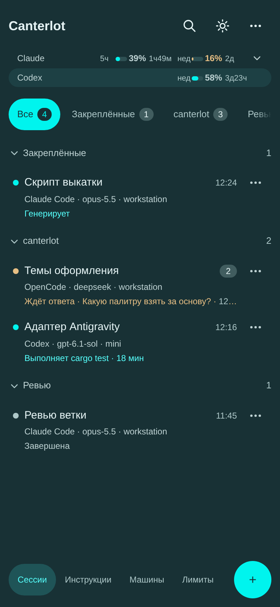
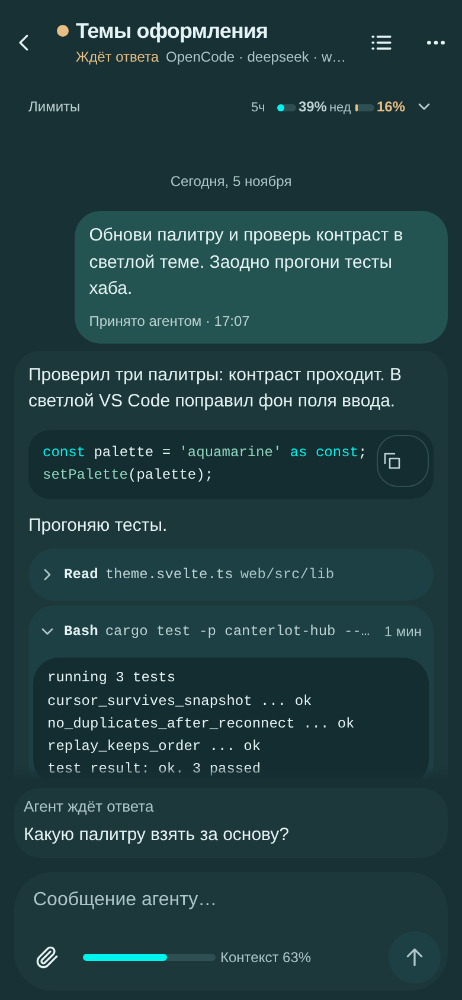
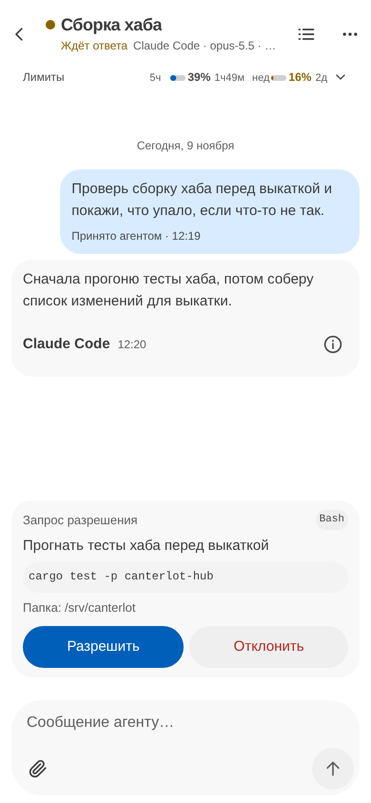
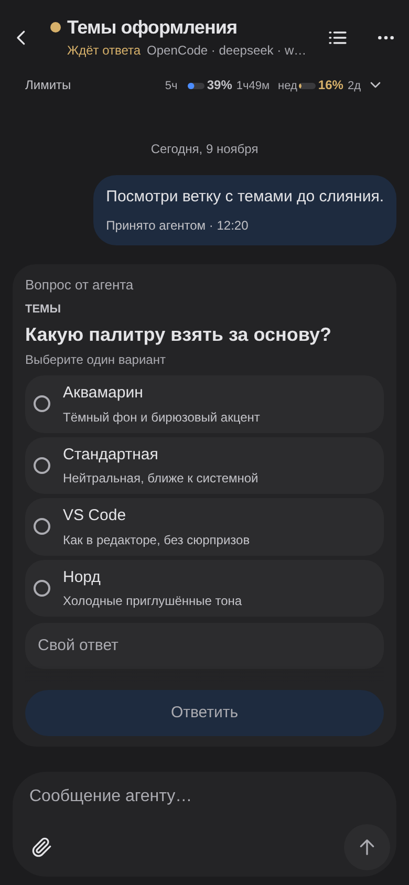
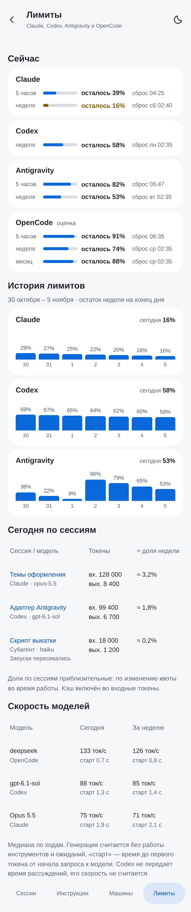
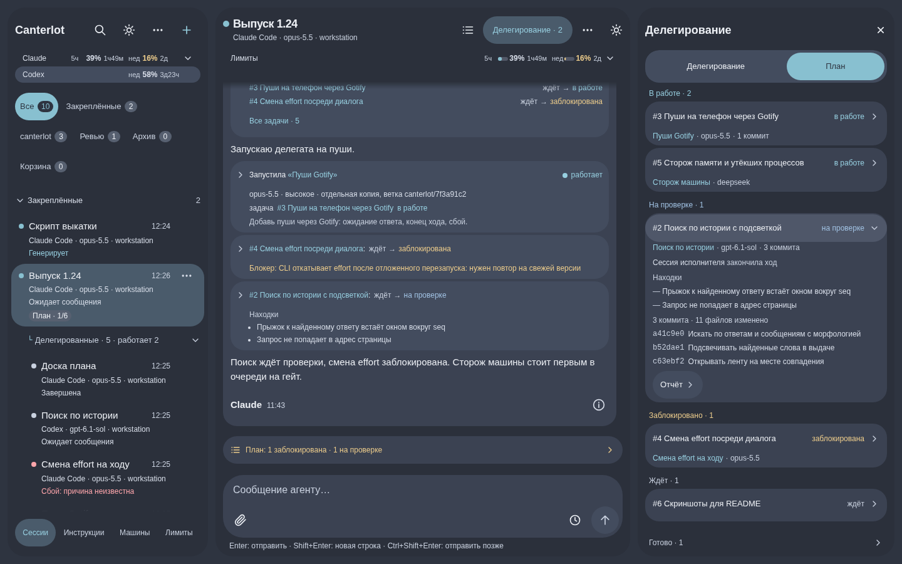

# Canterlot

Canterlot — self-hosted хаб для агентов программирования. Claude Code, Codex, OpenCode и Antigravity работают на машинах владельца, а сессии открываются с телефона через PWA: лента, разрешения и вопросы, очередь сообщений, лимиты и настройки. Antigravity работает на Google-аккаунте владельца и использует его каталог `~/.gemini`: настройки, MCP-серверы и история разговоров общие с Antigravity владельца.

Хаб написан на Rust и хранит состояние в PostgreSQL. На каждой рабочей машине запущен Rust-воркер, хаб и воркеры общаются по gRPC поверх TLS. Клиент — статическая сборка SvelteKit; её раздаёт обратный прокси, он же закрывает вход (Caddy и Authelia). Отдельного сервера приложений у клиента нет.

Что можно делать из интерфейса:

- смотреть ленту сессии: ответы, вызовы инструментов, субагентов и служебные строки;
- отвечать на разрешения и вопросы агента карточками; ответ проходит этапы «отправка → сохранено → передано → применено»;
- вести очередь сообщений: «Отправить сейчас» вливает сообщение в идущий ход, а ждущее сообщение можно изменить до отправки;
- убирать сессию в корзину на 24 часа, возвращать её одним нажатием или удалять окончательно;
- прерывать текущий ход, не закрывая сессию: контекст и процесс остаются, следующее сообщение продолжает работу;
- видеть заполнение контекста и сжимать его, в том числе между ходами;
- запускать делегированные сессии через MCP-инструменты: отдельная рабочая копия, вложенный список, приём результата;
- давать агенту будильники: по времени, по состоянию других сессий (в том числе одним сообщением за всю пачку и со сторожем по сроку), по сбросу лимита провайдера и по освобождению машины; в чате они видны плашками;
- включать автопинок делегата: хаб сам подталкивает исполнителя, бросившего ход без маркера `STATUS: DONE`, и будит оркестратора один раз, когда толчки кончились;
- следить за лимитами провайдеров по пятичасовому, недельному и месячному окнам и за скоростью ответа; настраивать пороги жёлтого и красного предупреждений и недельный резерв — изменения действуют сразу, без перезапуска хаба;
- видеть в сведениях о сессии расход токенов за всю сессию и всех её делегатов, по моделям и с кэшем;
- вставлять скриншоты и файлы из буфера или перетаскиванием; агент может отдать файл в ленту;
- видеть свободное место на машинах и тихое предупреждение в списке сессий, когда его меньше `[machines] disk_warn_free_gb = 30` ГБ (критический уровень — `disk_critical_free_gb = 10`);
- видеть версию в настройках, окно «Что нового» и историю изменений.

## Скриншоты

Телефон и рабочий стол: темы Аквамарин, Стандартная и VS Code.

<table align="center">
  <tr>
    <td align="center"> Сессии, лимиты и группы</td>
    <td align="center"> Чат, код и инструменты</td>
    <td align="center"> Разрешения агента</td>
  </tr>
  <tr>
    <td align="center" valign="top"> Вопросы с вариантами</td>
    <td align="center" valign="top" colspan="2"> История лимитов и скорость</td>
  </tr>
  <tr>
    <td align="center" colspan="3"> Рабочий стол: список и чат рядом</td>
  </tr>
</table>

## Документация

- [Разработка](docs/development.md) — тулчейн, структура репозитория, проверки, тесты и обновление контракта.
- [Конфигурация](docs/configuration.md) — `hub.toml` и `worker.toml`, ключи, запуск, отзыв и ротация машин.
- [HTTP и вход](docs/http.md) — заголовки прокси, CSRF, Caddy и WSS.
- [PWA](docs/pwa.md) — модули клиента, статическая публикация (CSP и `wss://<origin-host>`), установка и обновление.
- [Развёртывание](docs/deploy/pilot.md) — пилотный контур: Proxmox LXC, PostgreSQL, Caddy, Authelia.
- [Контракт API](docs/design/api.md) — маршруты, ошибки и события; машинные схемы в `docs/api/`.
- [Проектирование](docs/design/README.md) — автоматы состояний, порядок блокировок, идемпотентность и восстановление.
- [Версионирование](docs/versioning.md) — правила бампа и проверка версии.

## Версии

Текущая версия — 1.10.1. История изменений для человека — [CHANGES.rst](CHANGES.rst), правила бампа — [docs/versioning.md](docs/versioning.md).

## Лицензии

Canterlot распространяется по лицензии MIT, текст — [LICENSE](LICENSE).

Сторонние зависимости и их лицензии — [docs/licenses/THIRD_PARTY.md](docs/licenses/THIRD_PARTY.md).
