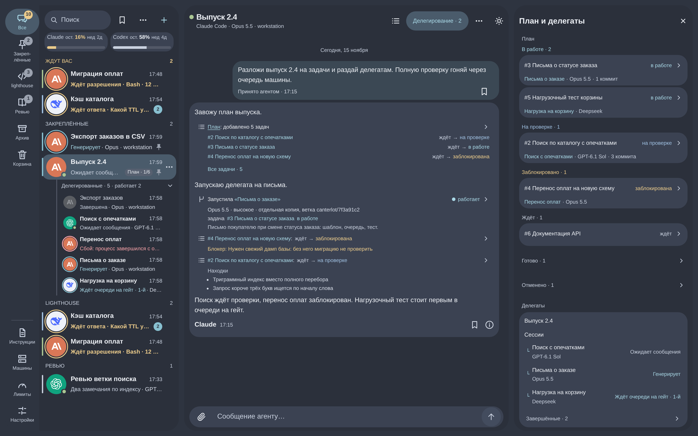
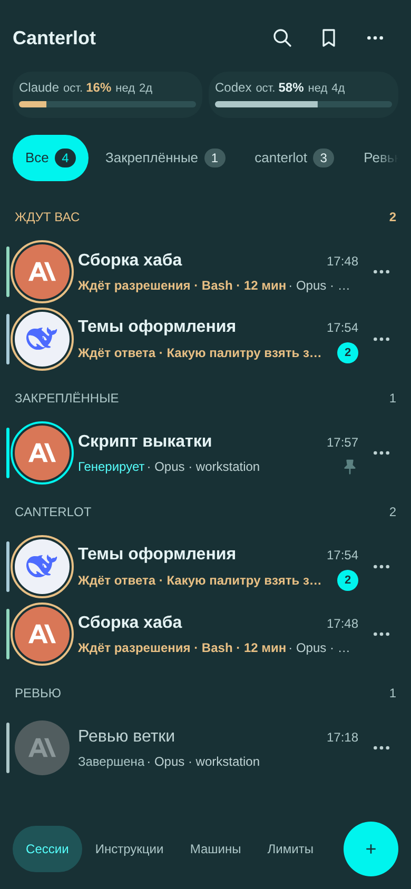
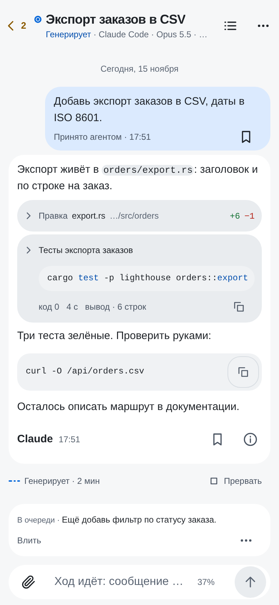
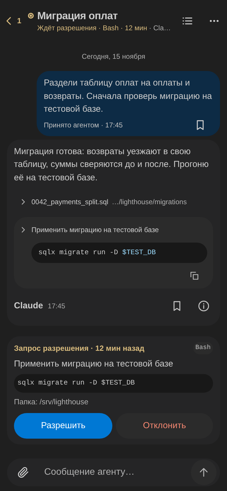
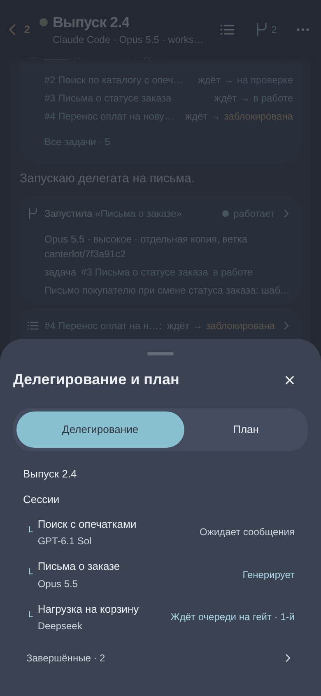
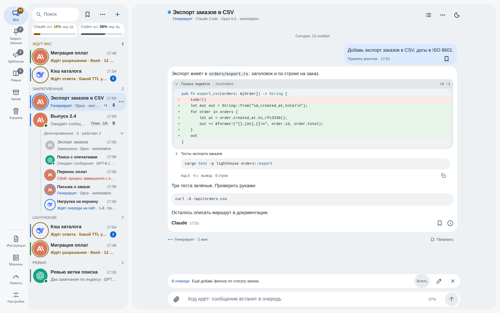

# Canterlot

Canterlot — self-hosted хаб для агентов программирования. Claude Code, Codex и OpenCode работают на ваших машинах, а вы ведёте их с телефона или компьютера: читаете ленту, отвечаете на разрешения и вопросы, раздаёте задачи делегатам и следите за лимитами. Проект рассчитан на одного владельца и его машины.

Разработка идёт в [Forgejo](https://git.fenicu.com/Fenicu/canterlot); GitHub — зеркало.

## Скриншоты

Все данные на картинках выдуманы. Снимки делает `npm run screenshots` в `web/` ([как](docs/development.md#скриншоты-readme)).

  

  
  
  
  
  

  

## Возможности

- **Лента и список.** Ответы, вызовы инструментов и субагенты в одной ленте; сессии, которым нужен ваш ответ, собраны наверху в разделе «Ждут вас».
- **Разрешения и вопросы.** Агент спрашивает карточкой, вы отвечаете в одно касание; секрет вводится один раз отдельной карточкой и живёт только в файле в tmpfs на машине сессии.
- **Очередь сообщений.** Пишите, пока идёт ход: сообщение встанет в очередь или вольётся в текущий ход. Черновики и вложения общие для всех устройств.
- **Делегирование.** Оркестратор запускает делегатов в отдельных рабочих копиях, в том числе на другой машине, ведёт доску плана и принимает результат; исполнителя выбирает ваша политика маршрутизации.
- **Лимиты.** Пятичасовое, недельное и месячное окна провайдеров, прогноз расхода, пауза и автопродолжение после сброса, цена каждого хода.
- **Машины.** Ресурсы, сторож кэшей и утёкших процессов, очередь тяжёлых задач, команды на месте и раннеры для сборок.
- **Память и поиск.** Общая память агентов с доменами `work` и `personal` и поиск по истории всех сессий.
- **Будильники и расписание.** Агент просыпается по времени, по состоянию других сессий или по сбросу лимита; повторяющиеся задачи идут по cron.
- **Ввод.** Диктовка с локальным распознаванием, меню slash-команд и навыков, подсказка следующего сообщения, вставка файлов и скриншотов с обрезкой и рисунками от руки.
- **Уведомления.** Пуши через Gotify, когда сессия ждёт вас, закончила ход или упала.
- **Интерфейс.** PWA для телефона, планшета и стола, пятнадцать тем в светлом и тёмном режиме, честное состояние без связи.

Полный перечень — в [docs/features.md](docs/features.md), история изменений — в [CHANGES.rst](CHANGES.rst).

## Архитектура

- **Хаб** (`canterlot-hub`, Rust) хранит состояние в PostgreSQL, отдаёт HTTP и WebSocket для PWA и сам проверяет вход владельца: пароль, ключи доступа, ссылка восстановления, сеансы.
- **Воркер** (`canterlot-worker`, Rust) стоит на каждой рабочей машине, запускает CLI агентов и подключается к хабу по gRPC поверх TLS; сессии переживают перезапуск воркера.
- **PWA** — статическая сборка SvelteKit. Её раздаёт обратный прокси Caddy, отдельного сервера приложений нет.
- **Диктовка** — необязательная служба `canterlot-speech` на хосте хаба (Parakeet v3 на GPU NVIDIA, запасной режим на CPU); звук и текст не попадают на диск.

Подробнее — в [docs/design](docs/design/README.md).

## Быстрый старт

На хосте с Docker одной строкой `curl -fsSL https://github.com/Fenicu/canterlot/releases/latest/download/install.sh | bash` ставятся хаб, база, Caddy, PWA и воркер ([установка одной строкой](docs/deploy/release-archives.md#установка-одной-строкой)). Без неё — по шагам:

В [выпусках на GitHub](https://github.com/Fenicu/canterlot/releases) лежат собранные хаб, воркер и PWA для x86_64 и glibc 2.41 и новее (Debian 13, Ubuntu 25.04). Понадобятся PostgreSQL 18, Caddy и CLI нужных агентов (`claude`, `codex`, `opencode`) на рабочих машинах.

1. Скачайте архивы выпуска и проверьте `SHA256SUMS`.
2. Поставьте хаб: база, `hub.toml`, `canterlot-hub init`, служба systemd. Первый вход — по одноразовой ссылке `canterlot-hub auth recovery-link`.
3. Разверните PWA за Caddy и передайте ему строку CSP из выпуска.
4. Выпустите машину командой `canterlot-hub machine add` и запустите на ней воркер пользовательской службой.

Команды и конфигурация по шагам — в [docs/deploy/release-archives.md](docs/deploy/release-archives.md); там же вторая машина, раннеры и обновление. Сборка из исходников — в [docs/development.md](docs/development.md).

## Документация

- [Возможности](docs/features.md) — полный перечень того, что умеют интерфейс и инструменты агента.
- [Развёртывание из архивов](docs/deploy/release-archives.md) и [пилотный контур](docs/deploy/pilot.md) — установка, Caddy, выкат и обновление.
- [Конфигурация](docs/configuration.md) — `hub.toml` и `worker.toml`, адаптеры и версии CLI, лимиты, пуши, раннеры.
- [HTTP и вход](docs/http.md) — вход владельца, сеансы, CSRF, Caddy и WSS.
- [PWA](docs/pwa.md) — модули клиента, статическая публикация (CSP и `wss://<origin-host>`), установка и обновление.
- [Контракт API](docs/design/api.md) — маршруты, ошибки и события; машинные схемы в `docs/api/`.
- [Проектирование](docs/design/README.md) — автоматы состояний, порядок блокировок, идемпотентность и восстановление.
- [Разработка](docs/development.md) — тулчейн, проверки, гейт, сборка и выпуск. Canterlot разрабатывают ИИ-агенты; правила для них — в [AGENTS.md](AGENTS.md).
- [Версионирование](docs/versioning.md) — правила бампа и проверка версии.

## Версия и лицензия

Текущая версия — 1.54.2. История изменений — [CHANGES.rst](CHANGES.rst).

Canterlot распространяется по лицензии MIT, текст — [LICENSE](LICENSE). Сторонние зависимости и их лицензии — [docs/licenses/THIRD_PARTY.md](docs/licenses/THIRD_PARTY.md).
