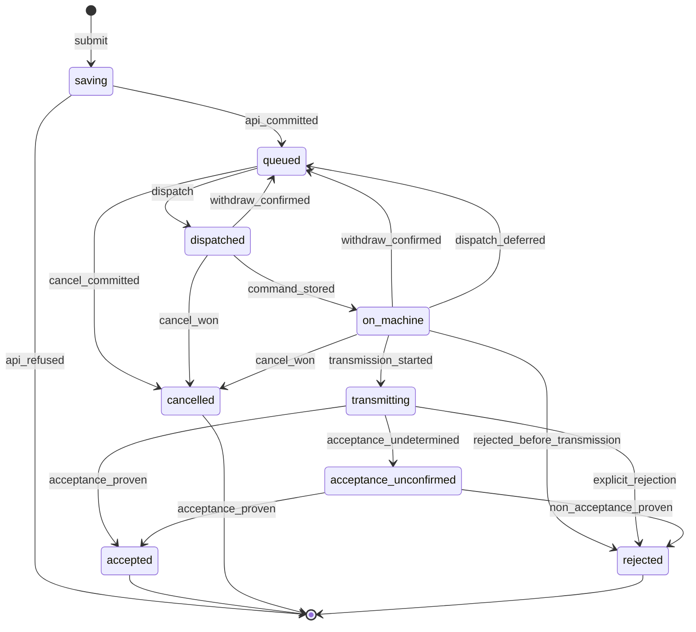
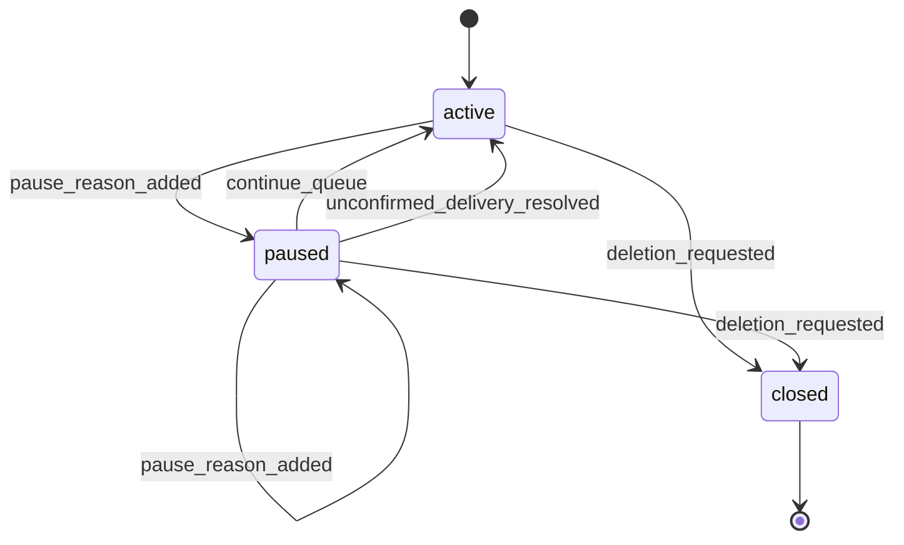
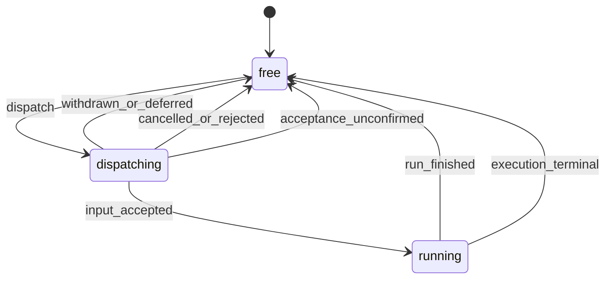
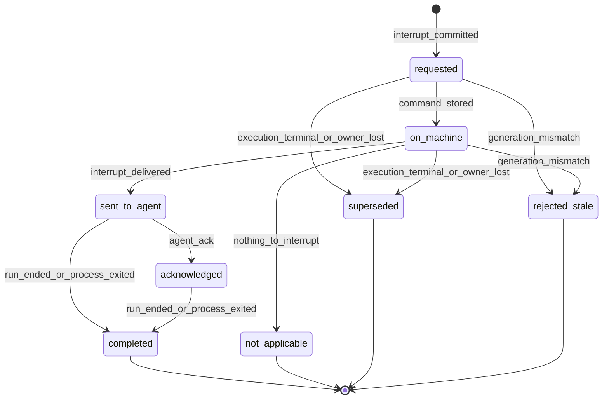
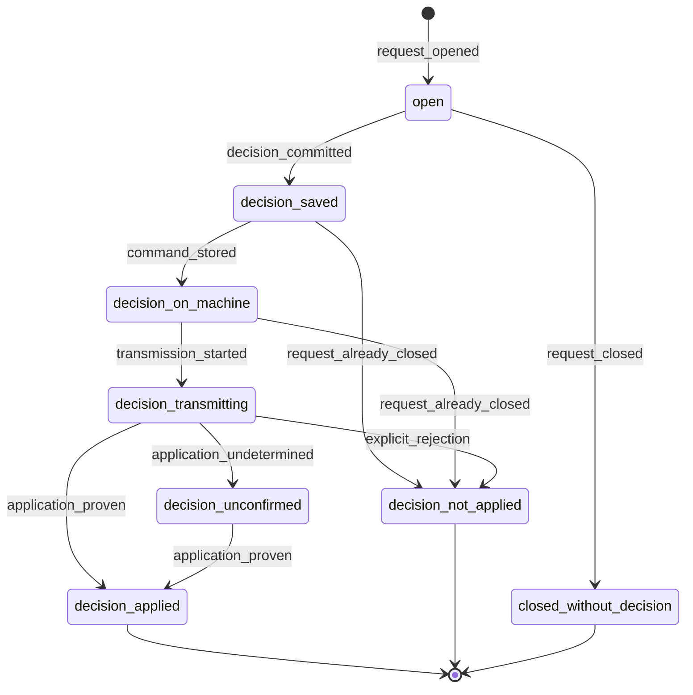

# Доставка, очередь, прерывание, запросы пользователя

Словарь идентичностей, метки хранения (`LS`, `PG-tx`, `CJ`, `SJ`) и контракт адаптера описаны в [README](README.md).

## 1. Идемпотентность (§7.1, §7.2, §14.1)

| # | Правило | Где | Проверки |
| --- | --- | --- | --- |
| I-1 | Каждая изменяющая операция клиента (отправка ввода, отмена, решение, прерывание, остановка, продолжение очереди, resume, удаление) несёт `idempotency_key`, созданный до первой отправки и записанный в `LS` вместе с содержимым операции. | браузер | AT-A-01, AT-E-05 |
| I-2 | Хаб проверяет пару (область владельца, `idempotency_key`) и хеш канонизированного содержимого. Тот же ключ и то же содержимое: тот же объект и тот же результат. Тот же ключ и другое содержимое: `idempotency_conflict`, исходный объект не меняется. | хаб | AT-A-01, AT-A-02 |
| I-3 | Ключ занимается только закоммиченным результатом. Отказ без commit (лимит, недоступная БД) ключ не связывает; повтор с тем же ключом выполняется заново. | хаб | AT-A-03, AT-C-11 |
| I-4 | Запись объекта, команды доставки и события для подписчиков, проверка ключа и лимитов: один `PG-tx`. Успешный ответ API только после commit. | хаб | AT-A-03, AT-A-04 |
| I-5 | При обрыве ответа клиент повторяет тот же запрос с тем же ключом или запрашивает результат по ключу. Новый ключ для той же операции не создаётся. | браузер | AT-A-01, AT-E-05 |
| I-6 | **Предложение**: ключ хранится вместе с объектом и живёт столько же; при удалении разговора его заменяет tombstone. Причина: §14.1 «столько, сколько нужны живым объектам», а повтор старого ключа должен найти объект, а не создать новый. | хаб | AT-A-12 |
| I-7 | Воркер дедуплицирует по `command_id` в `CJ`; повторная доставка возвращает текущую квитанцию и не создаёт второго намерения. | воркер | AT-A-05, AT-H-05 |
| I-8 | По одному `command_id` не более одного `transmission_started` за всё время жизни разговора на машине. Новая `dispatch_attempt` принимается, только если по квитанции передачи не было и номер попытки больше последнего виденного. | сопровождение | AT-A-05, AT-A-06 |
| I-9 | **Предложение**: минимальные квитанции команд (`command_id`, последняя `dispatch_attempt`, итоговый класс, без содержимого) хранятся в `CJ`, пока разговор существует на машине; итоговый класс из `SJ` переносится в `CJ` до компактации `SJ`; компактация квитанции не удаляет. Причина: без них повторную выдачу после restore (§18.1 п. 4) или после очистки таблиц хаба нельзя отличить от новой. | воркер | AT-A-12, AT-G-11 |
| I-10 | Команды адресуются `execution_id` + `execution_generation`. Воркер отклоняет закрытое поколение (`generation_closed`) и поколение ниже максимального известного для разговора (`generation_mismatch`). | воркер | AT-C-06, AT-A-12 |
| I-11 | Повторное открытие RPC, библиотечный retry и replay журнала не создают новых команд и не меняют ключи событий. Hedging не используется. | оба | AT-H-05, AT-C-04 |
| I-12 | После `transmission_started` автоматического повтора ввода или решения нет. Явный повтор: новая операция с новым ключом, новым `input_id`, ссылкой `retry_of` на исходный ввод и предупреждением о возможном повторном действии. | хаб, UI | AT-A-06, AT-A-07 |
| I-13 | Статусы команд применяются монотонно по рангу внутри одной `dispatch_attempt`; статус более старой попытки игнорируется; пропуск промежуточных статусов допустим. Перестановка и повтор сообщений не меняют результат (§8.6 п. 3). | хаб | AT-B-02, AT-H-04 |

## 2. Доставка пользовательского ввода (§6.2, §7.1–§7.3)

| Состояние | UI (§6.2) | Где хранится | Смысл |
| --- | --- | --- | --- |
| `saving` | Сохраняется | `LS` | операция с ключом записана на устройстве, commit не подтверждён |
| `queued` | В очереди | PG | ввод, `command_id` и событие закоммичены; ждёт выдачи из FIFO |
| `dispatched` | В очереди | PG | выдан текущему поколению (`dispatch_attempt` n), `command_stored` ещё нет |
| `on_machine` | На машине | `CJ` → PG | `command_stored`; передачи агенту не было |
| `transmitting` | Передаётся агенту | `SJ` → PG | `transmission_started` записано до первого байта |
| `accepted` | Принято агентом | `SJ` → PG | адаптер вернул доказательство приёма |
| `acceptance_unconfirmed` | Приём не подтверждён | `SJ`/`CJ` → PG | передача могла состояться, доказательства нет |
| `cancelled` | Отменено | PG или `SJ`/`CJ` | отмена записана раньше начала передачи |
| `rejected` | Отклонено | PG | однозначный отказ без неопределённости исполнения |

Флаги поверх состояния: `cancel_requested` (UI «отмена запрошена»), `withdraw_requested` (системный отзыв выдачи при паузе; пользователю не показывается как отмена). Черновик без операции (нет ключа) в автомат не входит: офлайн-черновик не отправляется сам после появления сети (§12.3).

| Из | Событие | Условие | Действие | В |
| --- | --- | --- | --- | --- |
| черновик | `submit` | пользователь нажал отправку, сеть есть | `LS`: операция {`idempotency_key`, текст, ссылки на вложения}; поле ввода очищается после записи `LS`; HTTP-запрос | `saving` |
| `saving` | `api_committed` | ответ 2xx | на хабе `PG-tx`: проверка ключа (I-2), tombstone, лимитов (текст ≤ 256 КиБ, метаданные ≤ 64 КиБ, сериализованная команда ≤ 1 МиБ, очередь ≤ 100; §8.6 п. 8, §13), готовности вложений того же владельца и разговора (§13.1); ввод с `input_seq`, команда `deliver_input`, событие `input_queued`. `LS`: операция подтверждена | `queued` |
| `saving` | `api_refused` | однозначный отказ API: `queue_full`, `resource_limit`, `idempotency_conflict`, `conversation_deleted`, `attachment_not_ready` | `LS`: текст возвращается в черновик с причиной; ключ операции выбрасывается, следующая отправка создаёт новый | черновик |
| `saving` | `api_outcome_unknown` | таймаут или обрыв ответа | `LS` без изменений; тот же запрос с тем же ключом с backoff или запрос по ключу | `saving` |
| `queued` | `dispatch` | ввод в голове FIFO, затвор очереди открыт (§3) | `PG-tx` под блокировкой очереди разговора: `run_slot` = ввод, `dispatch_attempt` + 1, команда привязана к поколению; сигнал доставщику | `dispatched` |
| `queued` | `cancel_committed` | ввод ещё `queued` в момент `PG-tx` | `PG-tx`: `cancelled`, событие | `cancelled` |
| `dispatched`, `on_machine` | `cancel_requested` | пользователь отменяет выданный ввод | `PG-tx`: флаг, команда `cancel_input(command_id)`; UI «отмена запрошена» | без изменения |
| `dispatched`, `on_machine` | `cancel_won` | на машине отмена записана раньше `transmission_started` | `SJ`/`CJ`: квитанция `cancelled`; `PG-tx`: `cancelled`, `run_slot` свободен | `cancelled` |
| `dispatched`, `on_machine` | `cancel_lost` | `transmission_started` записано раньше | `PG-tx`: снять флаг; UI «передача уже началась, обычная отмена невозможна» и действие «прервать исполнение» | по факту передачи |
| `dispatched`, `on_machine` | `withdraw_confirmed` | хаб отозвал выдачу (`withdraw_input` при постановке паузы), передачи не было | `SJ`/`CJ`: квитанция `withdrawn(attempt)`; `PG-tx`: ввод снова в голове очереди с прежним `input_seq`, `run_slot` свободен | `queued` |
| `on_machine` | `dispatch_deferred` | машина не начала передачу и не может: поколение закрыто, исполнение остановлено | как `withdraw_confirmed`; причина из ответа становится удержанием или паузой очереди | `queued` |
| `on_machine` | `rejected_before_transmission` | однозначный отказ до передачи: неподдерживаемое вложение, лимит ресурса, недоставляемый файл | `PG-tx`: `rejected(reason)`, `run_slot` свободен | `rejected` |
| `on_machine` | `transmission_started` | затвор сопровождения открыт (§3) | `SJ`: fsync намерения, только затем статус хабу и запись во внешний процесс: хаб может увидеть `transmitting` раньше первого байта, что безопасно, потому что из этого состояния нет возврата в очередь (D-5, D-6) | `transmitting` |
| `transmitting` | `acceptance_proven` | адаптер: `accepted(proof)` | `SJ`: результат; `PG-tx`: `accepted`, `agent_confirmed_at`; ввод переходит из блока очереди в историю | `accepted` |
| `transmitting` | `explicit_rejection` | адаптер: `rejected(reason)` | `SJ`, `PG-tx`: `rejected`, `run_slot` свободен | `rejected` |
| `transmitting` | `acceptance_undetermined` | адаптер: `undetermined` (в т.ч. истёк его deadline); сопровождение умерло; исполнение завершилось без результата; область команды в `SJ` повреждена | `SJ`/`CJ`: `unconfirmed`; `PG-tx`: `acceptance_unconfirmed`, пауза `unconfirmed_delivery(input_id)`, `run_slot` свободен | `acceptance_unconfirmed` |
| `acceptance_unconfirmed` | `acceptance_proven` | поздний факт или `reconcile` нашли доказательство | `PG-tx`: `accepted`; пауза `unconfirmed_delivery` этого ввода снимается | `accepted` |
| `acceptance_unconfirmed` | `non_acceptance_proven` | `reconcile`, источник истории гарантирует полноту; на закреплённых версиях недостижим: история ни Claude Code, ни Codex полноту не гарантирует | `PG-tx`: `rejected(non_acceptance_proven)`; пауза остаётся до решения владельца | `rejected` |
| `acceptance_unconfirmed` | `retry_as_new` | явное действие владельца после предупреждения | новая операция `submit` с новым ключом и `retry_of`; **Предложение**: в конец FIFO, потому что порядок задаёт серверная нумерация | исходный без изменений |

Отображение на CLI (факты этапа 0, README «Контракт адаптера»):

| Событие | Claude Code 2.1.310 | Codex 0.164.0 | OpenCode 2.1.4 |
| --- | --- | --- | --- |
| запись после `transmission_started` | строка `SDKUserMessage` с `uuid` = `command_id` | `turn/start` с `clientUserMessageId` = `command_id` | `POST .../prompt` с `id: msg_<command_id>` и всегда `delivery: "queue"`: значение по умолчанию `steer` влило бы ввод в идущий ход |
| `acceptance_proven` | кадр `command_lifecycle` `started`/`completed` с `command_id` (до первого кадра модели), иначе первый `stream_event` или `assistant` с `command_id` в `user_message_uuid(s)` | `item/started` элемента `userMessage` с `clientId` = `command_id` | ответ 200 с тем же `id`; позднее доказательство находит сверка по `.../inbox` и `.../message` |
| `explicit_rejection` | не бывает для корректного ввода | ошибка JSON-RPC в ответ на `turn/start` | 400, 404 или 409 на `POST .../prompt` |
| `non_acceptance_proven` | недостижим | недостижим | недостижим: достижимость при мёртвом сервере и пустых проекциях тестом не доказана, остаётся `acceptance_unconfirmed` |
| ввод влит в чужой ход | не возникает, пока ввод пишется только после `result` (затвор сопровождения, п. 2). Пробуждающий ход (execution.md §2) приписывается последней команде, ввод ждёт его конца; записанный на его старте ввод CLI держит сам, `result` такого хода его не заканчивает | ответ `turn/start` несёт `turn.id` уже активного хода. **Предложение**: ввод получает статус по своему доказательству, очередь получает паузу `fatal_error` с ошибкой области `adapter_protocol`. Причина: обычная отправка молча стала вмешательством, что §7.3 запрещает | не возникает: ввод идёт с `delivery: "queue"`. Запуск без ввода приписывается последней команде, ввод ждёт его конца |

Затвор сопровождения перед `transmission_started` описан в §3. Сопровождение может ждать открытия затвора (каталог занят, вложения не готовы, агент не готов); ожидание видно хабу как удержание очереди, а отмена и отзыв в это время побеждают.

Точка линеаризации отмены, отзыва и передачи одна: `CJ`, пока управляющая служба не передала команду сопровождению, затем `SJ` исполнения; если сопровождение мертво, решение принимает служба по чтению его `SJ` ([recovery.md](recovery.md) R3). Отмена или отзыв неизвестного машине `command_id` записывается в `CJ` как квитанция, и поздно пришедшая `deliver_input` с этим ID сразу получает её.

**Инварианты**

- D-1: запись `transmission_started` в `SJ` предшествует первому байту во внешний процесс; без неё передача не начинается.
- D-2: по одному `command_id` не более одного `transmission_started` (I-8).
- D-3: `cancelled` только если отмена записана раньше `transmission_started`: в PG для `queued`, на машине для выданного ввода. «Отменено» после начала передачи не показывается никогда (AT-A-10).
- D-4: `accepted` только по доказательству адаптера; запись в stdin не доказательство (§6.2).
- D-5: возврат в `queued` только из состояний без `transmission_started`.
- D-6: из `transmitting` и `acceptance_unconfirmed` нет автоматического пути к повторной передаче; таймер тишины ввод не повторяет (§6.1).
- D-7: положительное доказательство сильнее вывода из отсутствия: если после `rejected(non_acceptance_proven)` пришло доказательство приёма, ввод становится `accepted`, фиксируется диагностика `delivery_fact_conflict`.
- D-8: машине выдаётся только голова FIFO одного разговора; остальные вводы не покидают хаб.
- D-9: квитанция отмены или отзыва записывается раньше, чем её результат уходит хабу. Отмена действует против целевой попытки выдачи и всех последующих попыток той же команды; отзыв действует только против своей `target_dispatch_attempt`.

**Терминальные состояния и поздние факты.** `accepted`, `rejected`, `cancelled` терминальны (с исключением D-7). `acceptance_unconfirmed` автоматически покидается только по доказательству. Дубликаты статусов и статусы старых попыток игнорируются (I-13). События ответа, пришедшие после терминального состояния исполнения, дополняют историю хода.

**Проверки**: AT-A-01…AT-A-07, AT-A-10, AT-A-12, AT-E-05, AT-F-07, AT-H-02, AT-H-04, AT-H-05, AT-H-09, AT-H-10.

### Вводы от других сессий и задание `session_task`

Агент может поставить ввод в очередь другой сессии (`session_send`, бриф `session_spawn`, события подписок, заметки хаба). Такой ввод идёт тем же путём, что ввод владельца (`submit_input_in_tx`: FIFO, паузы, затворы, состояния этого раздела), и отличается тремя вещами.

- **Происхождение.** Ввод несёт `inputs.origin` (jsonb): `kind` равен `message`, `spawn` или `event`, плюс `from`, `title`, `harness`, `model`, `chain_depth` и у `message` `sha256` текста. Служебная первая строка `[canterlot] …` хранится в `content` так, как доставлена модели: история и PWA видят то же, что агент. Вложений у таких вводов нет. `origin` не входит в хеш идемпотентности, поэтому старые ключи совпадают с прежними. Заметки хаба о запросе запуска, приёме и сбое несут `origin` вида `event`: они не сбрасывают глубину цепочки, не считаются отправкой и не выглядят как ввод владельца. После удаления отправителя `origin` сжимается до `kind`, `chain_depth` и `sender_deleted`, строка с его именем в тексте заменяется нейтральной.
- **Ключ идемпотентности.** `agent:<call_id>` у `session_send` и брифа (повтор транспорта возвращает прежний ввод и подписку не трогает), `sub:<id задания>` у события подписки, `spawn:<request_id>` у брифа по одобрению. Тот же текст тому же адресату в течение 10 минут, пока первый ввод не закончен (в очереди, выдан, на машине, передаётся или занимает слот хода), даёт прежний `input_id`.
- **Принятие агентского ввода сбрасывает `resume_pending`** так же, как ввод владельца: событие подписки и есть продолжение сессии.

Доставка событий и заметок идёт заданием планировщика `session_task` (таблица `scheduled_jobs`), а не прямой записью в очередь адресата: оценка подписок идёт в транзакции проектора цели, и держать там очередь подписчика нельзя (порядок блокировок: сначала строка провайдера, затем очередь, и никогда две очереди сразу). Действия задания:

| Действие | Что делает |
| --- | --- |
| `event` | Собирает итог цели в момент срабатывания и ставит его вводом `kind = event` в очередь подписчика с глубиной, сохранённой при взводе подписки; необязательная граница удержания в нагрузке задания ограничивает ответ удержанным ходом. Если цель удалена, текст один: «session … was deleted», без названия |
| `note` | Ставит заметку хаба (исход запуска, приём результата и уборка копии, закрытие запроса) |
| `spawn` | Создаёт сессию по решению владельца и ставит `spawn_close` |
| `spawn_close` | Под очередью родителя закрывает запрос как `decision_applied` или `decision_not_applied` и ставит родителю заметку |
| `cleanup` | Приём результата: ждёт конца исполнения (проверка раз в 5 секунд, один принудительный останов через 10 минут), затем ставит команду `remove_worktree` или архивирует сессию |

Повторы. `queue_full` у подписчика не расходует `max_attempts` и повторяется до 24 часов от первой заблокированной попытки доставки (`scheduled_jobs.blocked_since`, снимается успешной доставкой), а не от создания задания: событие о завершении дороже сообщения. Прочие отказы считаются в `failures` и расходуют `max_attempts` как у `message`. Исчерпавшие попытки `spawn`, `spawn_close` и `cleanup` закрывают запрос или копию сами (`decision_not_applied` с причиной `job_failed`, копия `failed`) и сообщают родителю. У каждого действия задания свой обработчик отказа в `abandon_in_tx`; разбор действия исчерпывающий, поэтому новое действие без обработчика не собирается. Событие, поставленное при остановленном подписчике, ждёт в его очереди: процесс подписчика мог выйти, и очередь на паузе `ProcessExited` не выдаёт ввод, пока владелец не продолжит сессию. Отписка и приём результата отменяют ожидающие события своей пары (приём — также события принятой сессии), задания в работе пропускаются.

Задание `session_task` удаляется планировщиком через 30 дней после завершения, как остальные. Удаление сессии кладёт в задания подписчиков событие `deleted` без названия; идентификатор удалённой сессии остаётся в этом задании и в поставленном им вводе до их очистки.

### Будильники

Будильник — не отдельный вид задания: срабатывание ставит `session_task` с действием `alarm_deliver` в очередь получателя, и доставка идёт обычным вводом с `origin.kind=alarm`. Поэтому очереди, паузы, лимиты и повтор при `queue_full` работают как у итога подписки.

- **Время.** Задание создания ставится на `fire_at + 5 с`. При выполнении оно переводит в `fired` свой будильник и все будильники этого получателя, чей срок наступил (`fire_at` или `deadline_at` не позже now), под `for update skip locked`; так два срабатывания в пределах пяти секунд дают один ввод. Пропущенная под чужой блокировкой строка не сгорает: если после выборки ещё есть сработавшие или ждущие срока будильники, задание просит обычный повтор планировщика (без расхода отказов), и только пустой список без ожидающих даёт `Cancelled("alarm_settled")`.
- **Условие `session_state`.** Проектор цели после `subs::evaluate_in_tx` смотрит взведённые будильники по `condition->'session_ids'` и сравнивает отпечаток устоявшейся цели с отпечатком при взводе. Целей до двадцати; `all` ждёт, пока устоится каждая, иначе достаточно первой. Срабатывание идёт в той же транзакции, что и проекция; удаление цели засчитывает `deleted` у пачки даже сверх `states`, потому что отдельное сообщение об удалении уже ушло подпиской. Взвод и начальный сбор `all` идут через `completion::is_completion`. После наступления срока условие больше не срабатывает: исход `timed_out` остаётся за заданием срока.
- **Пачка.** С `batch` (только вместе с `all`) итоги `idle` и `stopped` не уходят отдельными заданиями `event`: подписка сдвигает отпечаток, а пачка хранит состояние, отпечаток, идентификатор подписки, поколение взвода и границу завершения. Остальные подходящие состояния (`failed`, `waiting_for_user`, `stalled`, `quota_paused`, `deleted`) приходят обычной подпиской и только засчитываются для `all`; сообщение пачки упоминает их одной строкой «reported separately», не повторяя уведомление. Цель, уже устоявшаяся при взводе пачки, засчитывается сразу: её отпечаток больше не изменится, поэтому пачка ждёт только остальных, а не срока; для `idle`/`stopped` сообщение говорит, что цель устоялась до взвода. Владение итогом `idle`/`stopped` хранится явно: `held` (пачка), `separate` (обычная подписка) или `pending` — тогда отпечаток засчитан, но строку подписки держит чужая транзакция, условие не засчитывается и пачка не срабатывает; следующий обход забирает итог себе. Строка «reported separately» печатается только для `separate`. Когда собраны все цели, одно сообщение несёт удержанные итоги, общий предел 16 КиБ делится поровну, а отрисовка не выходит за границу завершения: это идентификатор последнего законченного хода и снятая при удержании последовательность блоков хаба, а не время воркера, поэтому повтор журнала после переподключения не подменяет удержанный ответ более новым. Владение проверяется на каждой отдаче — при обычной доставке, отмене или замене, сроке сторожа и отказе доставки: итог с закрытой подпиской или другим `armed_at` отбрасывается. Отмена и отказ доставки отпускают удержанное заданием `event`, и задание несёт границу удержания с собой: доставка показывает тот же ответ, даже если цель успела сходить ещё раз. Отписка, приём или переподписка не воскрешают итог. Пересекающиеся пачки делят итоги по первой собравшей.
- **Сторож.** `only_on_timeout` молча отменяет будильник причиной `condition_met`, когда условие выполнилось до срока, и будит только в `deadline_at` с `timed_out`. Решение «цель завершилась» для подписки, пачки и сторожа одно — `completion::is_completion`.
- **Доставка.** Задание забирает все сработавшие и ещё не доставленные будильники получателя, но за один запуск ставит не больше одной части: первой по прежнему порядку. Ключ части — `alarm:<id задания>:<id первого будильника части>`; он устойчив к повтору, потому что доставленные будильники выпадают из выборки. Доставленные будильники помечаются `delivered_input_id`/`delivered_at` в той же транзакции, а если остались ещё части, задание просит немедленный повтор. Так одно свободное место в очереди не откатывает уже доставленную часть. Повтор задания после commit не находит неотданных будильников и завершается `Cancelled("alarm_settled")`; новый ввод не появляется.
- **Терпение.** Переполненная очередь не теряет будильник: задание повторяется, а `blocked_since` считается с первой блокированной попытки. Через сутки без доставки задание закрывается, `abandon_in_tx` переводит будильник в `failed` с `failure_reason=delivery_failed`.
- **Срок.** Условие без исхода срабатывает в `deadline_at` причиной `timed_out`; вечных будильников нет. Завершённые будильники (`fired` с доставкой, `cancelled`, `expired`, `failed`) старше 30 дней убирает та же уборка планировщика, что и задания.

### Порядок блокировок инструментов сессии

Инструменты сессии (`session_*`, будильники, проектор цели) берут блокировки в одном порядке: владелец (`conversations::lock_owner`) → строки `conversations` по возрастанию ID → очередь получателя (`queue_state`) → подписки (`session_subscriptions`) по возрастанию ID → будильники (`alarms`) по возрастанию ID → задания (`scheduled_jobs`). Доставка будильника берёт очередь получателя до строк подписок и будильников: приём результата держит очередь и закрывает подписку, поэтому обратный порядок даёт цикл. Замена будильника по `key` берёт строки целей до правки старого будильника: удаление цели держит разговор и ждёт будильник, поэтому обратный порядок тоже даёт цикл. Строки будильников в доставке и удержании пачки берутся `for update skip locked`, поэтому под удержанными подписками они не ждут. Отмена и отказ доставки идут от уже взятой строки будильника к подписке: встречная сторона берёт будильники только `skip locked`, поэтому цикла нет. Исключение из порядка записывается в задаче явно.

## 3. Очередь разговора (§7.3, §14)

Устойчивое состояние очереди (одна запись на разговор):

| Поле | Смысл |
| --- | --- |
| `pause_reasons` | множество причин паузы; непустое множество запрещает автоматическую выдачу; снимаются по правилам ниже |
| `hold_reasons` | множество временных удержаний; снимаются сами при исчезновении условия |
| `run_slot` | `free`, `dispatching(input_id, attempt)` или `running(input_id)`: единственный пользовательский запуск разговора |
| `next_input_seq` | серверная нумерация FIFO |
| `closed` | разговор удаляется или удалён |

**Предложение**: запись состояния очереди разговора является единой точкой сериализации; каждый `PG-tx`, меняющий FIFO, паузы, удержания, `run_slot` или статусы вводов разговора, блокирует её перед изменением очереди с соблюдением общего порядка из README. Причина: §14 запрещает выдачу двух вводов при двух доставщиках, а построчная блокировка проверяется конкурентным тестом AT-A-08.

### Причины паузы

| Причина | Строка §7.3 | Кто ставит | Снятие | Условие снятия |
| --- | --- | --- | --- | --- |
| `user_stop` | пользователь запросил остановку | `PG-tx` прерывания или остановки, до отправки команды | `continue_queue` | нет |
| `fatal_error` | фатальная ошибка | исполнение `failed` либо фатальная ошибка адаптера | `continue_queue` | нет |
| `process_exited` | завершение процесса | исполнение терминально не по запросу пользователя, в т.ч. перезагрузка машины (`machine_rebooted`) | `continue_queue` | нет |
| `limit_reached(provider, window, resets_at)` | исчерпание лимита вне «кранча»; поля необязательны для старых записей | факт адаптера `limit_reached` | `continue_queue` | нет |
| `unconfirmed_delivery(input_id)` | неподтверждённый приём | ввод перешёл в `acceptance_unconfirmed` | автоматически при `acceptance_proven` этого ввода или при `retry_as_new` по нему; иначе `continue_queue` без повтора ввода | нет |
| `owner_lost` | потерян владелец процесса | исполнение перешло в `owner_lost` | автоматически при `ownership_reclaimed` ([execution.md](execution.md) §1, E-4); иначе `continue_queue`, в том числе составной из `resume_and_continue` | исполнение вышло из `owner_lost` (§9.5 завершён или владение доказано). Выход в `failed` или `stopped` паузу не снимает: рядом появляется `fatal_error` или `process_exited`, и обе причины уходят одним `continue_queue` |
| `restore_pending` | выполнен restore БД | старт хаба в режиме restore (§18.1 п. 2) | `continue_queue` | машина разговора сверена в новом поколении, команды разговора классифицированы (§18.1 п. 4–5) |

Отрицательный результат отдельного инструмента паузу не ставит (§7.3, §6.3). **Предложение**: пауза ставится и при пустой очереди, чтобы причина оставалась видимой (README, вопрос 14).

### Причины удержания

| Причина | Источник | Где действует | Снятие |
| --- | --- | --- | --- |
| `run_in_progress` | `run_slot` занят | хаб | освобождение слота |
| `awaiting_user_request` | открыт запрос разрешения или вопрос | хаб и машина | закрыты все запросы исполнения; затем заново ждать готовности |
| `context_maintenance` | фаза `context_maintenance` | хаб и машина | смена фазы; затем заново ждать готовности |
| `machine_not_reconciled` | разрыв транспорта, restart хаба, расхождение состояния; выводится из сеанса машины ([streams.md](streams.md) §1) | хаб | сеанс `live` и сверка машины завершена; если найден неподтверждённый приём, ставится пауза `unconfirmed_delivery` |
| `no_live_execution` | нет исполнения в `running` | хаб | новое исполнение стало `running` после явного старта или resume |
| `execution_starting` | исполнение `created` или `starting` | хаб | `running` или терминальное состояние |
| `storage_low` | журнал машины в `warning` или хуже ([execution.md](execution.md) §6) | хаб и машина | журнал вернулся в `normal` |
| `workdir_busy(conflict_conversation_id)` | машина ждёт владения каталогом (§5.1) | машина | владение получено |
| `attachments_pending(input_id)` | вложения головы ещё не опубликованы на машине (§13.1); причина из `input_attachments.machine_reason` видна в `HoldView.machine_reason` | машина | все вложения подтверждены `attachment_ready` |
| `quota_exhausted(provider, window, wake_at)` | факт исчерпания окна у разговора в «кранче» | хаб | подтверждённый свежим наблюдением сброс; автоматическое продолжение только для `resume_pending` с живым исполнением, без ввода владельца, других пауз и недельного резерва |
| `weekly_reserve(provider, resets_at)` | достигнут недельный порог провайдера; время сброса может быть неизвестно | хаб | подтверждённый сброс недели либо явное действие владельца «Продолжить, тратя резерв» для этого разговора |
| `capability_missing(input_id)` | команда головы содержит вложения или настройки, а живой сеанс не согласовал `pilot_v1` | хаб | подключение сеанса с `pilot_v1` |

Удержания `machine_not_reconciled` и `capability_missing` вычисляются и передаются только через `HoldView`, в `HoldReason` они не хранятся. Остальные причины хранятся вместе с паузами. `quota_exhausted` и `weekly_reserve` являются удержаниями; текущий ход при входе в недельный резерв не прерывается. Порядок блокировок транзакции задан в [README](README.md#порядок-блокировок-хаба).

### Затворы выдачи

Затвор хаба (`dispatch` разрешён):

1. `closed = false`, `pause_reasons` пусто;
2. нет удержаний, действующих на хабе;
3. `run_slot = free`;
4. есть голова FIFO: наименьший `input_seq` в `queued`;
5. исполнение `running`, связь с машиной `available` (оба потока).

Затвор сопровождения (`transmission_started` разрешено):

1. поколение команды совпадает с живым поколением сопровождения;
2. адаптер сообщил готовность (`awaiting_input`), наблюдённую после последнего `transmission_started` этого исполнения;
3. владение рабочим каталогом удерживается или получено ([execution.md](execution.md) §4);
4. все вложения ввода `file_ready_for_agent`;
5. для команды не записаны отмена или отзыв;
6. журнал машины не в `critical`.

Факт этапа 0 к п. 2: Claude Code и Codex вливают ввод, записанный во время хода, в этот ход (Claude Code при вызовах инструментов, Codex всегда), поэтому без п. 2 обычная отправка стала бы вмешательством. OpenCode делает то же со значением по умолчанию `steer`, поэтому адаптер всегда шлёт `delivery: "queue"`. Готовность: Claude Code `result`, Codex `turn/completed` и `thread/status/changed` → `idle`, OpenCode `session.execution.*`.

### Автомат режима очереди

### Автомат слота запуска

**Предложение**: `run_finished` является записью `SJ` после всех событий хода (как все записи `SJ`, она идёт по каналу данных, [streams.md](streams.md) §3); хаб освобождает слот только после её commit. Причина: хаб коммитит записи журнала без разрывов, поэтому весь ответ хода гарантированно зафиксирован в истории раньше, чем начнётся выдача следующего ввода; сигнал по другому каналу такого порядка не дал бы (§8.4).

### Переходы (строки §7.3 и смежные события)

| §7.3 | Из | Событие | Условие | Действие | В |
| --- | --- | --- | --- | --- | --- |
| 1 | слот `running` | `run_finished` | ход, начатый этим вводом, завершён, адаптер подтвердил готовность | `PG-tx`: `run_slot = free`; если затвор открыт, `dispatch` следующего | слот `free` |
| 2 | любой режим | `stop_requested` | interrupt хода или остановка исполнения | `PG-tx`: пауза `user_stop`, команда `interrupt` или `stop_execution` текущему поколению; если слот `dispatching` без передачи, команда `withdraw_input`; только после commit отправка | `paused` |
| 3 | любой режим | `execution_failed`, `process_exited`, `limit_reached` | не отрицательный результат инструмента | `PG-tx`: пауза с причиной; вводы сохраняются; слот освобождается по статусу ввода; новый CLI не запускается | `paused` |
| 4 | любой | `user_request_opened`, `context_maintenance_started` | | `PG-tx`: удержание | без изменения |
| 4 | любой | `user_request_closed`, `context_maintenance_finished` | | снять удержание; выдача ждёт свежей готовности (затвор сопровождения, п. 2) | без изменения |
| 5 | любой | `machine_session_lost`, `state_divergence` | | удержание `machine_not_reconciled`; если слот `dispatching` без передачи, отзыв выполнится после reconnect | без изменения |
| 5 | любой | `machine_reconciled` | сверка завершена | снять удержание; для каждого найденного `acceptance_unconfirmed` пауза `unconfirmed_delivery` | без изменения или `paused` |
| 6 | любой | `owner_lost`, `restore_started` | | `PG-tx`: пауза `owner_lost` или `restore_pending`; отзыв невыполненной выдачи | `paused` |
| 7 | `paused` | `continue_queue` | явное действие владельца с ключом | `PG-tx`: снять причины, у которых выполнено условие снятия; оставшиеся (`owner_lost`, `restore_pending` без сверки) называются в ответе; вводы в `acceptance_unconfirmed` не трогаются; если причин не осталось, проверить затвор | `active` или `paused` |
| | `paused` | `unconfirmed_delivery_resolved` | единственная причина паузы снята доказательством приёма | проверить затвор | `active` |
| | любой | `resume_execution` | явный resume ([execution.md](execution.md) §1) | создаёт исполнение; паузы не снимает; по факту `running` снимается `no_live_execution` | без изменения |
| | любой | `resume_and_continue` | составное действие UI (§7.3) | **Предложение**: одна операция с одним ключом, в одном `PG-tx` создаёт исполнение и выполняет `continue_queue` по тем же правилам. Причина: одно подтверждение владельца на обе операции и никакого промежуточного состояния при обрыве ответа | |
| | `active`, `paused` | `input_submitted` | лимит 100 не превышен | `input_seq = next_input_seq++` в том же `PG-tx` | без изменения |
| | любой | `clear_queue` | явное действие | `PG-tx`: все `queued` → `cancelled`; выданный ввод отменяется через `cancel_input` с обычной гонкой | без изменения |
| | любой | `deletion_requested` | | `closed`; новые вводы запрещены ([recovery.md](recovery.md) R6) | `closed` |

**Предложение**: в лимит 100 входят вводы в `queued`, `dispatched` и `on_machine`. Причина: лимит защищает очередь хаба, а переданные агенту вводы её уже не занимают.

**Инварианты**

- Q-1: в разговоре не более одного ввода в `dispatched`, `on_machine` или `transmitting`; новый не выдаётся, пока слот занят (AT-A-08).
- Q-2: следующий ввод передаётся только после готовности, подтверждённой адаптером после предыдущей передачи; `context_maintenance`, `awaiting_permission`, `awaiting_answer` и `unknown` готовностью не являются (AT-A-11).
- Q-3: порядок выдачи задаёт `input_seq`, а не часы клиента; отозванный или отложенный ввод возвращается на своё место (AT-A-09).
- Q-4: пауза `user_stop` закоммичена раньше, чем interrupt уходит воркеру (AT-A-13).
- Q-5: ни resume, ни новое соединение, ни живой процесс не снимают паузу (AT-A-16, AT-A-17).
- Q-6: interrupt, ошибка и restore не удаляют вводы; очистка и отмена отдельные действия.
- Q-7: `continue_queue` не повторяет ввод в `acceptance_unconfirmed` и выдаёт следующий допустимый ввод ровно один раз (AT-A-17).
- Q-8: машине выдаётся только голова FIFO (D-8).
- Q-9: у каждой паузы и каждого удержания есть видимая причина.

**Терминальное состояние**: `closed`. Поздние факты для закрытой очереди (статусы, события) дополняют историю до её центрального удаления и не создают выдачи.

**Проверки**: AT-A-08, AT-A-09, AT-A-11, AT-A-13…AT-A-17, AT-C-03, AT-C-15, AT-F-11, AT-G-11.

### Вливание в идущий ход («Отправить сейчас»)

Сообщение из очереди можно влить в идущий ход, не дожидаясь его конца. По умолчанию отправка во время хода ждёт: это действие — явный обход.

- Хаб: команда владельца `send_now(input_id)` с ключом идемпотентности. Действительна, только пока ввод ещё в `queued`, а слот `running` (ход идёт); иначе 400 с причиной (`input_not_queued`, `no_running_turn`, `request_open`, `compacting`, `unsupported_harness`, `capability_missing`, `conversation_closed`), PWA показывает её подписью. Повтор другим ключом возвращает ту же команду; запрос пишет `input_state_changed` с `cause: steer_requested`. Машине команда уходит новым видом `steer_input` (возможность `send_now_v1`; старый воркер её не получит из outbox). Ввод остаётся в `queued`, слот не трогается; пока steer головы очереди не завершён, выдача ждёт его итога и не пускает вперёд вводы, поставленные позже.
- Итог steer: отказ воркера (`steer_rejected`) и отложенное вливание (`steer_deferred`) оставляют ввод в `queued` с причиной в событии и у команды вливания. Без итога за `timers.steer_outcome` (2 мин) или при конце исполнения хаб гасит steer сам: не ушедший с хаба — ввод остаётся в очереди, ушедший — `acceptance_unconfirmed` с паузой, повторной отправки нет. Захват выдачи снимается, только если его поставила та же попытка outbox, которая не попала в транспорт. Команду, которую сеанс машины не поймёт (нет нужной возможности), хаб завершает отказом `capability_missing`; ввод или вливание, уже уходившие прошлому сеансу, становятся `acceptance_unconfirmed`.
- Воркер: вливает, только если ход правда идёт (иначе `steer_no_turn`), нет открытого запроса и сжатия. Отказ оставляет ввод в очереди: концом хода он станет обычным следующим ходом, дубля нет. Успех приписывает ввод чужому ходу без второго хода; недоказанный приём — `acceptance_unconfirmed` с обычной паузой, слот чужого хода не освобождается.
- Адаптеры: Codex — `turn/steer` с `expectedTurnId` и `clientUserMessageId`, протухший id (`-32600`) — оставить в очереди; Claude Code — `user`-кадр между кадрами хода, доказательство — `command_lifecycle` CLI (`interrupt(send_now:true)` не годится: он останавливает ход и стартует влитое новым ходом, живой прогон); OpenCode — `POST .../prompt` с `delivery: "steer"`, прерывает текущий шаг, подпись в PWA предупреждает. Несколько вливаний подряд идут по порядку.

## 4. Прерывание (§7.4)

Одна команда `interrupt` на поколение; повторный запрос того же поколения возвращает существующую нетерминальную команду. Остановка всего исполнения (`stop_execution`) и принудительная остановка (`force_stop`) идут через автомат исполнения ([execution.md](execution.md) §1).

| Состояние | UI | Смысл |
| --- | --- | --- |
| `requested` | «остановка запрошена» | `PG-tx`: пауза `user_stop` и команда закоммичены |
| `on_machine` | «остановка запрошена» | `command_stored` |
| `sent_to_agent` | «остановка запрошена» | сопровождение записало в `SJ` и передало прерывание адаптеру |
| `acknowledged` | «агент подтвердил остановку» | адаптер подтвердил приём прерывания (если CLI это умеет) |
| `completed` | «остановлено» | установленный факт: ход завершён как прерванный или процесс завершился |
| `not_applicable` | «нечего прерывать» | у поколения нет активного хода |
| `superseded` | по состоянию исполнения | исполнение ушло в `owner_lost` или терминальное состояние раньше доставки |
| `rejected_stale` | нет | поколение команды не совпадает с живым (AT-C-06) |

| Из | Событие | Условие | Действие | В |
| --- | --- | --- | --- | --- |
| нет | `interrupt_committed` | есть нетерминальное исполнение | `PG-tx`: пауза `user_stop` (Q-4), команда `interrupt(execution_id, generation)`, отзыв невыполненной выдачи; UI сразу «остановка запрошена» | `requested` |
| `requested` | `command_stored` | | `CJ` | `on_machine` |
| `requested`, `on_machine` | `generation_mismatch` | поколение закрыто или не совпадает | квитанция `rejected_stale`; новое исполнение не затрагивается | `rejected_stale` |
| `on_machine` | `nothing_to_interrupt` | адаптер не в ходе | квитанция; пауза остаётся | `not_applicable` |
| `on_machine` | `interrupt_delivered` | | `SJ`: запись; адаптер получил прерывание | `sent_to_agent` |
| `sent_to_agent` | `agent_ack` | CLI подтверждает прерывание: Codex ответом `{}` на `turn/interrupt`; Claude Code кадром `result` с `terminal_reason: aborted_tools` (квитанция `control_response` приходит раньше него), см. отображение ниже | `SJ`, PG | `acknowledged` |
| `sent_to_agent`, `acknowledged` | `run_ended_or_process_exited` | факт адаптера о конце хода либо подтверждённый выход процесса | `SJ`, PG: терминальное состояние хода; блоки хода `incomplete` или `final`; слот свободен | `completed` |
| `requested`, `on_machine` | `execution_terminal_or_owner_lost` | | PG | `superseded` |
| любое нетерминальное | 3 с без `acknowledged` или `completed` | таймер UI от `requested_at` | UI «подтверждение задерживается» | без изменения |
| любое нетерминальное | 10 с без `completed` | таймер UI | UI предлагает `force_stop` принадлежащего дерева процессов | без изменения |

**Инварианты**

- INT-1: пауза очереди фиксируется раньше отправки interrupt (Q-4).
- INT-2: interrupt адресован `execution_id` + `execution_generation`; другое поколение не прерывается (AT-C-06).
- INT-3: «остановлено» публикуется только по подтверждению агента или установленному факту завершения процесса. Истечение deadline, `CANCELLED`, `UNAVAILABLE`, `GOAWAY` и конец stream остановкой не являются (§8.6 п. 5, AT-H-04).
- INT-4: потеря связи и таймеры не убивают процесс; `force_stop` отдельное явное действие и касается только подтверждённо принадлежащей группы ресурсов (AT-C-09, AT-C-10).
- INT-5: прерывание не откатывает файлы и внешние действия инструментов; UI этого не обещает.
- INT-6: прерывание идёт по каналу управления и не ждёт очереди событий (P-05, AT-H-03).
- INT-7: `completed` («остановлено») означает конец хода, а не всех процессов инструментов. Если адаптер сообщает, что процессы инструментов пережили прерывание или их наличие неизвестно, UI показывает их как фоновую работу исполнения и предлагает их остановку: у Codex `thread/backgroundTerminals/clean`, у любого адаптера `stop_execution` или `force_stop`; владение каталогом не освобождается (execution.md §4, W-5).

Отображение на CLI (факты этапа 0 и решения контролёра в [сводке этапа 0](../stage0/README.md) §6):

| Событие | Claude Code 2.1.316 | Codex 0.164.0 | OpenCode 2.1.4 |
| --- | --- | --- | --- |
| `interrupt_delivered` | `control_request` `{"subtype": "interrupt"}` на stdin; SIGINT только запасной, если квитанции нет в срок | `turn/interrupt {threadId, turnId}` | `POST .../interrupt` |
| `agent_ack` | `result` с `subtype: error_during_execution`, `terminal_reason: aborted_tools`; он же конец хода. Квитанция `control_response` (`{still_queued, cancelled?}`) приходит раньше него | ответ `{}`, 15 мс | ответ `{interrupted: true}`, `false` значит `not_applicable` |
| `run_ended_or_process_exited` | `result error_during_execution` завершает ход, процесс жив; выход CLI только по запасному SIGINT | `turn/completed status: interrupted`, 15–16 мс, процесс жив | `session.execution.interrupted {reason: "user"}`, процесс жив |
| процессы инструментов | дерево Bash останавливается прерыванием хода, процесс CLI жив | запущенная команда работает дальше; её элемент не получает `item/completed` до смерти процесса (поздний факт); адаптер показывает её по `thread/backgroundTerminals/list` (INT-7) | основная команда снята, фоновые `shell` работают дальше и показываются блоком; `DELETE` разбудил бы модель |
| открытый запрос пользователя | MCP `notifications/cancelled` → `request_closed(interrupted)` | `serverRequest/resolved` без нашего ответа → `request_closed(interrupted)` | сервер снимает запрос сам: `request_closed(interrupted)`, остальным отказ с текстом |
| исполнение после прерывания | остаётся `running`; следующий ввод уходит в тот же процесс | остаётся `running` | остаётся `running` |

Прерывание Claude Code управляющим запросом останавливает ход, а не сессию: актом `run_ended` ход закрывается как прерванный, `interrupt_keeps_process = true`, у очереди остаётся только пауза `user_stop`, которая и так требует явного продолжения (§7.3). Запасной SIGINT (квитанции нет в срок) завершается выходом процесса с кодом 0: исполнение `stopped(user_stop)`, продолжение = явный resume новым исполнением; `continue_queue` без него упирается в удержание `no_live_execution`, UI предлагает `resume_and_continue`.

Codex (решение контролёра): точная политика для команд, выполнявшихся в прерванном ходе, определяется на этапе 2 с отдельным тестом; до этого действует INT-7.

**Терминальные состояния**: `completed`, `not_applicable`, `superseded`, `rejected_stale`. Поздние факты (подтверждение агента после выхода процесса) дополняют историю.

**Проверки**: AT-A-13, AT-C-06, AT-C-09, AT-C-10, AT-H-03, AT-H-04, AT-E-12 (отзывчивость кнопки остановки).

## 5. Запросы разрешений и вопросы (§11, §9.3)

| Состояние | UI | Смысл |
| --- | --- | --- |
| `open` | кнопки активны | запрос из `SJ` закоммичен в PG |
| `decision_saved` | «решение сохранено хабом» | первое решение закоммичено, команда `deliver_decision` создана |
| `decision_on_machine` | «решение сохранено хабом» | `command_stored` |
| `decision_transmitting` | «решение передаётся агенту» | `transmission_started` по `request_id` в `SJ` |
| `decision_applied` | «агент применил решение» | доказательство адаптера |
| `decision_unconfirmed` | «применение не подтверждено» | передача могла состояться, доказательства нет |
| `decision_not_applied` | «решение не применено: запрос закрыт» | запрос закрылся на машине раньше, чем решение было передано |
| `closed_without_decision` | кнопки неактивны, причина | истёк, отменён агентом, исполнение завершилось, сработала локальная политика |

| Из | Событие | Условие | Действие | В |
| --- | --- | --- | --- | --- |
| нет | `request_opened` | факт из `SJ`: `request_id`, поколение, вид операции, точные аргументы или область, допустимые решения, срок | `PG-tx`: запрос, удержание `awaiting_user_request`, событие | `open` |
| `open` | `decision_committed` | `PG-tx` с условием «запрос `open` и поколение то же»; решение входит в допустимые; для вопроса значения и порядок по контракту запроса | `PG-tx`: решение, команда `deliver_decision(request_id, generation)`, событие | `decision_saved` |
| любое | `competing_decision` | условие `PG-tx` не выполнено | ответ API: текущее состояние и решение-победитель | без изменения |
| `open` | `request_closed` | факт адаптера: срок истёк, агент отменил запрос, ход прерван, исполнение терминально, локальная политика | `PG-tx`: кнопки неактивны; снять удержание, если открытых запросов не осталось | `closed_without_decision` |
| `decision_saved`, `decision_on_machine` | `request_already_closed` | сопровождение видит в `SJ`, что запрос закрыт | квитанция `not_applied(reason)` | `decision_not_applied` |
| `decision_on_machine` | `transmission_started` | поколение живо, запрос открыт в `SJ`, по `request_id` передачи не было | `SJ`: fsync намерения, затем передача адаптеру | `decision_transmitting` |
| `decision_transmitting` | `application_proven` | адаптер: `accepted(proof)` | `SJ`, PG: запрос закрыт как решённый; снять удержание | `decision_applied` |
| `decision_transmitting` | `explicit_rejection` | адаптер однозначно отклонил: закрытие запроса наблюдено раньше записи ответа в CLI. Сами CLI решения не отвергают (отображение ниже) | `SJ`, PG | `decision_not_applied` |
| `decision_transmitting` | `application_undetermined` | `undetermined` или смерть сопровождения | `SJ`/`CJ`, PG; повтор запрещён | `decision_unconfirmed` |
| `decision_on_machine` | `execution_ended` | исполнение закончилось или сопровождение потеряно, а факты передачи могут опоздать: `SJ` идёт отдельно от `CJ` и сверки | PG; повтор запрещён | `decision_unconfirmed` |
| `decision_unconfirmed` | `application_proven` | поздний факт или `reconcile` | PG | `decision_applied` |
| `decision_unconfirmed` | `retry_as_new` | явное действие владельца с предупреждением, запрос по данным адаптера ещё открыт | новое решение со ссылкой на исходное. На закреплённых версиях недостижим: ответ привязан к JSON-RPC `id` запроса в пределах соединения (Codex) или к ответу на MCP `tools/call` (Claude Code), повторный ответ CLI молча игнорирует, а после потери сопровождения запроса больше нет | исходный без изменений |

Отображение на CLI (факты этапа 0, README «Контракт адаптера»):

| Факт | Claude Code 2.1.310 | Codex 0.164.0 | OpenCode 2.1.4 |
| --- | --- | --- | --- |
| `request_opened` | вызов MCP `tools/call` нашего prompt tool: `tool_name`, точный `input`, `tool_use_id`; `tool_name: AskUserQuestion` означает вопрос. Форма аргументов не документирована: контрактный тест на каждую версию | server request `item/commandExecution/requestApproval` или `item/fileChange/requestApproval` с `threadId`, `turnId`, `itemId`; вопрос `item/tool/requestUserInput` на экспериментальной поверхности, включённой решением владельца (OD-1), в обычном режиме и в plan mode | `permission.asked` или `form.created`; запрос потомка несёт его `sessionID`, ответ идёт на путь потомка |
| нативный ID для `request_id` | `tool_use_id` | `itemId` и JSON-RPC `id` запроса (уникален в пределах соединения) | `per_...` или `frm_...` |
| допустимые решения | allow (с `updatedInput`) или deny (с текстом); ответы на вопросы в `updatedInput.answers`, свободный текст допускается | только из `availableDecisions` запроса (у команды в проверке `accept`, `acceptWithExecpolicyAmendment`, `cancel`); ответы на вопросы из `options[].label`, свободный текст при `isOther` | `{"decision": "once"}` или отказ с текстом: отказ без текста кончает ход; `always` не отправляется |
| срок | CLI запрос не истекает (документировано) | у одобрения поля срока нет; у вопроса поле `autoResolutionMs`, в проверке `null`; истечение не проверялось | не истекает, живёт только в памяти сервера |
| `request_closed` | MCP `notifications/cancelled` с `requestId` при прерывании хода; терминальное исполнение | `serverRequest/resolved` без нашего ответа: прерывание, начало или конец хода; терминальное исполнение | `permission.replied` и `form.cancelled` без нашего ответа, конец хода, прерывание |
| `application_proven` | `tool_result` с тем же `tool_use_id` после ответа: allow даёт вывод инструмента, deny даёт `is_error` с нашим текстом и запись в `result.permission_denials` | `serverRequest/resolved` по нашему `requestId` и `item/completed` того же `itemId` со статусом решения; одного `serverRequest/resolved` мало, он приходит и при очистке | 204 на ответ |
| отказ CLI в решении | не бывает: ответ после `notifications/cancelled` не исполняется, ошибки нет | не бывает: поздний и повторный ответы молча игнорируются | 404 и 409: `request_not_pending`; 400: `decision_invalid`, затем отказ с текстом |
| действие без запроса (`auto_approved_by_cli_policy`) | встроенный read-only набор (`ls`, чтение в рабочем каталоге, `sleep 20`) и разрешения из настроек владельца (OD-3); часть команд CLI блокирует сам (`standalone sleep 30`) | действия, которые не требуют одобрения в режиме сессии; пользовательские `.rules` владельца с `allow` исполняют команду вне песочницы без запроса (OD-3) | вызов дошёл до конца без `permission.asked` при режиме не `bypass`: пометка `cli_policy` |

Карточка запроса в журнале ограничена 256 КиБ JSON. Крупные поля заменяются превью, а в карточку добавляется метка `truncated: true`; разрешение относится к исходному входу, который адаптер хранит у себя. У вопроса `id` и `label` не обрезаются: ответ сверяется по ним. Если не влезает и превью, агент получает явный отказ, а в журнал уходит диагностика `request_too_large`. Запрос вне хода и запрос, переживший конец хода, тоже получают отказ: ответить на них некому. Вне хода диагностика `request_outside_turn`.

Режим разрешений сессии (решение владельца OD-3). Сессия наследует режим разрешений и песочницы из конфигурации агента владельца, как если бы владелец запустил CLI сам (§15). Хаб показывает действующий режим каждой сессии и позволяет владельцу переопределить его на сессию (§11): Claude Code `--permission-mode` при запуске, действующее значение в `system/init.permissionMode`; Codex `approvalPolicy` и `sandbox` в `thread/start`, действующие значения в его ответе. Воркер всегда оставляет маршрут разрешений подключённым: Claude Code `--permission-prompt-tool` с нашим MCP-сервером, Codex `approvalsReviewer: "user"`. Режим, при котором CLI не спрашивает (у владельца в Codex `approval_policy = "never"`), запросов не порождает; это видимая настройка владельца, а не обход R-3: разрешения по таймеру или по отсутствию связи по-прежнему нет.

**Предложение**: deadline адаптера для решения длится до конца хода или закрытия запроса, а не фиксированный таймер. Причина: у обоих CLI доказательство применения allow приходит только по завершении инструмента (`tool_result`, `item/completed`), и короткий таймер переводил бы каждый долгий инструмент в `decision_unconfirmed`.

Политика сопровождения на время отключения хаба (§9.3):

| Политика | Поведение |
| --- | --- |
| `wait` | **Предложение**: по умолчанию. Запрос ждёт восстановления связи; агент стоит. Причина: «отсутствие связи не означает согласие», а безопасный отказ ТЗ требует только по явно заданной политике |
| `deny_after(timeout)` | только явной настройкой владельца: после таймаута без связи сопровождение отвечает отказом, в `SJ` факт `resolved_by_policy(deny)`; запрос закрывается с этой причиной, позднее решение пользователя получает `decision_not_applied` |

Разрешения по таймеру или по отсутствию связи нет ни в одной политике. Действие, разрешённое политикой самого CLI без запроса, показывается фактом `auto_approved_by_cli_policy`; UI не обещает его отозвать (AT-D-06).

**Инварианты**

- R-1: первое закоммиченное решение единственное; конкурент получает фактический результат (AT-D-01).
- R-2: решение применяется только к своему `request_id` и поколению; к закрытому запросу и новому исполнению никогда (AT-D-02).
- R-3: истечение срока, офлайн клиента и потеря связи не дают разрешения (AT-D-04).
- R-4: по одному `request_id` не более одного `transmission_started`; дубликат решения не запускает инструмент повторно (AT-D-03).
- R-5: варианты ответа только из контракта запроса; порядок вопросов и семантика значений сохраняются, локализуется только отображение (AT-D-05).
- R-6: «решение сохранено хабом» и «агент применил решение» разные отметки (§11).

**Запрос `spawn_approval`.** Это запрос, принадлежащий хабу: его заводит `session_spawn` для пары харнесса и модели вне белого списка владельца, `native_request_id` равен `spawn:<id вызова>`, команд на машину у него нет. Решение владельца `decision_saved` не порождает `deliver_decision`, а ставит задание `session_task` (действие `spawn`); применение закрывает запрос как `decision_applied` (создан) или `decision_not_applied` (отказ или сбой запуска; решение «Отклонить» применяется без создания). Запрос не удерживает очередь родителя и не учитывается при вычислении `waiting_for_user`. При конце исполнения родителя открытый запрос становится `closed_without_decision`, родителю ставится заметка; сохранённое решение владельца при этом не отменяется и применяется заданием.

**Терминальные состояния**: `decision_applied`, `decision_not_applied`, `closed_without_decision`. Поздний `request_closed(reason = decided)` после `decision_applied` ничего не меняет; факты запросов терминального исполнения дополняют историю и закрывают открытые кнопки.

**Проверки**: AT-D-01…AT-D-06.
