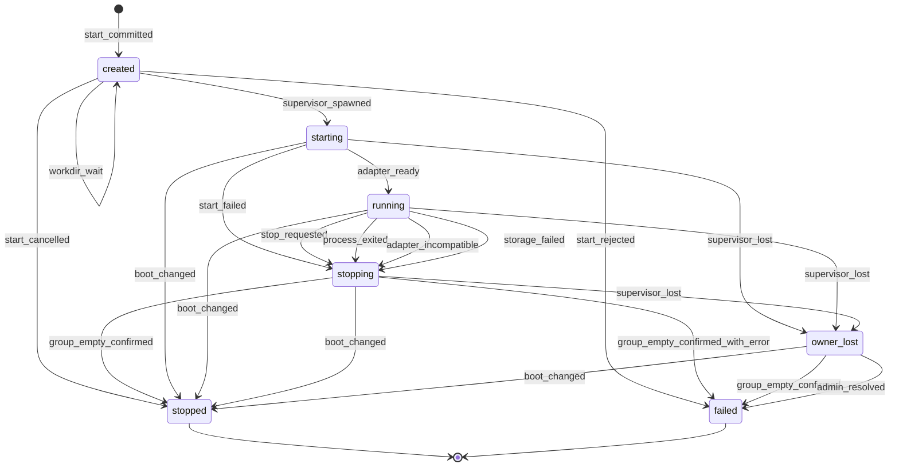
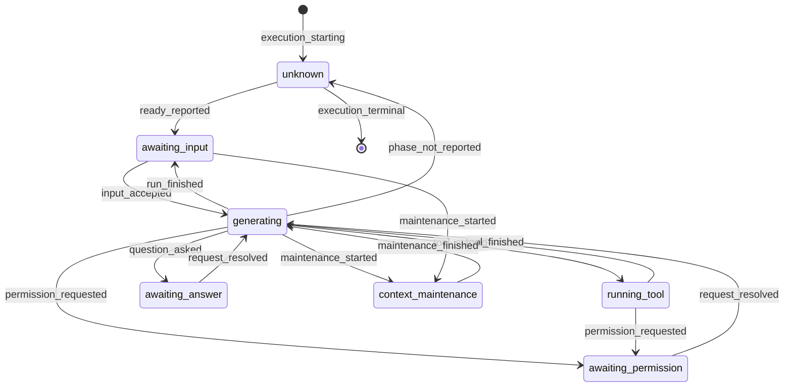
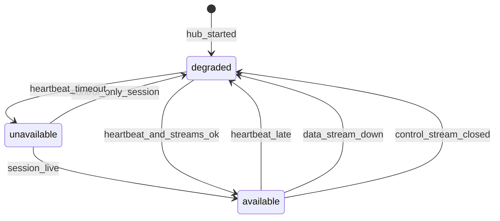
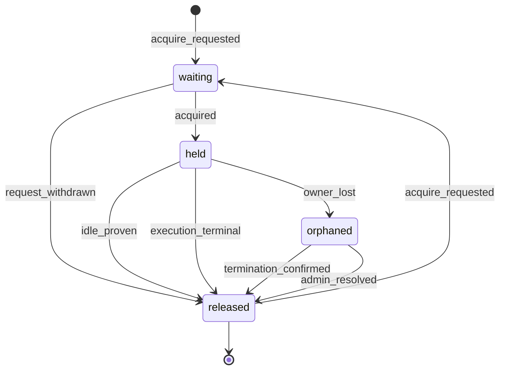
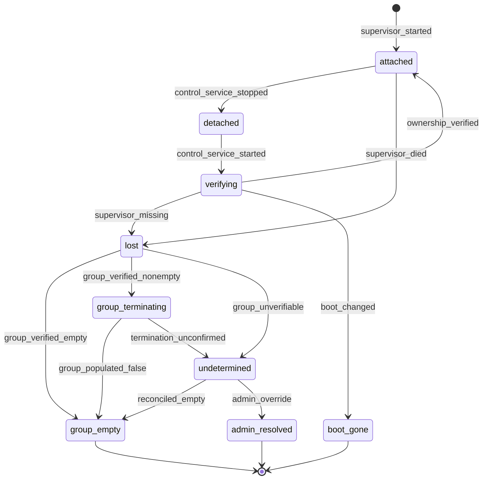
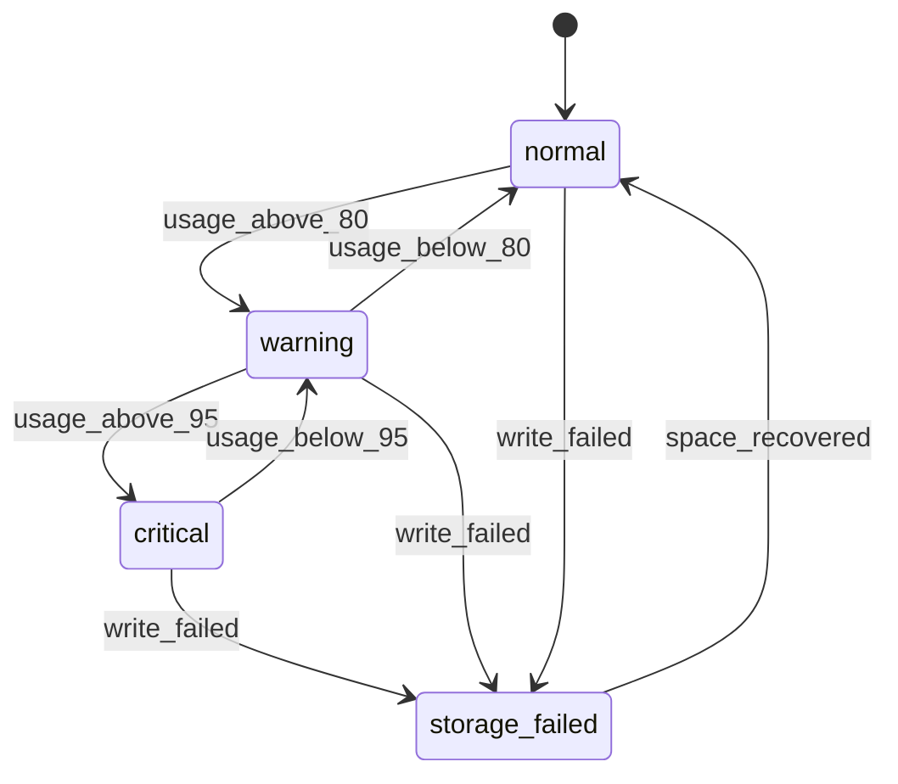

# Исполнение, машина, рабочий каталог, процессы

Словарь и метки хранения описаны в [README](README.md). Пошаговые протоколы для событий этого документа собраны в [recovery.md](recovery.md).

## 1. Жизненный цикл исполнения (§5, §6.1, §9)

Исполнение: одна попытка продолжить разговор в конкретном процессе агента. Источник истины для процессных фактов: воркер; хаб хранит последнее наблюдение и его давность. Все факты жизненного цикла от живого сопровождения, включая `execution_state`, `phase_changed`, `run_finished` и `journal_closed`, записываются в его `SJ` с fsync. Управляющая служба пишет такие факты в `CJ` только когда сопровождение не может их записать: `command_rejected` при отказе старта, `execution_state{stopped, start_cancelled}` до запуска сопровождения и `execution_state{owner_lost}`. Общего порядка между `CJ` и `SJ` нет (S-3).

| Состояние | Описание (§6.1) | Смысл |
| --- | --- | --- |
| `created` | создано | `PG-tx` создал исполнение (`execution_id`, поколение) и команду `start_execution`; процесса нет |
| `starting` | запускается | запись принадлежности в локальном журнале `ownership`, сопровождение запущено, CLI стартует |
| `running` | процесс работает | адаптер завершил handshake с CLI, native ID сохранён |
| `stopping` | останавливается | идёт штатная или принудительная остановка, либо CLI вышел и закрывается остаток группы |
| `stopped` | остановлено | группа ресурсов подтверждённо пуста, итог без ошибки исполнения |
| `failed` | завершено с ошибкой | старт не удался или процесс завершился с ошибкой; группа подтверждённо пуста либо выход разрешён административно |
| `owner_lost` | владелец потерян / исполнение не определено | сопровождение умерло или не подтверждено; завершение группы не доказано |

Итог (`outcome`) терминальных состояний:

| Состояние | `outcome` |
| --- | --- |
| `stopped` | `user_stop`, `normal_exit`, `machine_rebooted` (§9.4 «прерванным»), `start_cancelled`, `force_stopped` |
| `failed` | `start_rejected`, `start_failed`, `cli_incompatible`, `auth_required`, `crashed`, `protocol_incompatible`, `storage_failure`, `supervisor_died`, `admin_resolved` |

| Из | Событие | Условие | Действие | В |
| --- | --- | --- | --- | --- |
| нет | `start_committed` | явный старт нового разговора, resume или `resume_and_continue`; нет нетерминального исполнения разговора (E-1); разговор не удалён; машина разговора не ожидает сверки после restore (§18.1 п. 5) | `PG-tx`: исполнение с поколением `max + 1`, команда `start_execution` (агент, каталог, настройки, `native_conversation_id` для resume), удержание `execution_starting`, событие | `created` |
| `created` | `start_rejected` | воркер однозначно отказал до запуска: каталог вне разрешённых корней, CLI не найден или несовместим, нужен локальный вход, журнал не в `normal`, поколение не новее известного | `CJ`: квитанция; `PG-tx`: `failed(reason)`; автоповтора нет | `failed` |
| `created` | `workdir_wait` | каталог занят конфликтующим исполнением (§4) | `CJ`: место в локальной очереди владения; хабу удержание `workdir_busy(conflict)` | `created` |
| `created` | `start_cancelled` | владелец отменил старт до запуска сопровождения (линеаризация в `CJ`) | `CJ`, `PG-tx` | `stopped` |
| `created` | `supervisor_spawned` | владение каталогом получено; запись принадлежности записана в локальном журнале `ownership` до запуска CLI (§5) | сопровождение создаёт `SJ`, записывает `journal_opened` и `execution_state{starting}`, создаёт группу ресурсов, запускает CLI | `starting` |
| `starting` | `adapter_ready` | адаптер подтвердил протокол CLI (отображение ниже) | `SJ`: native ID; `PG-tx`: `running`, `native_conversation_id`, снять `execution_starting` и `no_live_execution` | `running` |
| `starting` | `start_failed` | CLI вышел, handshake не удался или истёк deadline запуска (§8.5) | сопровождение закрывает группу | `stopping` |
| `running` | `stop_requested` | команда `stop_execution` (штатно) или `force_stop` (принудительно) текущему поколению | `SJ`: намерение; штатно адаптер закрывает CLI, принудительно завершается подтверждённая группа | `stopping` |
| `running` | `process_exited` | CLI вышел сам: ошибка, лимит, нормальный выход | `SJ`: код выхода; сопровождение закрывает остаток группы (§10.2 «Завершение») | `stopping` |
| `running` | `adapter_incompatible` | обязательное событие неизвестного формата (§10.3); неизвестное необязательное событие только диагностируется | `SJ`: ошибка совместимости; управляемая остановка CLI; итог `failed(protocol_incompatible)` | `stopping` |
| `running` | `storage_failed` | запись в журнал невозможна (§6) | управляемая остановка; итог `failed(storage_failure)` | `stopping` |
| `stopping` | `group_empty_confirmed` | группа пуста по проверке группы, не по PID | `SJ`: итоговый `execution_state` и запись `journal_closed`; `PG-tx`: итог; владение каталогом освобождено; открытые запросы закрыты; передачи без результата → `acceptance_unconfirmed`; пауза очереди по [delivery.md](delivery.md) §3 | `stopped` или `failed` |
| `starting`, `running`, `stopping` | `supervisor_lost` | управляющая служба установила смерть сопровождения или не может его подтвердить (§5) | `CJ`, `PG-tx`: `owner_lost`, пауза `owner_lost`; владение каталогом `orphaned`; открытые запросы закрыты | `owner_lost` |
| `owner_lost` | `group_empty_confirmed` | сверка: группа пуста | `CJ`, `PG-tx`: `failed(supervisor_died)`; владение освобождено | `failed` |
| `owner_lost` | `admin_resolved` | явное административное решение после предупреждения | `CJ`, `PG-tx`: `failed(admin_resolved)` с флагом `termination_unconfirmed`; владение освобождено решением владельца | `failed` |
| любое с записью принадлежности | `boot_changed` | `boot_id` записи ≠ текущему: все процессы прошлой загрузки завершены | `CJ`, `PG-tx`: `stopped(machine_rebooted)`; владение освобождено; передачи без результата → `acceptance_unconfirmed`, если `reconcile` не доказал иное | `stopped` |

Отображение на CLI (факты этапа 0, README «Контракт адаптера»):

| Событие | Claude Code 2.1.310 | Codex 0.164.0 |
| --- | --- | --- |
| `adapter_ready` | процесс жив, MCP-сервер разрешений получил от него `initialize` и `tools/list` (`clientInfo.version` совпадает с закреплённой версией); native ID = `--session-id`, назначенный воркером, при resume прежний. `system/init` приходит только с первым вводом: тогда сверяются `claude_code_version` и статус `connected` нашего MCP-сервера, расхождение даёт `adapter_incompatible`; `permissionMode` оттуда показывается владельцу (решение владельца OD-3) | ответ `initialize` с `capabilities.experimentalApi` и процесс, запущенный с `--enable default_mode_request_user_input` (решение владельца OD-1); ответ `thread/start` или `thread/resume` с `thread.id`, действующими `approvalPolicy` и `sandbox` (решение владельца OD-3: показываются владельцу) |
| `stop_requested`, штатно | EOF stdin; если CLI ждёт живую фоновую работу и не выходит, SIGTERM (код 143, деревья Bash убиты) | EOF stdin: выход за ≈20 мс, с фоновым терминалом за ≈1 с, терминал завершён |
| `process_exited` | код 0 после EOF или SIGINT; код 1, если последний `result` был ошибкой или строка ввода битая. Выход после прерывания по SIGINT (решение владельца OD-2) является итогом команды `interrupt`: `stopped(user_stop)`, delivery.md §4 | код 0 после EOF, SIGINT или SIGTERM без активного хода; SIGTERM во время хода не проверялся |
| остаток группы после выхода | потомки Bash в собственных группах процессов; после SIGKILL CLI живут | после SIGKILL Node-обёртки живут нативный app-server, `codex-code-mode-host`, `bwrap` и команды |
| resume (E-9) | новый процесс с `--resume <session_id>`, тот же ID, прерванный ход не продолжается. Транскрипт старше `cleanupPeriodDays` (исходно 30 дней) CLI удаляет сам; resume такого разговора не проверялся, при отказе UI предлагает новый разговор | новый процесс, `thread/resume {threadId}`; прерванный ход хранится как `interrupted` |

Исполнение в `created` без записи принадлежности перезагрузку переживает: процесс не запускался, команда старта остаётся в `CJ` и выполняется после старта воркера.

**Инварианты**

- E-1: в разговоре не более одного нетерминального исполнения (`created` … `owner_lost`).
- E-2: потеря связи, истечение heartbeat, ошибки и завершение RPC не переводят исполнение в терминальное состояние и не дают права запустить копию агента (AT-C-03, AT-H-04, §9.1).
- E-3: после запуска сопровождения терминальное состояние наступает только по подтверждённо пустой группе ресурсов, смене `boot_id` или административному решению; `created` без сопровождения завершается только отказом или отменой старта.
- E-4: из `owner_lost` нет пути в `running`. **Предложение**: восстановление управления живым CLI в первой версии не реализуется. Причина: каналы stdin/stdout CLI принадлежали умершему сопровождению и доказуемо не восстанавливаются, а §9.5 допускает это только при доказательстве.
- E-5: resume и новое исполнение запрещены, пока предыдущее исполнение разговора нетерминально, в том числе в `owner_lost` (AT-C-15).
- E-6: PID без проверки группы ресурсов, времени старта и `boot_id` не используется ни для завершения, ни для присвоения процесса (AT-C-10).
- E-7: исполнение никогда не запускается и не перезапускается автоматически: ни после ошибки, ни после перезагрузки, ни при несовместимом CLI (AT-A-14, AT-C-07, AT-F-10).
- E-8: команды старого поколения не действуют на новое (AT-C-06).
- E-9: resume создаёт новое исполнение с новым поколением и прежним `native_conversation_id`; если адаптер не может продолжить, UI предлагает новый разговор (F-10, §10.2).

**Терминальные состояния**: `stopped`, `failed`. Поздние факты: события `SJ` этого исполнения (replay после reconnect или чтение журнала умершего сопровождения) дополняют историю: блоки могут финализироваться, появляются результаты инструментов и коды выхода. Состояние не возвращается, владение каталогом новых исполнений не затрагивается, очередь меняется только снятием `unconfirmed_delivery` при доказательстве приёма.

**Проверки**: AT-C-03, AT-C-06, AT-C-07, AT-C-09, AT-C-10, AT-C-15, AT-C-16, AT-A-14, AT-A-15, AT-F-10, AT-G-05, AT-G-08.

## 2. Фаза агента (§6.1)

Наблюдаемое измерение внутри `starting`, `running` и `stopping`; командами не задаётся. Источник: только факты адаптера; из тишины или живости процесса фаза не выводится.

| Фаза | Описание | Готовность к вводу | Влияние на очередь |
| --- | --- | --- | --- |
| `awaiting_input` | ожидает ввода | да, если наблюдена после последней передачи | открывает п. 2 затвора сопровождения |
| `generating` | формирует ответ | нет | |
| `running_tool` | исполняет инструмент | нет | |
| `awaiting_permission` | ждёт разрешения | нет | удержание `awaiting_user_request` |
| `awaiting_answer` | ждёт ответа пользователя | нет | удержание `awaiting_user_request` |
| `context_maintenance` | обслуживает контекст | нет | удержание `context_maintenance` |
| `unknown` | неизвестна | нет | UI: «агент работает; точная фаза неизвестна» |

Диаграмма показывает типичные переходы; любой факт адаптера может установить любую фазу. При терминальном исполнении фаза сбрасывается.

Отображение на CLI (факты этапа 0):

| Фаза | Claude Code 2.1.310 | Codex 0.164.0 |
| --- | --- | --- |
| `awaiting_input` | `result` хода; до первого ввода `adapter_ready` | `turn/completed` и `thread/status/changed` → `idle`; до первого хода `adapter_ready` |
| `generating` | `stream_event`, `assistant` текущего хода | `thread/status/changed` → `active` без флагов, `item/agentMessage/delta` |
| `running_tool` | `tool_use` в `assistant` до `tool_result` с тем же `tool_use_id` | `item/started` элемента `commandExecution` или `fileChange` до его `item/completed` |
| `awaiting_permission` | открыт вызов prompt tool, кроме `AskUserQuestion` | `activeFlags: ["waitingOnApproval"]` |
| `awaiting_answer` | открыт вызов prompt tool с `AskUserQuestion` | `activeFlags: ["waitingOnUserInput"]` (экспериментальная поверхность, решение владельца OD-1) |
| `context_maintenance` | на этапе 0 не наблюдалась; до проверки `unknown` | на этапе 0 не наблюдалась; до проверки `unknown` |

Сопутствующие наблюдения:

| Поле | Смысл |
| --- | --- |
| `last_confirmed_state_at` | время последнего подтверждённого состояния (часы хаба) |
| `last_agent_event_at` | время последнего события агента (часы хаба) |
| `background_work` | `count`, `list` или `unknown`; `unknown` не равно нулю |
| `service_retry` | **Предложение**: номер попытки, задержка до следующей и класс ошибки при повторе запроса к модели (Claude Code `system/api_retry`, Codex `error {willRetry: true}`); фаза остаётся `generating`, UI показывает «повтор запроса к модели». Причина: повторы идут минутами (Claude Code по умолчанию больше 3 мин, Codex без предела), а ТЗ §1 требует отличать задержку модели от отказа приложения |

Подсказки тишины (§6.1): через 15 с без событий во время активной работы UI показывает длительность тишины и состояние связи; через 60 с предлагает диагностику и прерывание. Автоматических действий нет: ни повтора ввода, ни объявления зависания, ни завершения (AT-C-08).

**Инварианты**: фаза не выводится из тишины, живости процесса или отсутствия текста (§6.1); готовностью считается только `awaiting_input`, наблюдённая после последней передачи (Q-2); «процесс жив» не показывается как прогресс модели.

**Терминальных состояний нет**: фаза существует, пока исполнение нетерминально. Поздние факты фазы от терминального исполнения игнорируются.

**Проверки**: AT-A-11, AT-C-08.

## 3. Связь с машиной (§6.1, §8.4, §8.6 п. 7)

Вычисляется хабом по монотонным часам: время с последнего прикладного heartbeat на канале управления и наличие обоих потоков. Пороги настраиваемые, исходно: heartbeat каждые 5 с, `degraded` после 15 с, `unavailable` после 30 с. HTTP/2 keepalive проверяет транспорт и heartbeat не заменяет.

| Состояние | Описание | Условие |
| --- | --- | --- |
| `available` | доступна | оба потока открыты, heartbeat не старше 15 с |
| `degraded` | связь ухудшилась | heartbeat 15–30 с, либо поток данных закрыт при живом управлении, либо поток управления закрыт менее 30 с назад, либо хаб стартовал менее 30 с назад и handshake ещё не было |
| `unavailable` | недоступна | heartbeat старше 30 с; 30 с после старта хаба без handshake |

Последствия:

| Состояние | Новые исполнения и выдача вводов | Прерывание, решения | Исполнения |
| --- | --- | --- | --- |
| `available` | разрешены (при сверенном сеансе) | идут | без изменений |
| `degraded` | запрещены (§8.4: без канала данных воркер не готов к новым запускам) | идут по управлению, если оно живо | без изменений |
| `unavailable` | запрещены | ждут в очереди команд хаба | без изменений; UI показывает недоступность и давность |

**Инварианты**: связь не меняет жизненный цикл исполнения и не даёт права на копию агента или автоматическое убийство процесса (E-2, AT-C-03). Сверенность сеанса отслеживается отдельно ([streams.md](streams.md) §1). Часы интервалов монотонные; часы машины для порогов не используются.

**Терминальных состояний нет**. Поздний heartbeat закрытого подключения (другой `connection_id`) не меняет состояние.

**Проверки**: AT-C-03, AT-C-08, AT-H-03, AT-H-04.

## 4. Владение рабочим каталогом (§5.1)

Владение принадлежит исполнению и действует во время запуска CLI, активной работы агента и его фоновых операций. Координация управляемых сессий на одной машине; не sandbox агента и не координация между машинами.

Конфликт двух каталогов: равенство или отношение предок/потомок. **Предложение**: идентичность каталога = пара (устройство, inode) после разрешения symlink; конфликт, если идентичности равны или идентичность одного встречается среди идентичностей предков другого при подъёме до корня. Причина: строковое сравнение путей не ловит symlink, разные пути и bind mount (AT-F-12).

**Предложение**: таблица владения хранится в `CJ`, все операции с ней сериализует управляющая служба под одной машинной блокировкой; сопровождение получает владение через IPC. Причина: проверка и получение должны быть атомарны относительно других запусков (§5.1), а файловые блокировки процесса снимаются ядром при его смерти, что противоречит правилу «владелец потерян, владение сохраняется».

| Состояние | Смысл |
| --- | --- |
| `waiting` | конфликт; исполнение стоит в локальной FIFO-очереди ожидания каталога |
| `held` | владение получено |
| `orphaned` | исполнение в `owner_lost`; владелец не определён, владение сохраняется |
| `released` | владения нет |

| Из | Событие | Условие | Действие | В |
| --- | --- | --- | --- | --- |
| нет, `released` | `acquire_requested` | перед запуском CLI и перед каждой передачей ввода, если владение не удерживается | под машинной блокировкой: вычислить идентичность, найти конфликтующих держателей | `waiting` |
| `waiting` | `acquired` | конфликтующих держателей нет, либо каждый покрыт действующим `shared_override` с этим исполнением и ни один не `orphaned` | `CJ`: запись владения; хабу снять `workdir_busy` | `held` |
| `waiting` | `conflict_persists` | конфликтующий держатель не освободил каталог | хабу удержание `workdir_busy(conflict_conversation_id)` | `waiting` |
| `waiting` | `request_withdrawn` | старт отменён, ввод отменён или отозван | `CJ` | `released` |
| `held` | `idle_proven` | адаптер подтвердил конец хода и ноль фоновых работ. Claude Code: `result` и пустой список `tasks` в последнем `system/background_tasks_changed`, плюс проверка группы ниже. Codex: `turn/completed` и пустой список экспериментального `thread/backgroundTerminals/list` (включён решением владельца OD-1), плюс та же проверка группы; на стабильной поверхности недостижим | `CJ`: освободить; разбудить первого ожидающего | `released` |
| `held` | `execution_terminal` | группа ресурсов подтверждённо пуста | `CJ`: освободить | `released` |
| `held` | `owner_lost` | | `CJ`: `orphaned` | `orphaned` |
| `orphaned` | `termination_confirmed` | §9.5: группа подтверждённо пуста | `CJ`: освободить | `released` |
| `orphaned` | `admin_resolved` | явное административное решение | `CJ`: освободить | `released` |

**Предложение** для обоих адаптеров: `idle_proven` дополнительно требует, чтобы в группе ресурсов исполнения не осталось процессов, кроме снимка её членов на момент `adapter_ready` (по PID и времени старта): процесс CLI, Node-обёртка и вспомогательные процессы Codex, MCP-серверы, включая унаследованные от владельца (OD-3). Причина: учёт CLI покрывает только его собственные фоновые задачи, а потомки команд уходят в собственные группы процессов и в этот учёт не попадают ([отчёт Claude Code](../stage0/claude-code.md) §5, [отчёт Codex](../stage0/codex.md) §6), тогда как §9.5 не позволяет считать ненаблюдаемое остановленным. Без этого доказательства владение держится до остановки исполнения (W-5).

Явное разрешение совместной работы (`shared_override`):

| Событие | Условие | Действие |
| --- | --- | --- |
| `shared_override_granted` | решение владельца для двух конкретных живых управляемых исполнений; ни одно не `owner_lost` | `PG-tx` и команда `allow_shared_workdir`; `CJ`: запись пары |
| `shared_override_expired` | любое из пары стало терминальным или `owner_lost` | `CJ`: удалить; на будущие исполнения и разговоры не переносится |

**Инварианты**

- W-1: два исполнения с конфликтующими каталогами не находятся одновременно в `held` без действующего override на эту пару (AT-F-11, AT-F-13).
- W-2: идентичность каталога определяется объектом файловой системы; symlink и разные пути не создают независимых блокировок (AT-F-12).
- W-3: `orphaned` не снимается ни override, ни обычным resume (AT-F-14, AT-C-16).
- W-4: restart управляющей службы не освобождает владение; таблица восстанавливается из `CJ` и подтверждённой принадлежности процессов (AT-F-12, AT-C-01).
- W-5: без доказательства отсутствия активной и фоновой работы владение держится до подтверждённой остановки исполнения.
- W-6: занятость каталога видна в очереди с указанием конфликтующего разговора.

**Терминальное состояние**: `released`. Поздний факт освобождения от старого поколения не трогает владение нового.

**Проверки**: AT-F-11…AT-F-14, AT-C-16, AT-C-01.

## 5. Принадлежность процессов и сопровождение (§4.4, §9.2, §9.5)

Запись принадлежности пишется с fsync в отдельный локальный журнал `ownership` до запуска CLI и содержит: `execution_id`, `execution_generation`, `boot_id`, PID и время старта сопровождения, PID и время старта CLI, идентификатор группы ресурсов, путь IPC-сокета и проверочное значение его секрета, `journal_id` журнала `SJ`, версию протокола воркер-сопровождение. Журнал `ownership` не отправляется хабу: он содержит локальные пути и SHA-256 секрета IPC. В отправляемом `CJ` этих данных нет. Запись проходит фазы `spawning`, `attached`, `released`; освобождение сохраняется с причиной.

**Предложение** (оформляется ADR, §21 п. 9): группа ресурсов = отдельная cgroup v2 на исполнение в делегированной пользовательской ветке systemd; наблюдение = pidfd сопровождения и событие `populated` группы; завершение = сигнал всем членам группы, затем принудительное завершение группы. Причина: cgroup переживает смерть родителя и restart службы, членство нельзя получить совпадением PID или имени, а `populated = 0` является проверяемым фактом пустоты группы. Этап 0 подтвердил необходимость: процессы инструментов обоих CLI уходят из группы процессов CLI в собственные группы и сессии и переживают SIGKILL CLI или Node-обёртки Codex, поэтому `killpg` недостаточно. Выбор cgroup v2 на исполнение (systemd user scope) принят по итогам этапа 0, ADR на этапе 1 ([сводка этапа 0](../stage0/README.md) §6).

Автомат связи управляющей службы с сопровождением:

| Состояние | Смысл |
| --- | --- |
| `attached` | IPC открыт и аутентифицирован, принадлежность подтверждена |
| `detached` | управляющая служба остановлена или перезапускается; сопровождение работает автономно |
| `verifying` | служба после старта проверяет запись: `boot_id`, PID и время старта, секрет IPC, поколение, `SJ` |
| `lost` | сопровождение мертво или не подтверждено при том же `boot_id`; исполнение `owner_lost` |
| `group_terminating` | идёт завершение подтверждённой группы |
| `group_empty` | группа подтверждённо пуста |
| `undetermined` | принадлежность или завершение установить нельзя |
| `boot_gone` | запись относится к прошлой загрузке ОС |
| `admin_resolved` | выход по административному решению |

| Из | Событие | Условие | Действие | В |
| --- | --- | --- | --- | --- |
| `attached` | `control_service_stopped` | штатный restart или обновление бинарника | сопровождение продолжает работу и пишет `SJ`; запросы разрешений ждут | `detached` |
| `detached` | `control_service_started` | | служба берёт локальную блокировку единственного экземпляра, читает записи принадлежности | `verifying` |
| `verifying` | `ownership_verified` | `boot_id` совпадает, сопровождение с этим PID и временем старта живо, IPC-секрет и поколение подтверждены | восстановить таблицу владения; принять `SJ` в отправку | `attached` |
| `verifying` | `boot_changed` | `boot_id` записи ≠ текущему | исполнение `stopped(machine_rebooted)` | `boot_gone` |
| `verifying` | `supervisor_missing` | тот же `boot_id`, сопровождение не живо или не прошло проверку | исполнение `owner_lost` | `lost` |
| `attached` | `supervisor_died` | pidfd сигнализирует выход, IPC закрыт | исполнение `owner_lost` | `lost` |
| `lost` | `group_verified_empty` | группа существует и пуста | исполнение `failed(supervisor_died)` | `group_empty` |
| `lost` | `group_verified_nonempty` | в группе есть процессы | **Предложение**: служба сама завершает только членов подтверждённой группы. Причина: CLI без сопровождения не может получить ввод или решение, а §9.5 требует подтвердить остановку старой группы (README, вопрос 4) | `group_terminating` |
| `group_terminating` | `group_populated_false` | группа опустела | исполнение `failed(supervisor_died)` | `group_empty` |
| `lost`, `group_terminating` | `group_unverifiable`, `termination_unconfirmed` | группа недоступна, процессы вне группы с признаками принадлежности, завершение не подтверждено | владение каталогом `orphaned`, новые исполнения разговора запрещены; UI: диагностика, повтор сверки, адресная остановка подтверждённых ресурсов, административное решение | `undetermined` |
| `undetermined` | `reconciled_empty` | повторная сверка: группа пуста | исполнение `failed(supervisor_died)` | `group_empty` |
| `undetermined` | `admin_override` | явное административное решение с предупреждением | исполнение `failed(admin_resolved)`, `termination_unconfirmed` | `admin_resolved` |

Правила §9.2: неизвестный сокет или процесс без записи принадлежности не присваивается по каталогу, имени или PID. Обновление бинарника не перезапускает живые сопровождения; если версия протокола воркер-сопровождение вне объявленного окна совместимости, исполнение получает видимое состояние `supervisor_protocol_incompatible`, а остановка старой версии выполняется отдельным видимым действием (AT-C-14).

**Инварианты**

- O-1: процесс завершается или присваивается только через подтверждённую группу ресурсов; посторонние процессы не затрагиваются (AT-C-10, AT-C-16).
- O-2: пока принадлежность или завершение не установлены, исполнение остаётся `owner_lost`, владение каталогом сохраняется, resume и override запрещены (AT-C-15, AT-C-16).
- O-3: отсутствие наблюдаемости фоновой работы не считается доказательством остановки (§9.5).
- O-4: restart управляющей службы не меняет PID и время старта сопровождения и CLI (AT-C-01).

**Терминальные состояния**: `group_empty`, `boot_gone`, `admin_resolved`; запись принадлежности после них хранится до терминального состояния исполнения в PG и затем компактируется. Поздние факты из `SJ` умершего сопровождения дополняют историю исполнения (R3).

**Проверки**: AT-C-01, AT-C-10, AT-C-14, AT-C-15, AT-C-16.

## 6. Отключение хаба и заполнение журнала машины (§9.3)

Работа машины без связи с хабом:

| Что | Поведение |
| --- | --- |
| текущий ход | продолжается, пока журнал не в `critical` и не нужно решение пользователя; события пишутся в `SJ` |
| запрос разрешения или вопрос | ждёт по политике сопровождения (`wait` по умолчанию, `deny_after` только явной настройкой, [delivery.md](delivery.md) §5); отсутствие связи не означает согласие |
| следующий ввод | не поступает: выдача идёт только с хаба |
| прерывание | ждёт на хабе вместе с паузой очереди; локальной автоматической остановки нет |
| исполнения | не завершаются из-за потери связи (E-2) |
| журнал | растёт, потому что подтверждений хаба нет; пороги ниже |

Общий предел журналов (`CJ` и все `SJ`) на машину, исходно 1 ГиБ с настраиваемым резервом. **Предложение**: порог `critical` 95 %. Причина: ТЗ задаёт только 80 % и «риск исчерпания», а 5 % от 1 ГиБ хватает на управляемую остановку.

| Состояние | Условие | Последствия |
| --- | --- | --- |
| `normal` | < 80 % | ограничений нет |
| `warning` | ≥ 80 % | новые исполнения отклоняются (`start_rejected(storage_low)`), выдача новых вводов удерживается (`storage_low`), предупреждение владельцу; текущий ход продолжается (README, вопрос 10) |
| `critical` | ≥ 95 % | приостановить чтение вывода CLI, если адаптер объявил это безопасным; иначе управляемая остановка: interrupt, затем `stop_execution`. Этап 0 безопасность приостановки не проверял ни для одного CLI, поэтому оба адаптера объявляют её небезопасной |
| `storage_failed` | запись в журнал невозможна | исполнение `failed(storage_failure)`; UI: отказ хранения и возможный неполный вывод |

Место освобождает компактация подтверждённых диапазонов ([streams.md](streams.md) §3); при недоступном хабе подтверждений нет, поэтому журнал только растёт.

**Инварианты**: беззвучного удаления неподтверждённых данных нет; компактация не трогает неподтверждённые записи, незавершённые команды и минимальные квитанции; причина деградации видна владельцу (AT-C-13). Нулевые потери гарантируются только для подтверждённых команд и зафиксированных событий; байты, которые агент выдал, но которые ещё не записаны надёжно, не обещаются (§9.3).

**Терминальных состояний нет**; `storage_failed` покидается, когда место освобождено, но исполнения, остановленные из-за него, не возобновляются сами (E-7).

**Проверки**: AT-C-13, AT-D-04.

## 7. Сводка последствий сбоев

Пошаговые протоколы: [recovery.md](recovery.md).

| Событие | Исполнение | Фаза | Связь | Владение каталогом | Очередь | Ввод в `transmitting` |
| --- | --- | --- | --- | --- | --- | --- |
| restart управляющей службы (§9.2) | без изменений | без изменений, наблюдение устаревает | `degraded` → `available` после reconnect | сохраняется | удержание `machine_not_reconciled` | без изменений: сопровождение живо |
| отключение хаба (§9.3) | без изменений | без изменений | `unavailable` | сохраняется | удержание | без изменений |
| смерть сопровождения (§9.5) | `owner_lost` | сброс | без изменений | `orphaned` | пауза `owner_lost` | `acceptance_unconfirmed`; ввод без намерения передачи возвращается в `queued` |
| перезагрузка машины (§9.4) | `stopped(machine_rebooted)` | сброс | `unavailable` → `available` | освобождается | пауза `process_exited` | `acceptance_unconfirmed`, если `reconcile` не доказал приём |
| restart хаба | без изменений | наблюдение устаревает до сверки | все `unavailable` до handshake | без изменений | удержание до сверки машины | без изменений |
| restore (§18.1) | старые активные статусы неподтверждённые | сброс | до сверки в новом поколении | по фактам машины | пауза `restore_pending` | классификация R7 |
