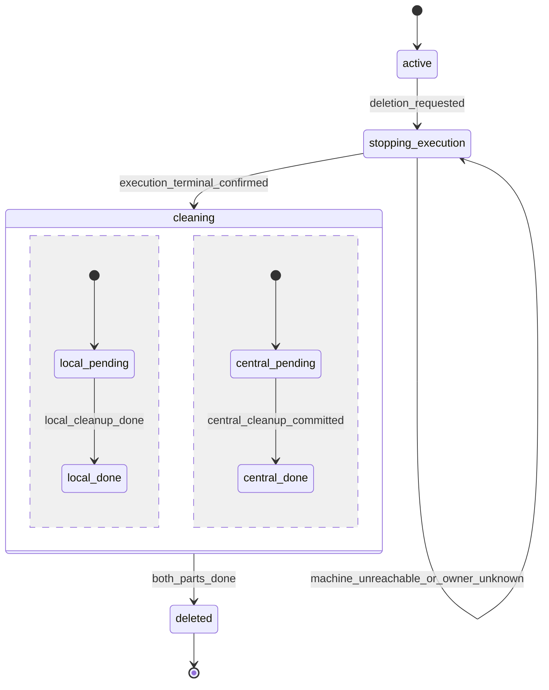
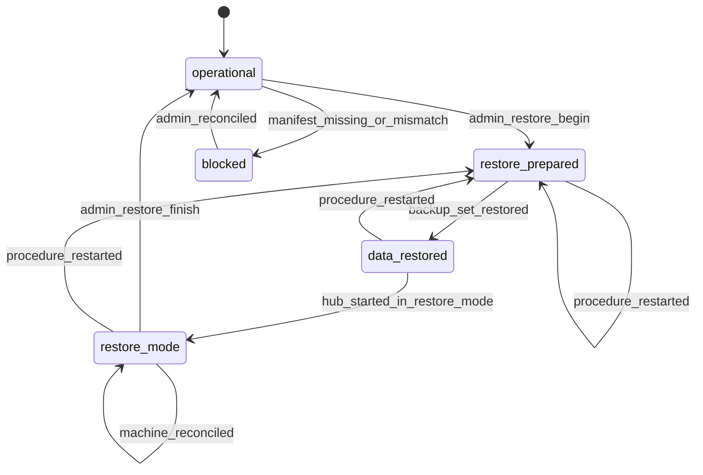

# Протоколы восстановления

Пошаговые последовательности поверх автоматов из [delivery.md](delivery.md), [execution.md](execution.md) и [streams.md](streams.md). Словарь и метки хранения описаны в [README](README.md). Общие правила для всех протоколов:

- никакой протокол не повторяет ввод или решение после `transmission_started` (I-12);
- никакой протокол не запускает исполнение CLI и не выполняет resume сам (E-7); процесс Codex только для чтения истории (R3 шаг 4, R4 шаг 3) исполнением не является: без `thread/resume` и без хода;
- транспортная ошибка не является фактом остановки агента (S-1);
- поздние факты дополняют историю старых объектов и не оживляют их.

## R1. Обычный restart хаба (§17, §18, §18.1)

| Шаг | Действие | Проверки |
| --- | --- | --- |
| 1 | Прочитать `MF`. Эксплуатационный старт только если манифест есть, `installation_id` совпадает с PG, `restore_generation` совпадает с PG и флаг незавершённого restore снят. Иначе административный режим без выдачи команд; манифест из БД молча не создаётся. | AT-C-17, AT-G-13 |
| 2 | Миграции выполняет только владелец миграционной блокировки. | AT-G-07 |
| 3 | Readiness положительна только при доступном PostgreSQL; без него изменяющие запросы не получают успешного durable-подтверждения. | AT-C-11 |
| 4 | Все сеансы машин начинаются `disconnected`; удержание `machine_not_reconciled` действует для всех их разговоров. Состояния исполнений не меняются, их наблюдение помечается устаревшим. | AT-C-02 |
| 5 | Доставщик читает из PG команды `pending` и ждёт сеансов. | AT-A-04 |
| 6 | Воркеры переподключаются с backoff; handshake с прежним поколением; сверка: replay журналов с закоммиченного номера + 1, повтор команд без `command_stored`, запрос статусов нетерминальных команд, сверка исполнений (таблица ниже). | AT-C-02, AT-C-04 |
| 7 | После сверки машины удержание снимается; найденные `acceptance_unconfirmed` ставят паузу `unconfirmed_delivery`; активная очередь без других причин продолжает выдачу сама. | AT-A-16 |
| 8 | Браузеры переподключают WSS и подписываются с курсоров; события, записанные воркерами во время простоя хаба, приходят в исходном порядке своих журналов. | AT-C-02, AT-B-09 |

Точки сбоя на пути ввода:

| Сбой | Результат после restart | Почему без дублей |
| --- | --- | --- |
| хаб упал до commit | клиент не получил успеха; повтор тем же ключом создаёт ровно одну операцию | I-3, I-5 (AT-A-03) |
| после commit, до отправки воркеру | команда `pending` в PG, доставляется после reconnect | outbox в PG (AT-A-04) |
| после отправки, до `command_stored` | команда пересылается | дедупликация `CJ` (AT-A-05) |
| после `command_stored`, статус не закоммичен | воркер повторяет статус из журнала | монотонные статусы (I-13) |
| после `transmission_started`, до результата | сопровождение живо и само получит результат, хаб узнает его при replay | хаб в передаче не участвует |

Сверка исполнений (хаб против отчёта воркера):

| Хаб | Воркер | Решение |
| --- | --- | --- |
| нетерминальное | то же поколение живо, принадлежность подтверждена | принять, обновить фазу и давность |
| нетерминальное | терминальное с фактами | применить как поздний факт |
| нетерминальное | `owner_lost` | применить, пауза `owner_lost` |
| `created` | старт не получен | обычный повтор `start_execution` |
| `starting` и далее | исполнение неизвестно при прежнем `cj_journal_id` | `state_divergence`: исполнение `owner_lost` с этой причиной, пауза, административная диагностика |
| записи нет | живое исполнение с записью принадлежности, поколение прежнее | `state_divergence`: хаб потерял данные без процедуры restore; выдача по машине удерживается, административная диагностика |
| любое | `cj_journal_id` изменился | `local_state_reset`: нетерминальные команды машины неподтверждённые, ни одного вывода «не передано»; если сменился и `boot_id`, исполнения прошлой загрузки `stopped(machine_rebooted)`, иначе `owner_lost` |

## R2. Restart управляющей службы воркера (§9.2)

| Шаг | Действие | Проверки |
| --- | --- | --- |
| 1 | Взять локальную блокировку единственного экземпляра; второй экземпляр на той же машине завершается с диагностикой и ничего не перехватывает. | AT-C-05 |
| 2 | Открыть `CJ`, проверить контрольные суммы, отделить повреждённый хвост (карантин, факт `journal_tail_corrupted`). | AT-C-12 |
| 3 | Для каждой записи принадлежности пройти автомат [execution.md](execution.md) §5: `verifying` → `attached`, `boot_gone` или `lost`. Неизвестные сокеты и процессы не присваиваются. | AT-C-01, AT-C-10 |
| 4 | Восстановить таблицу владения каталогами из `CJ` для подтверждённых исполнений; владение `owner_lost` остаётся `orphaned`. | AT-F-12 |
| 5 | Проверить версию протокола каждого живого сопровождения; вне окна совместимости: видимое состояние `supervisor_protocol_incompatible`, сопровождение не останавливается само. | AT-C-14 |
| 6 | Подключиться к хабу (streams.md §1), повторить неподтверждённые записи `CJ` и всех `SJ`, получить неотправленные команды. | AT-C-04 |
| 7 | Новые исполнения запускаются новым бинарником; старые сессии продолжают работать на старом. | AT-C-14 |

Во время простоя службы сопровождения работают автономно: CLI получает уже переданные данные, события пишутся в `SJ`, запросы разрешений ждут по политике `wait`. PID и время старта сопровождения и CLI не меняются (AT-C-01).

## R3. Смерть сопровождения (§9.5)

| Шаг | Действие | Проверки |
| --- | --- | --- |
| 1 | Обнаружение: pidfd сопровождения сигнализирует выход или IPC закрыт; при старте службы запись не проходит проверку при прежнем `boot_id`. | AT-C-15 |
| 2 | `CJ`: исполнение `owner_lost`, владение каталогом `orphaned`. Хабу: `PG-tx` с `owner_lost`, паузой `owner_lost`, закрытием открытых запросов (`execution_owner_lost`). | AT-C-15 |
| 3 | Служба читает `SJ` умершего сопровождения только для чтения: неподтверждённые события уходят хабу как поздние факты; команда с `transmission_started` без результата → `acceptance_unconfirmed`; команда без намерения передачи в целом журнале → `withdrawn`, ввод возвращается в `queued`; команда в повреждённой области → `acceptance_unconfirmed`. | AT-A-06 |
| 4 | `reconcile` неподтверждённых команд по нативной истории: положительное доказательство переводит в `accepted`, отсутствие записи ничего не доказывает (полноты нет ни у одного CLI). Claude Code: чтение файла транскрипта без процесса CLI, разбор закреплён за версией CLI и отключён для неизвестной версии; выполняется сразу. Codex: история читается только отдельным процессом app-server (`thread/turns/list`, `thread/items/list` без `thread/resume`). **Предложение**: для Codex этот шаг выполняется после шага 5 или 6, когда старая группа подтверждённо пуста, и не выполняется в шаге 7. Причина: §9.5 запрещает новый CLI до подтверждённого завершения прежнего (README, вопрос 4). | AT-A-07 |
| 5 | Опись группы ресурсов по группе, не по PID и имени. Пустая: исполнение `failed(supervisor_died)`, владение освобождено. | AT-C-10, AT-C-16 |
| 6 | Непустая: **Предложение** (README, вопрос 4): завершение членов подтверждённой группы (сигнал завершения, ожидание, затем принудительное завершение группы), ожидание `populated = 0`, затем как шаг 5. | AT-C-16 |
| 7 | Принадлежность или завершение не устанавливаются: исполнение остаётся `owner_lost`, владение сохраняется, новые исполнения и override запрещены. UI: диагностика, повтор сверки, адресная остановка подтверждённых ресурсов, административное решение с предупреждением. | AT-C-16, AT-F-14 |
| 8 | После выхода из `owner_lost` владелец явно делает resume (новое исполнение, новое поколение, прежний native ID) и отдельно `continue_queue` (или составное действие). Второй CLI до этого не существует. | AT-C-15, AT-A-17 |

## R4. Перезагрузка машины (§9.4)

| Шаг | Действие | Проверки |
| --- | --- | --- |
| 1 | Служба воркера стартует (systemd), берёт блокировку единственного экземпляра, открывает `CJ` (R2 шаги 1–2). | AT-C-05 |
| 2 | Записи принадлежности с другим `boot_id`: процессы прошлой загрузки завершены вместе с её группами ресурсов. Исполнения `stopped(machine_rebooted)`, владение освобождено. Старое исполнение по записи БД не объявляется работающим. | AT-C-07 |
| 3 | Каждый `SJ` прошлой загрузки читается: неподтверждённые события уходят хабу; передачи без результата проходят `reconcile` по нативной истории (Claude Code: транскрипт, разбор закреплён за версией; Codex: отдельный процесс app-server только для чтения, допустим сразу, потому что процессы прошлой загрузки завершены) и при положительном доказательстве становятся `accepted`, иначе `acceptance_unconfirmed`. | AT-A-06, AT-A-07 |
| 4 | Исполнения `created` без записи принадлежности стартуют как обычно: процесс не запускался. | |
| 5 | Хаб после сверки: исполнения терминальны, очередь на паузе `process_exited`, история доступна. | AT-C-07, AT-A-14 |
| 6 | Автоматического resume нет; старый неопределённый ввод и текст «продолжай» от имени пользователя не отправляются. Продолжение: явный resume создаёт новое исполнение того же разговора. | AT-C-07 |

## R5. Reconnect потоков с потерянными ACK (§8.4, §8.6)

| Шаг | Действие | Проверки |
| --- | --- | --- |
| 1 | Любое завершение потока (deadline, `CANCELLED`, `UNAVAILABLE`, `GOAWAY`, конец stream) переводит сеанс в `backoff`; исполнения и фазы не меняются; ввод не повторяется. | AT-H-04 |
| 2 | Backoff с jitter, новый `connection_id`, handshake с точками продолжения. | AT-H-07 |
| 3 | Replay и повтор команд по таблице ниже. | AT-C-04, AT-H-02 |
| 4 | Сверка статусов нетерминальных команд и исполнений, затем `live`; удержание снимается по правилам очереди. | AT-A-16 |

| Что потеряно | Что происходит после reconnect | Почему нет дублей |
| --- | --- | --- |
| `event_range_ack` | воркер повторяет записи с номера, закоммиченного хабом, + 1 | уникальный ключ записи в PG; повтор подтверждается без вставки |
| запись дошла до stream, но не закоммичена | повтор того же ключа | хаб коммитит один раз |
| `command_stored` | хаб пересылает команду | дедупликация `CJ`, ответ текущей квитанцией |
| статус команды | воркер повторяет из журнала | статусы монотонны (I-13) |
| команда не дошла до машины | `pending` пересылается | |
| ACK хаба на статусы | статусы повторяются | идемпотентное применение |

Библиотечный retry или повторное открытие RPC не создают второго действия: команда исполняется по `command_id` один раз, передача по `command_id` начинается один раз (AT-H-05). При 200 мс RTT и 1 % потерь те же правила дают отсутствие потерь подтверждённых данных и самопроизвольных повторов (AT-G-10).

## R6. Удаление разговора (§14.1)

| Состояние | Смысл |
| --- | --- |
| `active` | разговор существует |
| `stopping_execution` | tombstone записан, вводы, resume и выдача запрещены; ждём подтверждённой остановки исполнения |
| `cleaning` | две независимые части: локальная (`local_pending` → `local_done`) и центральная (`central_pending` → `central_done`) |
| `deleted` | обе части подтверждены; остаётся только tombstone |

**Предложение** (README, вопрос 6): после шага 2 центральная и локальная очистка идут независимо. Причина: п. 5 и AT-F-20 требуют отдельных статусов и ожидания локальной части при уже возможной центральной, а tombstone достаточно, чтобы отклонять поздние факты.

| Шаг | Из | Событие | Действие | В |
| --- | --- | --- | --- | --- |
| 0 | `active` | подтверждение в UI | UI прямо сообщает, что нативная история CLI сохраняется и удаляется штатными средствами агента. Claude Code: транскрипт в `~/.claude/projects`, CLI сам удаляет его через `cleanupPeriodDays` (исходно 30 дней), вручную `claude purge`. Codex: тред в `~/.codex/sessions`, виден в истории Codex владельца с `source: "vscode"`, удаление `thread/delete`. Расположение ожидает решения владельца (OD-3): при отдельном каталоге конфигурации история лежит в каталоге воркера | |
| 1 | `active` | `deletion_requested` | `PG-tx`: tombstone (`conversation_id`, максимальное поколение, машина), очередь `closed`, запрет вводов, resume и выдачи; отзыв невыполненной выдачи; событие «удаление ожидается». **Предложение**: удаление необратимо с этого момента (README, вопрос 12). Причина: tombstone уже разослан клиентам и запретил вводы, а протокола отмены ТЗ не описывает | `stopping_execution` |
| 2 | `stopping_execution` | | при нетерминальном исполнении команда `stop_execution`; при задержке UI предлагает `force_stop`; автоматического убийства нет. Недоступная машина или `owner_lost`: ожидание, разговор можно скрыть из списка, удаление не объявляется завершённым | `stopping_execution` |
| 2 | `stopping_execution` | `execution_terminal_confirmed` | исполнение терминально по [execution.md](execution.md) §1 (включая выход из `owner_lost` по §9.5) | `cleaning` |
| 3 | `local_pending` | `local_cleanup_done` | команда `delete_conversation_local`; воркер удаляет свои копии вложений и содержимое журналов этого разговора, не трогая чужие; оставляет минимальные квитанции (ID, поколения, классы) и квитанцию удаления; ответ после fsync | `local_done` |
| 4 | `central_pending` | `central_cleanup_committed` | `PG-tx`: удалить историю, вводы, блоки, запросы, метаданные; снять ссылки на вложения, blob освобождается сборщиком только без других действующих ссылок; событие удаления; подключённые клиенты очищают приватные данные разговора | `central_done` |
| 5 | `cleaning` | `both_parts_done` | статус «удаление завершено» для данных продукта | `deleted` |

**Инварианты**: «удаление завершено» только после подтверждения обеих частей (AT-F-18); пока исполнение не остановлено подтверждённо, локальная и центральная очистка не начинаются; очистка не затрагивает журналы и вложения других разговоров; tombstone не удаляется и не заменяется; разговор не возрождается ни поздней командой, ни событием, ни старым журналом.

**Терминальное состояние**: `deleted`. Поздние факты: команды, события и replay журнала для удалённого разговора получают от хаба конечную квитанцию `conversation_deleted`; воркер по ней очищает соответствующий повтор, не запускает агент и не повторяет попытки (AT-F-19). Неподключённый клиент получает tombstone при следующей сверке до попытки отправить сохранённый ввод (AT-F-20). Tombstone хранится без содержимого бессрочно в пределах инсталляции. Связь с restore: R7, факты новее бэкапа.

**Проверки**: AT-F-18…AT-F-20.

## R7. Restore с новым поколением (§18.1, §8.4)

### Режим хаба

| Состояние | Смысл |
| --- | --- |
| `operational` | обычная работа |
| `restore_prepared` | хаб остановлен, выдача отключена; в `MF` флаг restore и новое случайное поколение (§18.1 п. 1) |
| `data_restored` | восстановлен согласованный набор PostgreSQL и blobs |
| `restore_mode` | хаб запущен в режиме restore: набор проверен, новое поколение записано в PG, все очереди на паузе `restore_pending`, старые активные статусы неподтверждённые, новые исполнения запрещены; идёт сверка машин |
| `blocked` | манифеста нет или поколения расходятся вне процедуры: эксплуатационный старт запрещён |

Статус сверки каждой машины: `unverified` → `reconciling` → `verified`; либо `unreachable` (остаётся в ожидании), либо `local_state_lost` (журнал машины утерян или сброшен).

### Шаги

| Шаг §18.1 | Действие | Проверки |
| --- | --- | --- |
| 1 | Административная процедура: хаб остановлен, в `MF` флаг restore и новое случайное `restore_generation`, не зависящее от старого значения БД. На новом сервере манифест инициализирует процедура restore, а не обычный старт. | AT-G-13 |
| 2 | Восстановить PG и blobs как согласованный набор; хаб стартует в `restore_mode`: проверка набора, пауза `restore_pending` всем очередям, старые активные статусы исполнений и вводов неподтверждённые, новые исполнения запрещены. Процессы из бэкапа не выдумываются. | AT-G-08 |
| 3 | Каждый воркер при handshake видит новое поколение (`restore_reconciling`): не компактирует журналы, не исполняет обычные команды и сообщает факты: живые исполнения с записями принадлежности, квитанции всех известных команд, диапазоны журналов (первый хранимый, последний, подтверждённый прежним хабом), максимальное поколение по разговорам, квитанции удаления, нативное состояние агента, если адаптер умеет. Исторические факты дополняют старые исполнения и не становятся новыми командами; ID команд не меняются. | AT-G-11 |
| 4 | Классифицировать каждую восстановленную команду (таблица ниже). Неполный или очищенный журнал не доказывает непередачу. Доказанно исполненная команда не выдаётся повторно; неопределённая не выдаётся автоматически. | AT-G-11, AT-G-12 |
| 5 | Счётчик поколений каждого разговора поднять выше максимума, сообщённого машиной; только после этого машина `verified`, а её разговоры могут получить новые исполнения. Воркер сохраняет новое поколение только после подтверждения сверки хабом, поэтому сбой посреди сверки повторяет её. | README, вопрос 7 |
| 6 | Владелец явно подтверждает продолжение очередей сверенных разговоров (`continue_queue` снимает `restore_pending`). Недоступная машина остаётся `unreachable`, её разговоры на паузе; сверка остальных не делает её проверенной. | AT-G-12 |
| 7 | Снять общий флаг restore в `MF` можно при наличии отчёта восстановления и с сохранением всех локальных запретов для непроверенных объектов. | AT-G-13 |

Классификация команды (§18.1 п. 4):

| Класс | Условие | Действие |
| --- | --- | --- |
| `executed_confirmed` | квитанция машины `accepted` или `applied`, либо доказательство адаптера по нативной истории | статус «принято»; повторно не выдаётся |
| `refused_or_cancelled_confirmed` | квитанция `cancelled`, `rejected` или `withdrawn` без `transmission_started` | соответствующий статус; отозванный ввод возвращается в `queued` (очередь на паузе) |
| `safe_to_dispatch` | **Предложение**: `cj_journal_id` не менялся с момента сопряжения, хвост `CJ` не повреждался, а квитанции этого `command_id` нет. Причина: по I-9 квитанции не компактируются, пока разговор жив, значит их отсутствие в целом `CJ` доказывает, что машина команду не получала | ввод возвращается в `queued`; выдача только после шага 6 |
| `undetermined` | `transmission_started` без результата; `CJ` утерян или сброшен; машина недоступна; квитанции нет, а полнота не доказана | `acceptance_unconfirmed` или аналог для решения; автоматическая выдача запрещена; владелец может создать новый ввод с `retry_of` |

Команды других видов: `start_execution`, для которого машина сообщает более новое живое исполнение, становится `superseded` и не выдаётся; `interrupt` терминального исполнения `not_applicable`; решения по запросам закрытых исполнений `decision_not_applied`.

Факты новее бэкапа (README, вопрос 5):

| Факт на машине | Действие |
| --- | --- |
| записи журналов после закоммиченного номера | дополнить историю старых исполнений; компактированные интервалы попадают в отчёт как невосстановимые, текст с разрывом не финализируется |
| квитанции команд, неизвестных восстановленной БД | только в отчёт; новых команд из них не создаётся |
| живое исполнение известного разговора без записи в БД | **Предложение**: зарегистрировать наблюдённое исполнение с поколением из записи принадлежности, очередь на паузе `restore_pending`; без автоматической остановки |
| живое исполнение неизвестного разговора | **Предложение**: в отчёт как «исполнение вне восстановленных данных»; разговор не создаётся; доступны диагностика и адресная остановка по решению владельца |
| квитанция удаления разговора, живого в бэкапе | tombstone не считается восстановленным автоматически; **Предложение**: разговор помечается «удалён после точки восстановления» и остаётся на паузе до решения владельца (повторить удаление или оставить) |

Причина трёх предложений таблицы: §18.1 запрещает выдумывать процессы и скрыто повторять действия, а автоматическая остановка или удаление были бы действием без решения владельца.

Отчёт restore перечисляет: точку восстановления, восполненные факты, неизвестные результаты, невосстановимые интервалы, непроверенные машины, исполнения и разговоры вне бэкапа. Такой restore может потерять более позднюю историю, но не повторяет действия, чтобы её воссоздать.

Прерванная процедура: флаг в `MF` остаётся, эксплуатационный старт невозможен; повтор процедуры начинается с шага 1 с новым поколением, сверка идемпотентна и не повторяет пользовательские действия (AT-G-13).

**Инварианты**

- RS-1: эксплуатационная выдача команд невозможна без манифеста, при расхождении поколений или при поднятом флаге restore (AT-G-13).
- RS-2: смена поколения не меняет `command_id` и не обходит дедупликацию машины (I-7, I-9).
- RS-3: доказанно исполненная команда не выдаётся повторно; неопределённая не выдаётся автоматически (AT-G-11).
- RS-4: неполный, очищенный или утерянный журнал не доказывает непередачу (AT-G-12).
- RS-5: несверенная машина не становится проверенной из-за сверки других; её разговоры остаются на паузе.
- RS-6: обычный restart хаба не меняет поколение и не включает режим restore (AT-C-17).

**Терминальных состояний нет**: режим возвращается в `operational`. Поздние факты от машины, сверенной позже снятия общего флага, проходят ту же классификацию для её разговоров.

**Проверки**: AT-G-08, AT-G-11…AT-G-13, AT-C-17.
