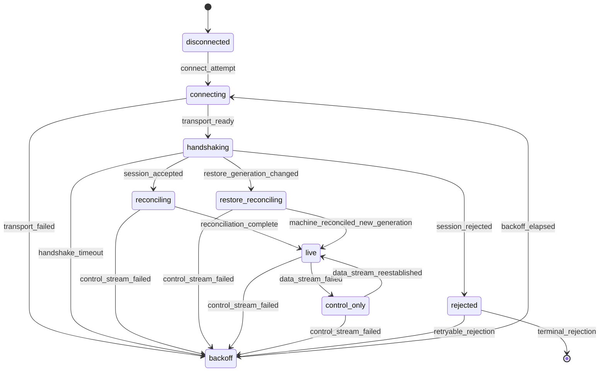
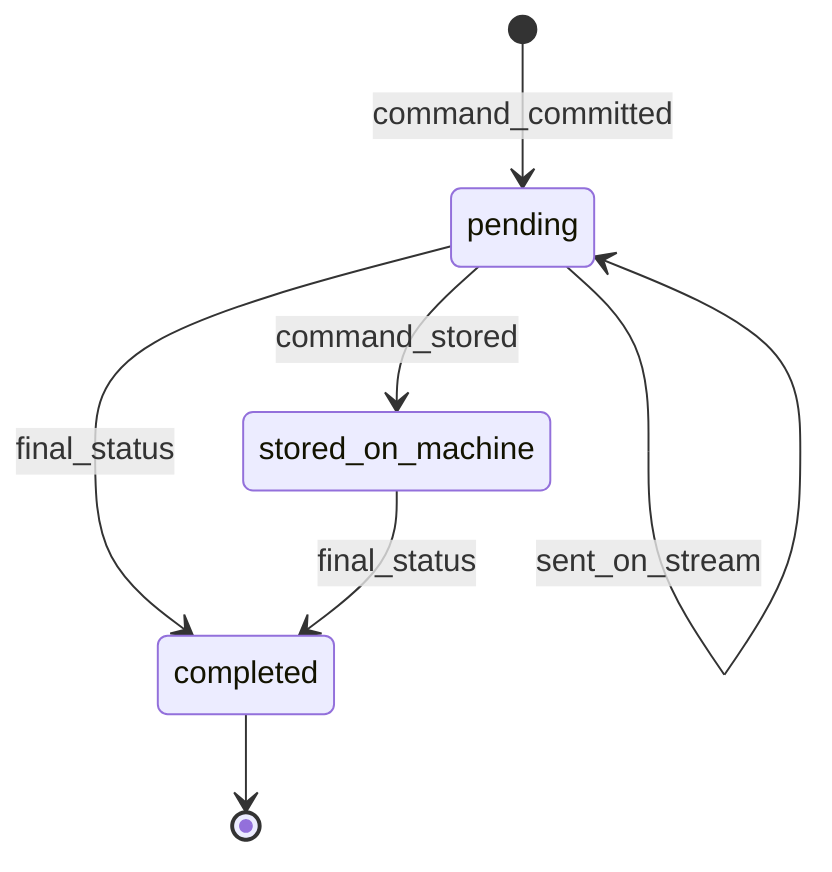
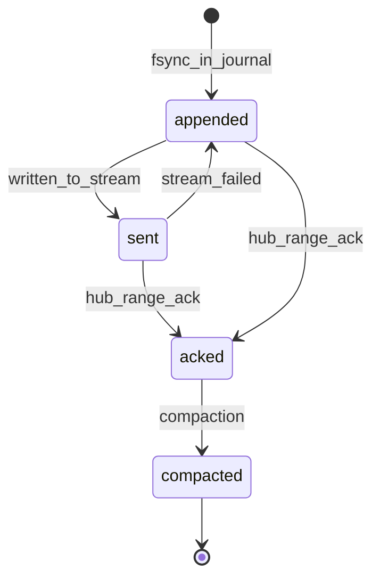
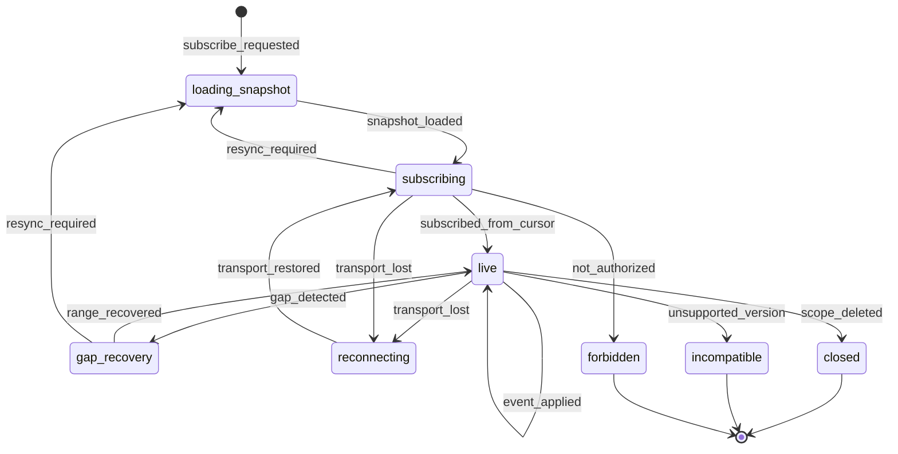
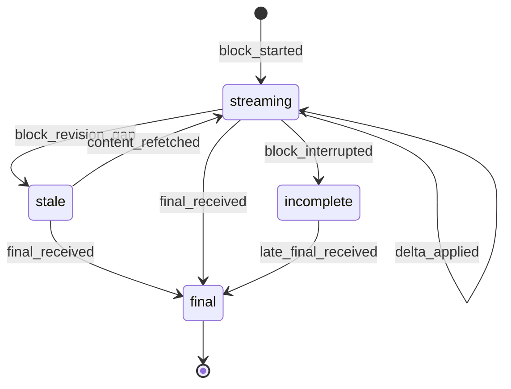
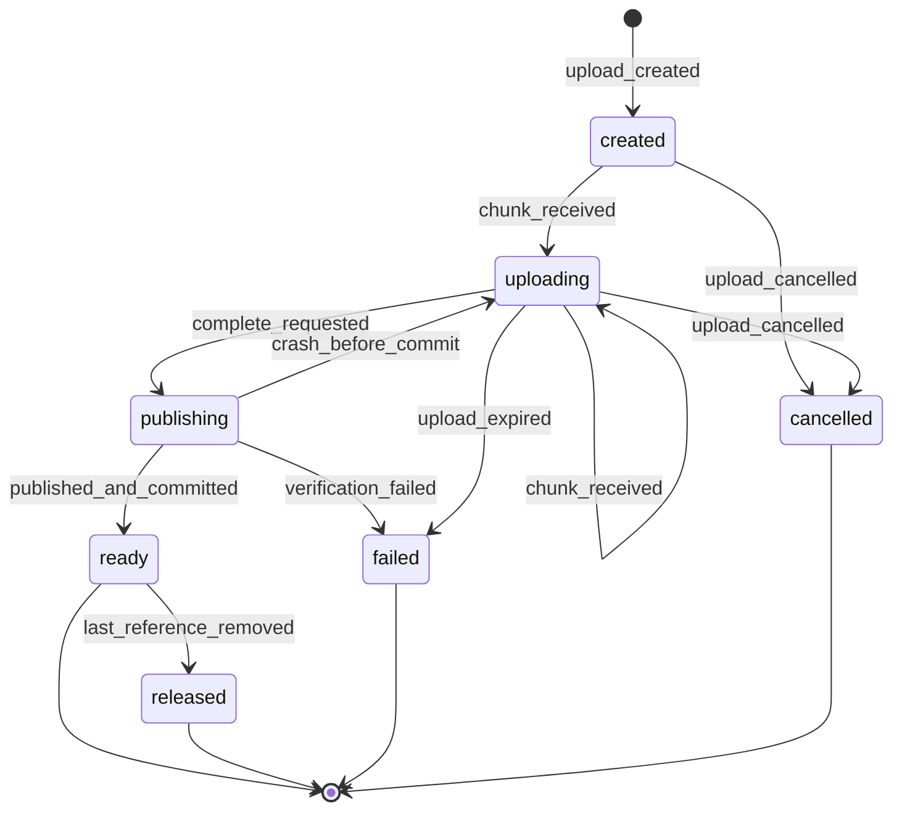
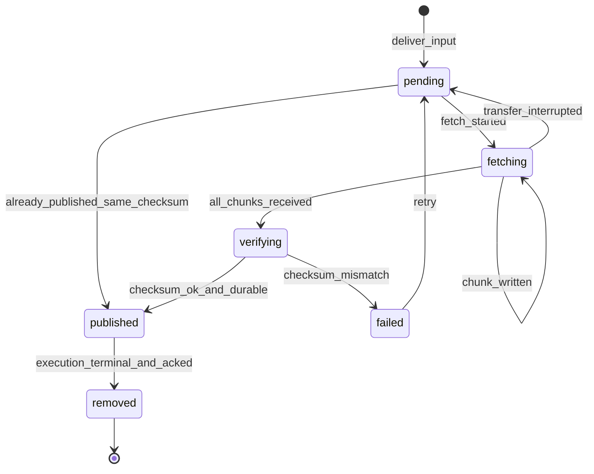

# Потоки, журналы, подписки, блоки ответа, вложения

Словарь и метки хранения описаны в [README](README.md).

## 1. Сеанс потоков воркер–хаб (§8.4, §8.6)

Воркер открывает два долговременных двунаправленных RPC: `control` (команды хаба, записи `CJ` с квитанциями команд, heartbeat, метаданные соединения) и `data` (записи `SJ`: события агента и статусы передачи; подтверждения диапазонов), см. §3. Большие артефакты идут отдельными ограниченными RPC. **Предложение**: `control` на отдельном HTTP/2-соединении, `data` и артефакты на другом. Причина: §8.4 предлагает так для базовой реализации, а изоляция двух RPC на одном соединении требует отдельного доказательства P-05/P-09.

### Первое сообщение каждого потока (§8.6 п. 2)

| Поле | Назначение |
| --- | --- |
| `installation_id` | воркер проверяет, что хаб тот, с которым он сопряжён; иначе отказ до приёма команд (смена хаба только явной локальной командой, §4.3) |
| `machine_id` | идентичность установки; сам credential передаётся защищённо в TLS/метаданных, не в сообщении и не в URL |
| `restore_generation` | последнее поколение восстановления, согласованное воркером |
| `protocol_version`, `required_capabilities`, `optional_capabilities` | неизвестная обязательная возможность: отказ до приёма команд |
| `connection_id` | один на оба потока подключения (README) |
| `cj_journal_id` | журнал `CJ`; смена означает сброс локального состояния машины |
| точки продолжения `control` | по `CJ`: первый хранимый номер, последний номер, последний номер, подтверждённый хабом |
| точки продолжения `data` | по каждому `SJ` (`journal_id`): те же три номера |
| `boot_id` | диагностика и сверка перезагрузки |
| `machine_time_ms` | часы машины в обоих `Hello`; смещение уточняется по `Heartbeat.machine_time_ms`, итог хода содержит `RunFinished.machine_time_ms` |

Ответ хаба: принят или отказ с причиной, текущий `restore_generation` хаба, закоммиченный номер только по журналам, которые воркер назвал в этом `Hello` (`cj_journal_id` и `cursors`). Журналы, не названные воркером, в `Accepted.committed` не добавляются; для нового журнала закоммиченный номер равен нулю.

Возможность `exec_v1` согласуется только через `Hello.optional_capabilities`; в `required_capabilities` она не поддерживается и приводит к `unknown_required_capability`. `Accepted.capabilities` повторяет только известные хабу необязательные возможности из запроса; отсутствие поля означает пустой список. После handshake воркер передаёт по `control` сообщение `ReconcileReport`: для каждого исполнения `execution_id`, `generation`, `state`, `outcome`, `supervisor_attached`, `sj_journal_id`. Это последнее наблюдение для сверки, а устойчивые факты исполнения доставляются записями журналов.

Необязательная возможность `pilot_v1` предлагается в `Hello.optional_capabilities` и действует только после повторения в `Accepted.capabilities`. После принятия такого сеанса воркер посылает `MachineReport`: версию, разрешённые корни, каталог харнессов и моделей, ограничения вложений, механизм containment, ОС и `home_dir`, домашний каталог пользователя воркера (пусто, если воркер его не знает или старше этого поля). Ограничения `MAX_ATTACHMENT_BYTES = 104_857_600` и `MAX_ATTACHMENTS_PER_INPUT = 10` берутся из `canterlot-proto::limits`; расхождение с хабом отключает вложения для машины. `MachineMetrics` описан в [execution.md](execution.md) §3.

Необязательная возможность `instructions_v1` согласуется так же. Без неё сеанс понимает только пресет «Как у владельца»: запуск и ввод с другим пресетом, включая «Без инструкций», хаб не выдаёт (`capability_missing`). Инструкции (`Instructions`: режим `clean`, `owner` или `preset`, текст не больше 64 КиБ, UUID, версия и название пресета) едут в `StartExecution.instructions` и `SettingsOverride.instructions`; вызовы инструментов агента — унарный `WorkerData.AgentCall` с именем инструмента (`presets.list`, `presets.save`, `presets.apply`) и аргументами JSON, хаб выводит разговор и владельца из живого исполнения вызвавшей машины. Текст пресета и аргументы вызова не попадают в журналы.

Необязательная возможность `todo_v1` согласуется так же и разрешает запись `TodoUpdated` (`RecordBody`, поле 34): полный список задач дорожки. Хаб повторяет её в `StartExecution.capabilities`, управляющий процесс передаёт сопровождению в `StartCli.todo_v1`. Без неё сопровождение отбрасывает список и один раз пишет диагностику `capability_missing` / `todo_dropped`; хаб, не знающий запись, остановил бы приём журнала.

Необязательная возможность `background_v1` согласуется так же и разрешает запись `BackgroundWorkChanged` (`RecordBody`, поле 37): все работающие фоновые задачи исполнения, задачи, закончившиеся с прошлой записи, и признак `wake_turn` хода, который CLI начал сам. Строка задачи хранится по `(conversation_id, task_id)`, устаревшее отсекает пара `(generation, revision)`. Задача, которой нет в полном списке, считается остановленной; при `omitted > 0` список неполон, и этого вывода нет. Без возможности сопровождение отбрасывает список и один раз пишет диагностику `capability_missing` / `background_dropped`, ход продолжается.

Необязательная возможность `compact_v1` согласуется так же и разрешает запись `SessionStuck` (`RecordBody`, поле 35) и команду `CompactSession` (`Command`, поле 17). Без неё факт отбрасывается с диагностикой `session_stuck_dropped`, ход продолжается, а хаб такую команду не отправит. Итог команды приходит записью `CompactionStatus` (поле 36) из журнала сопровождения или управляющей службы.

`PollLimits { provider }` просит одну машину опросить источник сейчас. `LimitsReport` содержит заменяемые наблюдения опроса; `LimitObservation { provider, window, used_permille, resets_at_ms, observed_machine_ms }` использует окна `five_hour` и `weekly`, нулевое время сброса означает неизвестное. Устойчивые `limit_observed` и `limit_reached` пишет только `SJ` сопровождения, чей `StartExecution.capabilities` содержал `pilot_v1`. Хаб рассылает `LimitsSnapshot { provider, current, weekly_reserve_active }` всем согласованным сеансам с этим провайдером в каталоге; воркер хранит последний снимок только в памяти для будущей пометки модели.

Необязательная возможность `workdir_suggest_v1` согласуется так же; без неё хаб подсказок не запрашивает, и форма остаётся со свободным вводом. `SuggestWorkdirs { request_id, path }` идёт по `control`, ответ `WorkdirSuggestions { request_id, directories }` идёт назад и в журналы не пишется, как и сами пути. Воркер делит путь на родителя и префикс имени и отвечает полными путями только тех каталогов, которые прошли бы проверку запуска: канонический путь внутри `allowed_workdir_roots`. Посторонний каталог не читается вовсе, предок корня читается ради пути к корню. Скрытые каталоги показываются при префиксе с точкой, ответ отсортирован, до `MAX_WORKDIR_SUGGESTIONS = 30` записей. Относительный путь, `..`, NUL, путь длиннее `MAX_WORKDIR_BYTES`, недоступный или несуществующий каталог дают пустой ответ, а не ошибку. Чтение идёт в отдельном блокирующем потоке со сроком 2 с, одновременно один поток; пока он занят, ждёт только последний запрос, предыдущие остаются без ответа.

Журнал, у которого следующая неподтверждённая запись является вариантом `pilot_v1`, не отправляется через сеанс без этой возможности: диапазон не пропускается, однократно фиксируется диагностика `journal_withheld`. `attachment_ready` и `attachment_failed` пишутся в `CJ` только для команд из согласованного сеанса. Порядок обновления: хаб первым, затем воркер; откат хаба ниже уже использованной возможности не поддерживается.

### Автомат сеанса (сторона воркера; хаб ведёт зеркальную копию)

| Из | Событие | Условие | Действие | В |
| --- | --- | --- | --- | --- |
| `disconnected`, `backoff` | `connect_attempt` | | новый `connection_id`; TLS с обязательной проверкой | `connecting` |
| `connecting` | `transport_ready` | соединения установлены | открыть `control`, затем `data`; первые сообщения; timeout согласования 10 с (§8.6 п. 4) | `handshaking` |
| `handshaking` | `session_accepted` | оба потока прошли согласование с одним `connection_id` и одной аутентифицированной установкой; `installation_id` и `restore_generation` совпадают; обязательные возможности известны | хаб: сеанс машины `reconciling`, удержание `machine_not_reconciled` остаётся | `reconciling` |
| `handshaking` | `restore_generation_changed` | поколение хаба ≠ поколению воркера | обычный replay команд не выполняется; воркер не компактирует журналы и принимает только сообщения сверки ([recovery.md](recovery.md) R7) | `restore_reconciling` |
| `handshaking` | `session_rejected` | см. причины ниже | | `rejected` |
| `reconciling` | (внутри) | | воркер повторяет неподтверждённые записи журналов; хаб пересылает команды без `command_stored` и запрашивает статусы нетерминальных команд; сверка исполнений ([recovery.md](recovery.md) R1) | `reconciling` |
| `reconciling` | `reconciliation_complete` | replay дошёл до конца журналов на момент handshake, исполнения сверены | хаб снимает `machine_not_reconciled`; найденные неподтверждённые приёмы ставят паузу | `live` |
| `live` | `data_stream_failed` | поток данных завершился, управление живо | **Предложение**: поток данных переоткрывается под тем же `connection_id` и снова проходит согласование. Причина: управление несёт heartbeat и прерывание, его незачем рвать из-за проблем канала данных. Связь `degraded`, новые запуски и выдача запрещены | `control_only` |
| `live`, `control_only`, `reconciling` | `control_stream_failed` | deadline, `CANCELLED`, `UNAVAILABLE`, конец stream, `GOAWAY`, нет ответа на heartbeat, повторное истечение срока прикладной квитанции | закрыть оба потока; исполнения не меняются; ввод не повторяется (§8.6 п. 5) | `backoff` |
| `backoff` | `backoff_elapsed` | | задержка: экспонента от 250 мс до 30 с со случайным jitter; **Предложение**: сброс к 250 мс после 30 с непрерывного `live`, чтобы мгновенно рвущийся сеанс не переподключался в тесном цикле | `connecting` |

Причины отказа handshake:

| Причина | Повтор | Поведение |
| --- | --- | --- |
| `credential_revoked` | нет | локальная диагностика; живые сессии продолжают работу офлайн, их немедленная остановка не обещается (AT-F-02) |
| `installation_mismatch` | нет | нужна явная локальная перерегистрация (§4.3) |
| `protocol_incompatible`, `unknown_required_capability` | нет, до обновления | команды не принимаются (AT-H-06) |
| `identity_in_use` | да | у этой `machine_id` уже есть живой сеанс; хаб его не вытесняет; диагностика владельцу (AT-C-05) |
| `connection_binding_mismatch` | да, с новым подключением | поток данных с `connection_id`, не принадлежащим управлению той же аутентифицированной установки (AT-H-08) |
| `hub_not_operational` | да | хаб в административном режиме: нет манифеста, расхождение поколений, незавершённый restore (AT-G-13) |

**Предложение** по коллизии идентичности: новый handshake для `machine_id` с живым сеансом (оба потока открыты, heartbeat свежее 30 с) отклоняется `identity_in_use`; если прежний сеанс закрыт или heartbeat старше 30 с, новый принимается, прежний закрывается. Причина: §9.1 запрещает автоматическое вытеснение, а 30 с совпадают с порогом недоступности. Смена `cj_journal_id` при известной машине считается `local_state_reset`: по этой машине не делается ни одного вывода «не передано», её нетерминальные команды и исполнения требуют сверки, владелец получает диагностику (README, вопрос 8).

Deadlines и квитанции (§8.5, §8.6 п. 4): согласование 10 с; конечные unary RPC имеют deadline; долговременные потоки общего deadline не имеют; ожидание модели и человека не ограничивается коротким deadline. **Предложение**: каждая прикладная квитанция (`command_stored`, `event_range_ack`, `heartbeat_ack`) имеет свой таймер, исходно 5 с для `command_stored` и `heartbeat_ack`, 10 с для `event_range_ack`; первое истечение: повтор по тому же потоку (дедупликация делает его безопасным) и диагностика, второе: `control_stream_failed`. Библиотечный retry долговременных RPC выключен, hedging не используется; восстановление выполняет только прикладной reconnect.

Heartbeat: воркер шлёт `heartbeat` каждые 5 с по `control`, хаб отвечает `heartbeat_ack`; обе стороны меряют задержку на монотонных часах. HTTP/2 keepalive настраивается реже и согласуется с idle timeout proxy (§8.6 п. 7).

**Инварианты**

- S-1: транспортные события (запись в stream, flow control, статус RPC, `GOAWAY`) не являются прикладными квитанциями и не являются фактом остановки агента (AT-H-02, AT-H-04).
- S-2: восстановление соединения библиотекой не считается восстановлением сеанса; после любого разрыва повторяются согласование и сверка курсоров.
- S-3: между `control` и `data` нет общего порядка; связь команды, результата и событий задаётся ID и поколением.
- S-4: смена `restore_generation` никогда не обрабатывается как обычный reconnect.
- S-5: живой сеанс не вытесняется новым подключением с той же идентичностью.

**Проверки**: AT-C-04, AT-C-05, AT-C-17, AT-F-02, AT-H-01…AT-H-08, AT-G-10, AT-G-13.

## 2. Исходящие команды хаба

Доставщик хаба читает устойчивую очередь команд из PG; `NOTIFY` и внутренний broadcast только будят его (§14). Факт записи в stream в PG не сохраняется как прогресс.

| Команда | Адресат | Создаётся в `PG-tx` | Итоговые квитанции |
| --- | --- | --- | --- |
| `start_execution` | машина, новое поколение | старта или resume | `started`, `start_rejected(reason)`, `start_failed` |
| `deliver_input` | поколение | отправки ввода; выдача при `dispatch`; блоки `TextBlock` и `AttachmentRef`, необязательные настройки `SettingsOverride` | статусы ввода ([delivery.md](delivery.md) §2); готовность файлов через `attachment_ready`/`attachment_failed` в `CJ` |
| `cancel_input`, `withdraw_input` | команда ввода | отмены или постановки паузы | `cancel_won`/`cancel_lost`, `withdrawn`/`too_late` |
| `deliver_decision` | поколение и `request_id` | решения | статусы решения ([delivery.md](delivery.md) §5) |
| `interrupt` | поколение | остановки хода | статусы прерывания ([delivery.md](delivery.md) §4) |
| `stop_execution`, `force_stop` | поколение | остановки исполнения; полная остановка всех агентов машины (§18) = отдельное явное действие, создающее `stop_execution` для каждого её исполнения | жизненный цикл ([execution.md](execution.md) §1) |
| `allow_shared_workdir` | пара исполнений | решения владельца | `granted`, `refused(reason)` |
| `resolve_owner_lost` | исполнение | административного решения | жизненный цикл |
| `delete_conversation_local` | машина | удаления разговора | `local_cleanup_done` |
| `reconcile` | машина или команда | сверки | факты сверки |

| Из | Событие | Условие | Действие | В |
| --- | --- | --- | --- | --- |
| нет | `command_committed` | `PG-tx` операции | команда с `command_id` | `pending` |
| `pending` | `sent_on_stream` | сеанс `live` (команды сверки также в `reconciling`/`restore_reconciling`) | отправка; состояние не меняется | `pending` |
| `pending` | `command_stored` | квитанция воркера | `PG-tx`: `stored_at` | `stored_on_machine` |
| `pending`, `stored_on_machine` | `final_status` | итоговая квитанция, в т.ч. отказ (`unsupported_command`, `generation_closed`, `resource_limit`, `conversation_deleted`) | `PG-tx`: результат | `completed` |
| `pending` | reconnect | | повтор отправки; воркер отвечает текущей квитанцией (I-7) | `pending` |

**Терминальное состояние**: `completed`. Поздние статусы той же команды применяются только по правилам автомата её объекта (I-13, D-7) и не возвращают команду в `pending`.

**Инварианты**: команда не теряется между commit и машиной (AT-A-04); повтор не создаёт второго действия (AT-A-05, AT-H-05); неизвестный вариант команды не исполняется и не трактуется как значение по умолчанию (AT-H-06); команда, превышающая лимиты §8.6 п. 8, отклоняется явной ошибкой ресурса до передачи агенту, и неполная команда агенту не уходит (AT-H-09, AT-H-10).

**Проверки**: AT-A-04, AT-A-05, AT-H-05, AT-H-06, AT-H-09, AT-H-10.

## 3. Журналы машины и durable ACK (§8.4, §9.3)

`CJ` хранит принятые команды и квитанции, факты жизненного цикла, которые не может записать сопровождение (`command_rejected` при отказе старта, `execution_state{stopped, start_cancelled}` до запуска сопровождения, `execution_state{owner_lost}`), квитанции удаления, согласованное `restore_generation` и подтверждённые хабом номера. Записи принадлежности с локальными путями и проверочным значением секрета IPC хранятся отдельно в локальном журнале `ownership`, который хабу не отправляется ([execution.md](execution.md) §5). `SJ` хранит все факты жизненного цикла живого сопровождения, намерения и результаты передач, решения об отмене и отзыве, события адаптера, факты запросов, `run_finished` и завершающую запись `journal_closed`. Ключ записи: `(journal_id, journal_seq)`.

**Предложение**: записи `CJ` (в т.ч. `command_stored`, `command_rejected` при отказе старта, `execution_state{owner_lost}`) идут по `control`, записи `SJ` (в т.ч. `transmission_started`, `accepted`, `cancel_won`, `run_finished`) по `data`; ACK диапазонов идёт по тому же потоку, что и записи. Причина: накопительный ACK по журналу требует, чтобы все записи одного журнала шли по одному упорядоченному потоку, а приём ввода и ответ на него из одного `SJ` сохраняют причинный порядок. Цена: отметки «Передаётся агенту» и «Принято агентом» стоят в очереди канала данных; heartbeat, `command_stored` и прерывание от него не зависят.

Первая запись `SJ`, `journal_opened`, связывает журнал с `execution_id` и `generation`, сообщает `supervisor_protocol_version`. Хаб сохраняет эту связь в `journal_cursors.execution_id`; `journal_closed` закрывает журнал. При согласовании `Accepted.committed` содержит только журналы, названные воркером в `Hello`, даже если хаб знает другие журналы этой машины. Факты одного живого сопровождения упорядочены только внутри его `SJ`, а не относительно `CJ`.

| Из | Событие | Условие | Действие | В |
| --- | --- | --- | --- | --- |
| нет | `fsync_in_journal` | запись с контрольной суммой и fsync | ключ присвоен навсегда | `appended` |
| `appended` | `written_to_stream` | сеанс `reconciling`, `restore_reconciling` или `live`; пакет ≤ 512 КиБ с метаданными | | `sent` |
| `sent` | `stream_failed` | | после reconnect отправка с номера, закоммиченного хабом, + 1 | `appended` |
| `appended`, `sent` | `hub_range_ack` | хаб закоммитил в PG все записи журнала до `up_to_seq` | воркер сохраняет подтверждённый номер | `acked` |
| `acked` | `compaction` | номер ≤ подтверждённого; не незавершённая команда, не минимальная квитанция (I-9), не квитанция удаления | удаление содержимого | `compacted` |

Правила хаба: запись с уже известным ключом не вставляется повторно, но подтверждается (AT-C-04); ACK накопительный по журналу и отправляется только после commit (AT-H-02); при разрыве нумерации хаб не коммитит дальше разрыва и запрашивает повтор с первого недостающего номера; записи разговора, удалённого tombstone, получают конечную квитанцию `conversation_deleted`, которая засчитывается как ACK (AT-F-19). Поток данных общий для всех сессий машины, поэтому запись SJ, которую хаб не примет и при повторе (`invalid_record`, отказ базы классов 22 и 54), не повторяется вечно: если журнал привязан к исполнению, курсор проходит мимо неё, в разговор уходит `adapter_diagnostic` с видом `journal_record_rejected`, очередь встаёт с `fatal_error`, а исполнение останавливается принудительной командой. Остаток журнала применяется как обычно. Журнал без исполнения, CJ, `unknown_record` (воркер новее хаба), чужое исполнение и прочие сбои базы по-прежнему закрывают поток: повтор после исправления применит запись.

Хаб применяет пакет `SJ` одной транзакцией, блокируя `journal_cursors` раньше `queue_state`; для каждой записи создаётся `SAVEPOINT`. Ошибка откатывает только текущую запись; применённый префикс и его курсор коммитятся вместе, затем подтверждаются. Ошибочная запись остаётся неподтверждённой: повтор без продвижения закрывает поток с прежней диагностикой. ACK никогда не опережает commit. Дубликаты по прежнему пропускаются, включая проверку digest последней записи.

Совместимость записей: новые виды `RecordBody` отправляются, только если обе стороны объявили в handshake совпадающую необязательную возможность (`optional_capabilities`). Запись неизвестного вида от воркера той же `protocol_version` хаб не применяет и не подтверждает: приём этого журнала останавливается намеренно (отравленная запись, `unknown_record`), поток закрывается с `InvalidArgument`, остановка видна в диагностике. Повтор той же записи после reconnect даёт тот же результат до обновления хаба или воркера. Запись с `seq = 0` отклоняется как `invalid_record`; запись курсора журнала создаётся только вместе с первой применённой записью.

Повреждение: при открытии журнала проверяются контрольные суммы; действительный префикс сохраняется, повреждённый хвост переносится в карантин, хабу уходит факт `journal_tail_corrupted(journal_id, from_seq)`, в UI видна возможная неполнота. Команды, чей результат мог находиться в повреждённой области, считаются `acceptance_unconfirmed` (README, вопрос 13) (AT-C-12).

Сравнение точек продолжения при handshake:

| Наблюдение | Значит | Действие |
| --- | --- | --- |
| закоммичено хабом = последний номер журнала | всё доставлено | ничего |
| закоммичено хабом < последний номер, первый хранимый ≤ закоммичено + 1 | обычный хвост | replay с закоммичено + 1 |
| первый хранимый > закоммичено + 1 или подтверждено по данным воркера > закоммичено хабом, поколение прежнее | хаб потерял подтверждённые данные: подмена БД без процедуры или ошибка | `state_divergence`: удержание по машине, административная диагностика; replay имеющегося с пометкой разрыва |
| то же при новом `restore_generation` | ожидаемо после restore | невосстановимый интервал в отчёте restore |
| неизвестный хабу `journal_id` `SJ` | новое исполнение | обычный приём |
| неизвестный `cj_journal_id` при известной машине | сброс локального состояния | `local_state_reset` (§1) |

**Инварианты**: компактация удаляет только подтверждённое (§8.4); ключ записи не меняется никогда; события терминального исполнения принимаются как поздние факты. При `restore_reconciling` компактация остановлена до подтверждения сверки.

**Терминальное состояние**: `compacted`. Поздний ACK на уже компактированный диапазон ничего не меняет; ACK больше последнего номера журнала считается расхождением.

**Проверки**: AT-C-02, AT-C-04, AT-C-12, AT-C-13, AT-H-02, AT-F-19.

## 4. Подписки браузера (§8.1, §8.2, §8.5, §12.3)

Один WSS-канал на вкладку; внутренние области: `owner:{id}:conversations`, `owner:{id}:machines`, `conversation:{id}`. Поле `scope` снаружи содержит только `conversations`, `machines`, `conversation:<uuid>`. Конверт события: `v`, `id`, `scope`, `scope_seq`, `committed_at`, `kind`, `payload`, `correlation_id`. Все номера последовательности, включая курсоры снимков, `created_seq`, `feed_seq` и `seq` в запросах, всегда десятичные строки. Время передаётся в RFC 3339 UTC с миллисекундами. Хаб отправляет только закоммиченные факты; повтор доставки допустим, повторное применение результата не меняет.

Соседние дельты одного блока объединяются в пределах окна 25 мс, без перескока через другие события: `scope_seq_from` и `committed_at_from` берутся из первой, конечные `scope_seq` и `committed_at` из последней, `id` и `correlation_id` из первой. Одиночное событие имеет одинаковые начальные и конечные значения. Внутренние виды вне `CLIENT_KINDS` заменяются на `hidden` без payload с сохранением настоящего номера; соседние заполнители также могут покрывать непрерывный диапазон. Правило применяется к WSS и `GET /events`, поэтому пропусков в курсоре нет. Словарь видов: [api.md](api.md).

**Предложение** по границе snapshot: `scope_seq` выдаётся из счётчика области, который обновляется в том же `PG-tx`, что и факт, и остаётся заблокированным до commit; snapshot читает материализованное состояние и значение счётчика в одной транзакции с единым снимком. Причина: блокировка счётчика упорядочивает commit фактов одной области, поэтому снимок всегда содержит префикс `1..B`, а всё после `B` есть в журнале событий; глобальный sequence БД такого порядка не доказывает (§8.2). Проверяется конкурентным тестом AT-B-04.

| Из | Событие | Условие | Действие | В |
| --- | --- | --- | --- | --- |
| нет | `subscribe_requested` | | HTTP: snapshot и граница `B` | `loading_snapshot` |
| `loading_snapshot` | `snapshot_loaded` | | применить snapshot, курсор = `B`; локальные операции `saving` из `LS` остаются | `subscribing` |
| `subscribing` | `subscribed_from_cursor` | сервер авторизовал область и курсор не старше срока журнала | события с курсор + 1 | `live` |
| `subscribing`, `gap_recovery` | `resync_required` | курсор старше журнала (исходно 7 суток, §14.1) | явный ответ и новый snapshot, без цикла reconnect (AT-B-05) | `loading_snapshot` |
| `live` | `event_applied` | `scope_seq` = курсор + 1 | применить, курсор + 1; `scope_seq` ≤ курсора игнорируется | `live` |
| `live` | `gap_detected` | `scope_seq` > курсор + 1 | буферизовать; HTTP-запрос недостающего диапазона | `gap_recovery` |
| `gap_recovery` | `range_recovered` | | применить по порядку | `live` |
| `live`, `subscribing` | `transport_lost` | обрыв, сон вкладки, отключение медленного клиента сервером | черновик и позиция просмотра сохраняются | `reconnecting` |
| `reconnecting` | `transport_restored` | backoff | подписка с последнего применённого курсора (AT-E-03, P-08) | `subscribing` |
| `live` | `scope_deleted` | tombstone разговора | удалить приватные данные разговора на устройстве, включая неотправленные операции (они получают `conversation_deleted`) | `closed` |
| `live` | `unsupported_version` | неизвестная обязательная версия схемы | явный отказ совместимости, предложение обновить PWA | `incompatible` |
| `subscribing` | `not_authorized` | область не принадлежит владельцу | знание ID доступа не даёт (AT-F-03) | `forbidden` |

Медленный клиент: очередь отправки сервера ограничена; при переполнении сервер закрывает подписку с указанием курсора, клиент восстанавливается по курсору или пересинхронизацией; остальные клиенты не замедляются (AT-E-07). Выход владельца закрывает подписки и очищает приватные данные (AT-E-08).

**Предложение**: событие ввода несёт `idempotency_key` (только своему владельцу), чтобы клиент заменил локальный элемент `saving` серверным без дубликата. Причина: AT-A-01 требует единственный видимый элемент после повтора.

**Инварианты**: ни одного потерянного факта на границе snapshot (AT-B-04); порядок только внутри области, области не сравниваются; временная метка не используется для порядка и дедупликации; текст с пропущенной серединой не показывается окончательным; служебные факты не становятся элементами истории.

**Терминальные состояния**: `closed`, `incompatible`, `forbidden`. События, пришедшие после `closed`, отбрасываются; после выхода владельца подписка не переоткрывается без нового входа.

**Проверки**: AT-B-04, AT-B-05, AT-B-09, AT-E-03, AT-E-07, AT-E-08, AT-F-03, AT-F-19.

## 5. Блоки ответа (§8.3, §10.3, §6.3)

Типы блоков: `text`, `reasoning` (только если агент сам его предоставляет), `tool_call`, `tool_result` (ссылается на `tool_call`), `warning`, `error`. События: `block_started`, `block_delta(block_id, base_rev, rev, append)`, `block_final(block_id, rev, полное содержимое или проверяемая ссылка на артефакт, checksum)`, `block_incomplete(block_id, rev, reason)`.

| Состояние | Смысл |
| --- | --- |
| `streaming` | блок дополняется дельтами |
| `stale` | у клиента пропущена ревизия; показывается как неокончательный |
| `final` | полное подтверждённое содержимое |
| `incomplete` | ответ оборван (ошибка, прерывание, конец исполнения); частичное содержимое доступно и помечено |

| Из | Событие | Условие | Действие | В |
| --- | --- | --- | --- | --- |
| нет | `block_started` | | блок с `block_id`, типом и связями | `streaming` |
| `streaming` | `delta_applied` | `base_rev` = текущей ревизии | дописать, ревизия = `rev`; дельта с `rev` ≤ текущей игнорируется (AT-B-02) | `streaming` |
| `streaming` | `block_revision_gap` | `base_rev` > текущей | HTTP-запрос актуального содержимого блока | `stale` |
| `stale` | `content_refetched` | | заменить содержимое и ревизию | `streaming` |
| `streaming`, `stale` | `final_received` | | заменить содержимое финалом, проверить checksum; поздние дельты игнорируются (AT-B-01, AT-B-03) | `final` |
| `streaming` | `block_interrupted` | ошибка агента, прерывание хода, запись `journal_closed` исполнения без финала блока | пометить незавершённым, индикатор набора остановлен по подтверждённому итогу (AT-B-08) | `incomplete` |
| `incomplete` | `late_final_received` | финал из журнала того же исполнения пришёл позже | заменить финалом; исполнение не оживает | `final` |

На хабе потоковый текст хранится добавлением строк `block_chunks(block_id, seq, text)` с ключом `(block_id, seq)`; `seq` — ревизия принятой дельты. Дельты применяются в порядке журнала без чтения и переписывания накопленного текста. `blocks::read_text` читает потоковый блок конкатенацией фрагментов по `seq`. При финале и при `incomplete` текст материализуется в `blocks.content`. U+0000 PostgreSQL не хранит, поэтому в дельте и финале он заменяется на U+FFFD; фрагмент с заменой сохраняет оригинал в `block_chunks.raw`. Сумма воркера сверяется с оригиналом, а `blocks.checksum` и `block_final.checksum` покрывают сохранённый текст, который сверяет браузер. Разрыв ревизий сохраняется как признак блока. Полный текст финала побеждает накопленный; расхождение checksum даёт `block_checksum_mismatch`. Финал крупнее 64 КиБ идёт без текста, с `text_omitted = true` и checksum: хаб собирает его только из дельт. Поэтому супервизор перед таким финалом дописывает дельтами (не больше 16 КиБ, по границе символа) всё, что адаптер не прислал потоком, например результат инструмента Claude Code или вывод команды Codex одной записью; уже ушедшее начало не повторяется, а расходящееся с финалом не дополняется. При `text_omitted = true` после разрыва ревизий или при несовпадении checksum блок получает `incomplete` с причиной `revision_gap`, а не `final`; частичный текст остаётся доступен. Обнаруженный разрыв даёт событие `block_revision_gap`. **Предложение**: оставшиеся `streaming`-блоки помечаются `incomplete` по записи `journal_closed` (или по факту полного replay журнала умершего сопровождения), а не по статусу на канале управления. Причина: каналы не упорядочены между собой, и ранняя пометка дала бы лишний переход `incomplete` → `final`.

**Предложение** по объединению дельт: хаб объединяет дельты одного блока в окне до 25 мс при публикации браузерам; объединённое событие несёт `base_rev` первой и `rev` последней исходной дельты и диапазон исходных ключей событий. Причина: так сохраняется проверяемость и учёт P-04 по самой старой дельте пакета (AT-E-13). Терминальные события, ошибки и запросы не объединяются и не отбрасываются (§8.5).

`tool_call`: частичный JSON аргументов не выдаётся за завершённый объект, финал содержит проверенный полный объект (AT-B-07). Большой вывод инструмента становится постранично загружаемым артефактом; в блоке статус, превью и ссылка (AT-B-10). Отрицательный результат инструмента не меняет состояние исполнения и очереди.

**Инварианты**: один `block_id` даёт один элемент ответа, финал не создаёт второй; дубликат дельты не удваивает текст; после `final` содержимое меняется только другим финалом с тем же checksum (повтор).

**Проверки**: AT-B-01…AT-B-03, AT-B-07…AT-B-10, AT-E-13.

## 6. Публикация вложений (§13, §13.1)

### Хаб

| Состояние | Смысл |
| --- | --- |
| `created` | `PG-tx`: загрузка с `attachment_id`, владельцем, разговором, ожидаемыми размером и checksum |
| `uploading` | содержимое пишется во временное хранилище (staging) |
| `publishing` | проверка длины и checksum, durable-публикация в `BLOB`, затем `PG-tx` метаданных (транзиентно, в PG остаётся `uploading`) |
| `ready` | метаданные опубликованы, ссылки разрешены |
| `failed` | проверка не прошла или загрузка просрочена |
| `cancelled` | загрузка отменена |
| `released` | ссылок не осталось, содержимое отдано сборщику |

| Из | Событие | Условие | Действие | В |
| --- | --- | --- | --- | --- |
| нет | `upload_created` | ≤ 25 МиБ, ≤ 10 вложений на ввод, тип допустим для адаптера (изображение без поддержки отклоняется до запуска, §13) | `PG-tx` | `created` |
| `created`, `uploading` | `chunk_received` | chunk ≤ 128 КиБ, смещение непрерывно, суммарно не больше заявленного | потоковая запись в staging без полной копии в памяти | `uploading` |
| `uploading` | `complete_requested` | | проверка длины и checksum по staging | `publishing` |
| `publishing` | `published_and_committed` | драйвер подтвердил `blob_published` (локальный том: временный файл в той же ФС → fsync файла → rename в неизменяемый путь → fsync каталога), затем `PG-tx`: `ready`, `blob_id` | | `ready` |
| `publishing` | `verification_failed` | длина или checksum не совпали | staging удаляется | `failed` |
| `publishing` | `crash_before_commit` | сбой после публикации содержимого, до `PG-tx` | содержимое остаётся orphan для сборщика; повтор `complete` с тем же ID и checksum завершает публикацию идемпотентно | `uploading` |
| `ready` | `complete_requested` повторно | тот же ID и checksum: тот же результат; другое содержимое: конфликт | | `ready` |
| `ready` | ссылка из ввода | `PG-tx` ввода блокирует запись вложения в разделяемом режиме, проверяет `ready`, владельца и разговор, создаёт ссылку | | `ready` |
| `ready` | `last_reference_removed` | удаление разговора или ввода; сборщик берёт эксклюзивную блокировку записи | | `released` |

Сборщик orphan и staging запускается с отсрочкой, исходно 24 часа, и не удаляет активную загрузку, содержимое готовой ссылки и содержимое незавершённой доставки. Блокировка записи вложения сериализует сборщик и создание ссылки (AT-F-17).

### Машина

Ссылки `AttachmentRef { attachment_id, name, mime, size, sha256, image }` входят в `deliver_input`. Отдельной команды доставки файла нет. Воркер инициирует `WorkerData.FetchAttachment(FetchAttachmentRequest { attachment_id, offset })` по каналу данных, с теми же TLS и аутентификацией машины. Ответ является потоком `AttachmentChunk { offset, data, last }`, `data` не больше `MAX_FILE_CHUNK_BYTES = 131_072`. Хаб проверяет связь вложения с вводом этой машины; максимум четыре потока на машину, воркер одновременно загружает не более двух файлов. Файлы живут в `data_dir/executions/<execution_id>/attachments/`, никогда в репозитории. Проверенные опубликованные пути передаются сопровождению как `Deliver.files: LocalFile { path, name, mime, size, image }`.

Состояние на пару (вложение, исполнение):

| Состояние | Смысл |
| --- | --- |
| `pending` | `deliver_input` с `AttachmentRef` записана в `CJ` |
| `fetching` | содержимое загружается во временный файл каталога исполнения |
| `verifying` | проверка длины и checksum |
| `published` | файл durable-опубликован под безопасным сгенерированным именем; хабу ушло `attachment_ready` |
| `failed` | ошибка с причиной и признаком повторяемости |
| `removed` | удалён после терминального состояния исполнения и подтверждения его журнала |

**Предложение**: воркер сам загружает содержимое ограниченным RPC с продолжением по смещению (chunks ≤ 128 КиБ, ограниченная параллельность). Причина: все RPC инициирует воркер (§4.3), а продолжение по смещению делает повтор дешёвым.

| Из | Событие | Условие | Действие | В |
| --- | --- | --- | --- | --- |
| `pending` | `already_published_same_checksum` | файл с тем же checksum уже опубликован | повторная квитанция `attachment_ready` (AT-F-16) | `published` |
| `pending` | `fetch_started` | | временный файл в каталоге исполнения | `fetching` |
| `fetching` | `transfer_interrupted` | разрыв | продолжение с последнего записанного смещения | `pending` |
| `verifying` | `checksum_ok_and_durable` | длина и checksum совпали; fsync файла, rename в безопасное имя, fsync каталога | `CJ`: квитанция; хабу `attachment_ready`; пользовательское имя файла только в метаданных и никогда в shell-команде | `published` |
| `verifying` | `checksum_mismatch` | | временный файл удалён; ввод удерживается `attachments_pending` с причиной | `failed` |
| любое до `published` | отмена или отзыв ввода | | временный файл удалён; доступным агенту не отмечается (AT-F-07) | `failed` или `removed` |

Копии на машине удаляются после терминального состояния исполнения и подтверждения его журнала; blob хаба остаётся, пока на него ссылаются вводы разговора. Ошибка загрузки передаётся в `CJ` как `attachment_failed { command_id, dispatch_attempt, attachment_id, reason, retryable }`, готовность как `attachment_ready { command_id, dispatch_attempt, attachment_id }`. Канал вложений не блокирует управление и обычный чат (§13.1, AT-H-03).

**Инварианты**

- F-1: готовая ссылка не указывает на неполный blob; содержимое долговечно раньше метаданных (AT-F-15).
- F-2: неопубликованный staging и непроверенный файл агенту не передаются (AT-F-07, AT-F-15).
- F-3: подтверждённый ввод ссылается только на `ready`-вложение того же владельца и разрешённого разговора.
- F-4: ввод не передаётся, пока все его вложения не `published` на машине; повтор доставки файла не создаёт второй передачи ввода (AT-F-16).
- F-5: сборка orphan не удаляет содержимое из-под подтверждённой ссылки (AT-F-17).

**Терминальные состояния**: на хабе `released`, `failed`, `cancelled` (и `ready` до снятия ссылок); на машине `removed`. Поздний chunk после `failed` или `cancelled` отклоняется; повторный `complete` после `ready` возвращает прежний результат; повторная `deliver_input` после `published` возвращает прежнюю квитанцию.

**Проверки**: AT-F-07, AT-F-15…AT-F-17, AT-H-03, AT-H-10.
